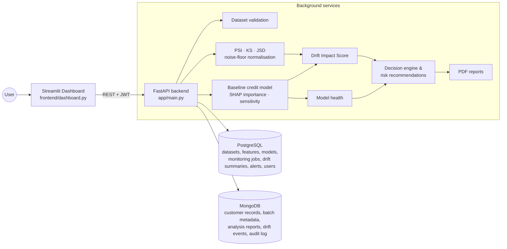

# DriftGuard – Banking Customer Data & Model Drift Monitoring System

DriftGuard watches the customers flowing into a bank's loan-sanctioning model and tells the credit risk team when today's applicants no longer look like the customers the model was trained on — and how much that matters.

---

## 1. Overview

A bank trained its credit-risk (loan default) model on **2020** customer data. By **2026**, incomes, credit scores, credit limits, outstanding loans, FD balances and debt-to-income ratios have shifted.

DriftGuard compares each **2026 production customer batch** with the **2020 historical baseline** and, for every batch:

1. measures distribution drift per financial attribute (PSI, KS test, Jensen–Shannon divergence);
2. weights that drift by how much the credit model relies on each attribute (**Drift Impact Score, DIS**);
3. checks model performance when actual loan outcomes are available;
4. assigns a risk category (LOW / MEDIUM / HIGH / CRITICAL) with recommended actions;
5. stores every result and produces a PDF report for the credit risk committee.

Everything is used through **one dashboard**. The API, databases and calculations run in the background.

## 2. Problem Statement

A credit model learns relationships from its training population. When the incoming population changes — higher incomes after inflation, falling credit scores, rising debt — the model is applied to customers unlike those it learned from. Its default predictions can become unreliable, which can lead to unsafe loan approvals or unnecessary rejections. Banks therefore need to detect such shifts early, judge which ones affect the model, and confirm actual performance once loan outcomes are known.

## 3. Key Features

- Historical (2020) baseline upload with validation and preview; a baseline credit model is trained automatically.
- Upload of multiple production CSV files at once, with per-file validation, record counts and duplicate protection.
- PSI, Kolmogorov–Smirnov and Jensen–Shannon divergence for every monitored attribute.
- Drift Impact Score combining drift, SHAP feature importance and model sensitivity.
- Feature-level drift tables and interactive baseline-vs-production distribution charts.
- Individual batch analysis and combined (pooled) batch analysis.
- Model health: accuracy, precision, recall, F1, ROC-AUC, confusion matrix and predicted default distribution once outcome labels exist.
- Automated risk recommendations from a documented decision engine.
- Downloadable PDF drift monitoring reports.
- Audit logging of uploads, analyses and report generation.
- Clearly flagged synthetic demo data (scenarios A–D).

## 4. System Architecture



The dashboard never computes statistics; it calls the API and displays stored results.

## 5. Technology Stack

| Layer | Technology |
|---|---|
| Dashboard | Streamlit, Plotly |
| Backend API | FastAPI, Uvicorn, Pydantic v2 |
| Statistics & ML | pandas, NumPy, SciPy, scikit-learn, XGBoost, SHAP |
| Relational database | PostgreSQL 15 (SQLAlchemy 2, psycopg2) |
| Document database | MongoDB 6 (PyMongo) |
| Reports | ReportLab |
| Security | Argon2 password hashing, JWT (PyJWT), role-based access, rate-limited login (slowapi) |
| Tooling | Docker Compose (databases), pytest, ruff, black |

## 6. Project Structure

```
DriftGuard/
├── start.sh / stop.sh        One-command start and stop
├── frontend/
│   ├── dashboard.py          The dashboard (sign-in + navigation)
│   ├── sections/             One file per dashboard section (A–H)
│   ├── api_client.py         Calls to the backend
│   └── components.py         Shared styling, KPI cards and chart helpers
├── app/
│   ├── main.py               FastAPI application
│   ├── api/                  Endpoints: auth.py, banking.py
│   ├── core/                 Configuration, security (JWT/roles), logging, rate limit
│   ├── database/             PostgreSQL + MongoDB connections, ORM models
│   ├── schemas/              Request validation models
│   └── services/
│       ├── drift/            PSI, KS, JSD, normalisation, bootstrap noise floor
│       ├── explain/          Drift Impact Score
│       ├── monitoring/       Analysis pipeline, baseline model, persistence
│       ├── recommendations/  Decision engine and risk categories
│       ├── datasets.py       CSV schema and validation
│       ├── synthetic_data.py Synthetic demo data (scenarios A–D)
│       └── reports.py        PDF report
├── db/                       PostgreSQL schema (init.sql), MongoDB indexes
├── data/
│   ├── baseline/             Sample 2020 baseline CSV (synthetic)
│   └── production/           Sample 2026 batch CSVs (synthetic)
├── scripts/                  generate_sample_data.py
├── tests/                    Automated tests
└── docs/                     Design decisions; course/ holds the DBMS lab deliverables
```

Runtime folders created automatically: `artifacts/` (trained model), `logs/`, `.run/` (process ids).

## 7. Installation Requirements

- **macOS or Linux** with `bash` and `curl`
- **Docker Desktop** (or Docker Engine with Compose v2), running
- **Python 3.11+**

`start.sh` creates the virtual environment (`.venv`) and installs `requirements.txt` on first run.

## 8. Environment Configuration

Settings are read from `.env`. On first run `start.sh` copies `.env.example` to `.env` and generates a random `SECRET_KEY`. To configure manually:

```bash
cp .env.example .env
# set SECRET_KEY to a long random value, e.g.:
python3 -c "import secrets; print(secrets.token_hex(32))"
```

| Variable | Purpose |
|---|---|
| `SECRET_KEY` | Signs login tokens. Never commit a real value. |
| `POSTGRES_URL`, `MONGO_URL`, `MONGO_DB` | Database connections (defaults match `docker-compose.yml`). |
| `MAX_UPLOAD_MB`, `MAX_BATCH_ROWS` | Upload limits (50 MB, 50,000 rows). |
| `SEVERITY_*`, `BATCH_DIS_*`, `NORM_CAP_*`, `NULL_*` | Drift thresholds (see §13). |
| `PERF_*`, `MIN_LABELS` | Model-performance rules (see §13). |

`.env` is git-ignored.

## 9. Running the Project

```bash
./start.sh
```

This checks dependencies, starts PostgreSQL and MongoDB in Docker, prepares `.venv`, starts the backend and the dashboard in the background, and opens **http://localhost:8501**.

On the first visit the dashboard asks you to create the administrator account. Afterwards, sign in with that account. Roles: **administrator** (everything, including baseline registration), **analyst** (uploads and analyses), **reviewer** (read-only).

## 10. Using the Dashboard

| Section | What you do there |
|---|---|
| **A. Overview** | KPIs: customers monitored, batches, features, drifted features, overall DIS, drift risk status; trends and distributions |
| **B. Dataset Management** | Upload the baseline; upload production CSVs; preview and validate; select batches and run analysis; optional synthetic demo data |
| **C. Customer Drift Analysis** | PSI, KS statistic, KS p-value, JSD and status per attribute; income, credit score, credit limit, FD balance, outstanding loans and DTI charts |
| **D. Drift Impact Score** | Overall DIS, per-feature D/FI/S contributions, batch comparison and trend |
| **E. Batch Monitoring** | All batches, status and results; batch vs baseline; batch vs batch; combined analysis; processing history |
| **F. Risk Recommendations** | Risk category, recommended actions and the evidence behind them |
| **G. Model Health** | Baseline vs production metrics, confusion matrices, default prediction distribution |
| **H. Reports** | Download the PDF monitoring report |

Typical workflow:

1. **Upload the historical baseline** – Dataset Management → *Historical baseline* → choose `data/baseline/baseline_2020.csv` → review validation → *Register baseline*.
2. **Upload production batches** – *Production batches* → select several files from `data/production/` → check record counts and dates → *Register*.
3. **Run drift analysis** – *Select & analyse* → pick batches → *Run drift analysis*.
4. **Inspect PSI, KS and JSD** – Customer Drift Analysis.
5. **Review DIS** – Drift Impact Score.
6. **Check risk recommendations** – Risk Recommendations (and Model Health for labelled batches).
7. **Download a PDF report** – Reports → *Generate PDF report* → *Download PDF*.

For a quick demo, an administrator can use **Dataset Management → Demo data (synthetic) → Seed synthetic demo**. All generated records are flagged as synthetic throughout the dashboard and in reports.

## 11. Dataset Format

CSV files only. Column names are matched case-insensitively (spaces/dashes become underscores).

| Column | Type | Required |
|---|---|---|
| `customer_id` | text | yes (identifier, not monitored) |
| `age` | number | yes |
| `monthly_income` | number | yes |
| `employment_type` | category (`salaried`, `self-employed`, `contract`, `unemployed`; other values are monitored as new categories) | yes |
| `credit_score` | number | yes |
| `credit_limit` | number | yes |
| `outstanding_loan_amount` | number | yes |
| `fd_balance` | number | yes |
| `debt_to_income` | number (ratio) | yes |
| `loan_amount_requested` | number | yes |
| `loan_tenure` | number (months) | yes |
| `number_of_existing_loans` | number | yes |
| `interest_rate` | number (e.g. 0.12) | yes |
| `loan_default` | 0, 1 or blank | optional – needed in the **baseline** to train the credit model, and in a **batch** (≥ 200 labelled rows) to evaluate performance |

Validation rules:
- **Rejected:** a non-`.csv` or empty file, more than 50 MB or 50,000 rows, missing required columns, fewer than 30 records, more than 5% non-numeric values in a numeric column, or `loan_default` values other than 0/1/blank.
- **Warnings only:** missing values, ≤ 5% non-numeric or infinite values (treated as missing), values outside plausible ranges, duplicate customer IDs, unknown employment types, and unrecognised extra columns (ignored).
- **Duplicates:** an existing batch ID, or identical file content under another ID, is rejected unless *overwrite* / *allow duplicate content* is ticked.

The **Fill missing attributes with synthetic values** option (baseline upload) generates any absent required columns and flags them as synthetic; real columns and labels are never changed.

## 12. Drift Detection Methodology

For each attribute, the production batch is compared with the baseline:

- **PSI (Population Stability Index)** – `Σ (p − q) · ln(p / q)` over 10 baseline-quantile bins with open-ended outer bins (categorical: one bin per category plus an "unseen" bin). Proportions are floored at 1e-4.
- **KS test** – two-sample Kolmogorov–Smirnov statistic and p-value (numerical attributes only).
- **JSD** – squared base-2 Jensen–Shannon distance between the binned distributions (0 = identical, 1 = disjoint).

Missing and infinite values are excluded per attribute; attributes with fewer than 30 usable values are reported as *Insufficient data*.

**Normalised drift D.** The three measures use different scales, so each is mapped to [0, 1] after removing sampling noise:
`Dn = clip((value − floor) / (cap − floor), 0, 1)`, where *floor* is the 95th percentile of the statistic across 200 bootstrap pairs drawn from the baseline alone at the batch's size, and *cap* is 0.5 (PSI), 0.5 (KS) or 0.3 (JSD). `D = max(Dn_PSI, Dn_KS, Dn_JSD)`.
Drift status: **Stable** D < 0.15 · **Moderate Drift** 0.15 ≤ D < 0.50 · **Significant Drift** D ≥ 0.50.

**Drift Impact Score (a proposed score, not an industry standard).**
`DIS_i = D_i × FI_i × S_i`
- `FI_i` – mean |SHAP| value of feature *i* for the baseline XGBoost credit model on the batch, divided by the largest feature's value.
- `S_i` – mean absolute change in predicted default probability when feature *i* is randomly permuted within the batch (5 repeats), divided by the largest feature's value.
- **Overall DIS = max_i DIS_i.** Batch drift level: **low** < 0.05 ≤ **moderate** < 0.25 ≤ **high**.

If the baseline has no `loan_default` labels, no model can be trained and DIS = D (FI = S = 1).

For comparison, the dashboard also flags *conventional alerts* (PSI > 0.25, KS p < 0.01 or JSD > 0.1). These are not used for the risk decision.

## 13. Risk Assessment

**Model performance state.** This requires at least 200 labelled outcomes in a batch. The baseline AUC comes from a 25% holdout of the 2020 data. A 95% bootstrap interval of the batch's ROC-AUC (200 resamples) gives the state:
- **stable** – upper bound ≥ baseline AUC − 0.02
- **degraded** – upper bound < baseline AUC − 0.02
- **severe** – upper bound < baseline AUC − 0.05
- **unknown** – not enough labels

**Decision engine** (`app/services/recommendations/`). The batch drift level and the performance state give an alert and a risk category:

| Risk | When | Recommended actions |
|---|---|---|
| **LOW** | drift level low | Distributions stable; continue monitoring |
| **MEDIUM** | drift level moderate | Increase monitoring frequency; investigate affected features |
| **HIGH** | drift level high, or degradation confirmed without strong drift | Review credit risk thresholds; evaluate model performance; notify the risk committee |
| **CRITICAL** | degradation **confirmed by labels** with moderate/high drift, or a severe drop | Urgent model review and retraining evaluation; notify the committee immediately |

Drift alone never exceeds HIGH. When labels are missing, the recommendation asks for them. DriftGuard never retrains the model or changes loan thresholds automatically. Each recommendation lists its evidence: the top three features with their D, FI and S values, the detector values, and the AUC change when labels exist.

## 14. Testing

```bash
.venv/bin/pip install -r requirements-dev.txt
.venv/bin/python -m pytest          # unit + API workflow tests (in-memory SQLite and mongomock; no live DB needed)
.venv/bin/ruff check app frontend tests scripts
.venv/bin/black --check app frontend tests scripts
```

- `tests/test_drift_methods.py` – PSI, KS and JSD against hand calculations and SciPy; normalisation; DIS; the decision table.
- `tests/test_api_auth.py` – registration, login, invalid and expired tokens, roles, validation, rate limiting.
- `tests/test_banking_platform.py` – validation edge cases, statistical edge cases, and the full upload → analysis → combined → report → persistence workflow, including a database-failure case.

## 15. Stopping the Application

```bash
./stop.sh             # stops dashboard, backend and database containers
./stop.sh --keep-db   # leaves the databases running
```

Stored data (Docker volumes `pg_data`, `mongo_data` and the trained model in `artifacts/`) is kept. Running `./start.sh` again resumes with all previous batches and results.

## 16. Limitations

- **Statistical drift does not prove model degradation.** A batch can drift heavily while the model still performs well. Performance can only be confirmed with labelled production outcomes (actual loan defaults), which arrive months later.
- Drift is measured one attribute at a time; shifts in the relationship between attributes can be missed.
- DIS is a proposed prioritisation score. Its thresholds are configurable starting values, not calibrated industry standards.
- FI and S come from a single XGBoost model trained on the baseline. SHAP measures attribution, not causation.
- The bundled sample data and demo scenarios are synthetic and illustrate behaviour only.
- Batches and baselines cannot be deleted from the dashboard; the most recently registered baseline is the active reference.

## 17. Future Enhancements

- Multivariate drift detection (e.g. classifier-based or MMD tests).
- Champion–challenger retraining workflow with approval and rollback.
- Scheduled monitoring of new batches arriving from a data source.
- Calibration of DIS thresholds on historical incidents.
- Email or chat alerts for HIGH and CRITICAL batches.
- Management of batches, baselines and users from the dashboard.
