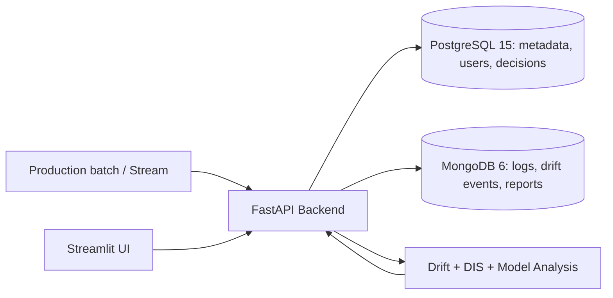

# DriftGuard

DriftGuard is an intelligent monitoring framework for tabular loan-default models. It distinguishes **drift-warning** (distributional shifts where performance is stable or labels are pending) from **confirmed-degradation** (verified model accuracy/AUC drop from ground-truth labels). DIS (Drift Impact Score) is a proposed research score combining drift magnitude, feature importance, and model sensitivity.

---

## Architecture



---

## Prerequisites

- **Python:** 3.11+
- **Docker & Docker Compose:** For running PostgreSQL 15 and MongoDB 6
- **Package Manager:** `pip`

---

## Quickstart: How to Run the Code

### 1. Environment Configuration

Copy the example environment file:
```bash
cp .env.example .env
```
Default settings are pre-configured for local development.

---

### 2. Set Up Python Environment

Create and activate a virtual environment, then install dependencies:

```bash
# Create virtual environment with Python 3.11
python3.11 -m venv .venv

# Activate virtual environment
source .venv/bin/activate   # On Linux/macOS
# or: .venv\Scripts\activate # On Windows

# Install dev & runtime dependencies
pip install -r requirements-dev.txt
```

---

### 3. Start Database Services (PostgreSQL & MongoDB)

Use Docker Compose to launch PostgreSQL (port `5432`) and MongoDB (port `27017`):

```bash
docker compose up postgres mongo -d
```

- PostgreSQL initializes tables from [`db/init.sql`](file:///Users/animesh/Documents/5th%20SEM/DBMS_PROJECT/code/db/init.sql).
- MongoDB initializes collections and indexes from [`db/mongo_init.js`](file:///Users/animesh/Documents/5th%20SEM/DBMS_PROJECT/code/db/mongo_init.js).

To check health status:
```bash
docker compose ps
```

---

### 4. Run the FastAPI Backend Server

Start the API service with Uvicorn:

```bash
uvicorn app.main:app --host 0.0.0.0 --port 8000 --reload
```

Once started:
- **Interactive OpenAPI (Swagger) Docs:** [http://localhost:8000/docs](http://localhost:8000/docs)
- **ReDoc Documentation:** [http://localhost:8000/redoc](http://localhost:8000/redoc)
- **Health Check Endpoint:** [http://localhost:8000/health](http://localhost:8000/health)

---

### 5. Interacting with the API

#### Check System Health
```bash
curl -s http://localhost:8000/health | jq .
```
Expected response:
```json
{
  "status": "ok",
  "postgres": "connected",
  "mongo": "connected"
}
```

#### Bootstrap the First Administrator
The first user registration must be an `administrator`:
```bash
curl -X POST http://localhost:8000/api/v1/auth/register \
  -H "Content-Type: application/json" \
  -d '{
    "name": "Admin User",
    "email": "admin@example.com",
    "password": "AdminPassword123",
    "role": "administrator"
  }' | jq .
```

#### Authenticate and Receive JWT Bearer Token
```bash
curl -X POST http://localhost:8000/api/v1/auth/login \
  -H "Content-Type: application/json" \
  -d '{
    "email": "admin@example.com",
    "password": "AdminPassword123"
  }' | jq .
```

#### Access Authenticated User Profile (`/me`)
```bash
curl -X GET http://localhost:8000/api/v1/auth/me \
  -H "Authorization: Bearer <YOUR_ACCESS_TOKEN>" | jq .
```

---

### 6. Running Tests & Code Quality

#### Run Unit Tests & Coverage
```bash
# Quick test run
pytest

# Test run with detailed coverage report
pytest -q --cov=app --cov-report=term-missing
```

#### Run Linters and Formatters
```bash
# Lint code with ruff
ruff check app tests

# Check code formatting with black
black --check app tests
```

#### Run Verification & Numerical Audits
Independent verification scripts covering numerical detectors (PSI, KS, JSD, DIS, decision logic) and API security:
```bash
# Drift engine numerical audit
PYTHONPATH=. python3 tests/audit/run_drift_audit.py

# API authentication, RBAC, and error validation audit
PYTHONPATH=. python3 tests/audit/run_api_audit.py
```

---

## Stopping the Services

To stop background database containers:
```bash
docker compose down
```
To also remove database volumes:
```bash
docker compose down -v
```

---

## Project Structure & Implementation Status

- [`app/main.py`](file:///Users/animesh/Documents/5th%20SEM/DBMS_PROJECT/code/app/main.py): FastAPI application factory, CORS, and health check.
- [`app/api/auth.py`](file:///Users/animesh/Documents/5th%20SEM/DBMS_PROJECT/code/app/api/auth.py): Authentication and RBAC endpoints (`/register`, `/login`, `/me`).
- [`app/services/drift/`](file:///Users/animesh/Documents/5th%20SEM/DBMS_PROJECT/code/app/services/drift/): Statistical drift detection routines (PSI, KS-test, JSD, normalisation).
- [`app/services/explain/dis.py`](file:///Users/animesh/Documents/5th%20SEM/DBMS_PROJECT/code/app/services/explain/dis.py): Drift Impact Score (DIS) calculation and ablation variants.
- [`app/services/decision.py`](file:///Users/animesh/Documents/5th%20SEM/DBMS_PROJECT/code/app/services/decision.py): Decision rule engine separating drift warnings from degradation.
- [`app/simulation/`](file:///Users/animesh/Documents/5th%20SEM/DBMS_PROJECT/code/app/simulation/): Synthetic loan-default data generator with controlled drift presets.
- [`db/init.sql`](file:///Users/animesh/Documents/5th%20SEM/DBMS_PROJECT/code/db/init.sql): PostgreSQL normalized schema (BCNF) with 8 core tables + 2 threshold tables.
- [`db/mongo_init.js`](file:///Users/animesh/Documents/5th%20SEM/DBMS_PROJECT/code/db/mongo_init.js): MongoDB collections and indexes setup script.

> [!NOTE]
> For details on currently implemented vs. planned modules, refer to [KNOWN_LIMITATIONS.md](file:///Users/animesh/Documents/5th%20SEM/DBMS_PROJECT/code/docs/KNOWN_LIMITATIONS.md) and the comprehensive [VERIFICATION_REPORT.md](file:///Users/animesh/Documents/5th%20SEM/DBMS_PROJECT/code/docs/VERIFICATION_REPORT.md).
