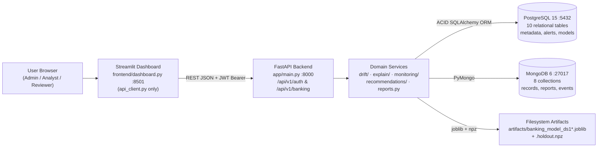

# 02 · Architecture, Folder Map & End-to-End Data Flow

## 1. System Architecture

DriftGuard follows a clean three-tier architecture: a **Streamlit** UI that performs *zero* statistical calculations, a **FastAPI** backend that orchestrates all ML/drift/governance logic, and a **hybrid storage layer** (PostgreSQL 15 + MongoDB 6 + filesystem model artifacts).



---

## 2. Repository Folder Structure

| Path | Responsibility |
|---|---|
| `app/main.py` | FastAPI app entry point, CORS (`localhost:8501`, `127.0.0.1:8501`), rate limiter, startup Mongo index creation, `/health` endpoint |
| `app/core/config.py` | Pydantic `Settings` reading `.env` (thresholds, bootstrap counts, DB URLs, ADWIN `delta`, retraining thresholds) |
| `app/core/security.py` | Argon2 password hashing (`hash_password`, `verify_password`), HS256 JWT (`create_token`, `current_user`), RBAC (`require_roles`) |
| `app/core/rate_limit.py` | `slowapi` rate limiter (`5/minute` on `/auth/login` and `/auth/register`) |
| `app/database/postgres.py` | SQLAlchemy engine, `SessionLocal`, `get_db()` dependency |
| `app/database/models.py` | ORM classes mirroring `db/init.sql` (`User`, `Dataset`, `Feature`, `Model`, `MonitoringJob`, `DriftSummary`, `Alert`, `RetrainingEvent`) |
| `app/database/mongo.py` | PyMongo client, `get_mongo_db()`, `ensure_indexes()` |
| `app/api/auth.py` | `/api/v1/auth/status`, `/register`, `/login`, `/me` |
| `app/api/banking.py` | All 28 `/api/v1/banking/*` routes (datasets, batches, analysis, overview, model health, recommendations, PDF reports, simulation, retraining) |
| `app/schemas/` | Pydantic request/response validators (`auth.py`, `banking.py`, `common.py`) |
| `app/services/datasets.py` | CSV schema validation, type checks, missing-value summaries, 12 monitored feature definitions |
| `app/services/drift/` | Statistical detectors: `psi.py`, `ks.py`, `jsd.py`, `calibration.py` (noise floors), `normalise.py`, `adwin.py` (River) |
| `app/services/explain/dis.py` | `dis_variants()` — computes DIS and 4 ablation scores (`d_only`, `d_fi`, `weighted_sum`, `rank_based`) |
| `app/services/monitoring/model.py` | XGBoost pipeline training, `save_model`/`load_holdout`, `shap_importance()`, `permutation_sensitivity()`, `performance_state()` |
| `app/services/monitoring/analysis.py` | Main pipeline `analyze_banking_drift()`, `compute_feature_drift()`, `stream_monitoring()`, `classify_drift_types()` |
| `app/services/monitoring/store.py` | Dual-database persistence (PostgreSQL + MongoDB) with compensation rollback in `complete_job()`, `settings_fingerprint()`, `audit()` |
| `app/services/monitoring/retraining.py` | Champion–challenger workflow: `create_challenger()`, `deploy()`, `reject()`, `rollback()` |
| `app/services/recommendations/` | `decision.py → decide()` (drift × performance matrix) and `risk.py → risk_assessment()` (LOW–CRITICAL, actions, `low_impact_drift_features`) |
| `app/services/reports.py` | `generate_committee_pdf()` — compiles ReportLab compliance PDF |
| `app/services/synthetic_data.py` | Synthetic banking generator for Scenarios A, B, C, D and concept shift |
| `db/init.sql`, `db/mongo_init.js` | PostgreSQL DDL (10 tables, constraints, indexes) and MongoDB index script |
| `frontend/dashboard.py` | Streamlit entry point: `st.navigation` grouped sidebar, strict login gating, live `/health` dots |
| `frontend/theme.py`, `components.py`, `api_client.py` | Design system tokens, Plotly template, reusable UI widgets, thin HTTP client |
| `frontend/sections/*.py` | The 9 authenticated dashboard pages + `shared.py` helpers |

---

## 3. End-to-End Request Trace: Upload CSV → Run Drift Analysis

Suppose an analyst uploads `March_2026.csv` and clicks **Register & Analyse**. Every step below happens in exact order:

```mermaid
sequenceDiagram
    actor User
    participant UI as Streamlit (frontend/)
    participant API as FastAPI (app/api/banking.py)
    participant VAL as datasets.py
    participant ANA as analysis.py + drift/ + model.py
    participant DEC as decision.py + risk.py
    participant ST as store.py
    participant PG as PostgreSQL
    participant MG as MongoDB

    User->>UI: Drop CSV & click Register
    UI->>API: POST /batches/upload (JWT)
    API->>VAL: prepare_banking_frame()
    API->>ST: register_batch()
    ST->>MG: insert banking_records & production_batches
    ST->>MG: audit("batch_uploaded")
    API-->>UI: 200 OK (registered)

    UI->>API: POST /analysis/run {batch_ids: ["March_2026"]}
    API->>ST: champion_model_id() + settings_fingerprint()
    API->>ST: find_reusable_report(input_signature)
    Note over API,ST: If unchanged signature & force=false, return cached report
    API->>ST: load_champion() & start_job()
    ST->>PG: INSERT monitoring_jobs (status='running')
    API->>ANA: analyze_banking_drift()
    ANA->>ANA: noise_floors() -> compute_feature_drift() (PSI, KS, JSD, D, agreement)
    ANA->>ANA: shap_importance() (FI) & permutation_sensitivity() (S)
    ANA->>ANA: dis_variants() -> overall_dis & batch_drift_level()
    ANA->>ANA: evaluate_model_health() -> performance_state() & adwin_stream()
    ANA->>ANA: classify_drift_types()
    ANA->>DEC: risk_assessment() -> decide()
    API->>ST: complete_job()
    ST->>PG: INSERT drift_summaries + alerts; UPDATE job='completed'
    ST->>MG: upsert root_cause_reports; insert drift_events & stream_events
    ST->>PG: COMMIT (on any error: PG rollback + delete Mongo docs)
    API-->>UI: 200 OK (full report JSON)
    UI-->>User: Render hero, KPIs, charts & feature table
```

### Exact Function-by-Function Call Order
1. **Upload route:** `app/api/banking.py → upload_batches()` checks `WRITE` role (`analyst` or `administrator`), reads bytes (enforcing `settings.max_upload_mb = 50`), validates via `app/services/datasets.py → prepare_banking_frame()`, and persists via `app/services/monitoring/store.py → register_batch()` into MongoDB `banking_records` and `production_batches` (recording `content_sha256`).
2. **Analysis route:** `app/api/banking.py → run_analysis()` calls `_run()`.
3. **Reuse check:** `_run()` resolves `champion_id = store.champion_model_id(session, base_meta)` and hashes `(mode, baseline_sha256, f"model:{champion_id}", store.settings_fingerprint(), batch_sha256s)`. If a completed report with that signature exists and `force=False`, `store.find_reusable_report()` returns it immediately (`reused=True`).
4. **Job start:** `store.load_champion()` loads the `.joblib` model (LRU-cached); `store.start_job()` inserts a `monitoring_jobs` row in PostgreSQL with `status="running"`.
5. **Core analysis (`app/services/monitoring/analysis.py → analyze_banking_drift()`):**
   - Computes or fetches cached bootstrap noise floors via `app/services/drift/calibration.py → noise_floors()`.
   - Loops over all 12 monitored features calling `compute_feature_drift()` → `psi()`/`categorical_psi()`, `ks()`, `jsd_from_counts()`, `normalise()`, `aggregate_d()`, `severity_of()`, and computes `detector_agreement`.
   - Computes model-specific weights: `model.shap_importance()` ($FI$) and `model.permutation_sensitivity()` ($S$).
   - Computes DIS and ablations via `app/services/explain/dis.py → dis_variants()`, `overall_dis = max(DIS_i)`, and `batch_drift_level()`.
   - Evaluates model health via `evaluate_model_health()` → `model.predict_proba()`, `stream_monitoring()` (ADWIN on `prediction` and `error` streams + KS on predicted probabilities), and if `n_labels >= 200`, `model.classification_metrics()` and `model.performance_state()` (bootstrap AUC CI).
   - Separates drift types via `classify_drift_types()`.
   - Computes risk category, alert type, recommendation, and `low_impact_drift_features` via `app/services/recommendations/risk.py → risk_assessment()` → `decision.py → decide()`.
6. **Atomic dual-store write (`store.complete_job()`):** Inserts `drift_summaries` and optional `alerts` in PostgreSQL, writes `root_cause_reports`, `drift_events`, and `stream_events` in MongoDB, and commits PostgreSQL inside a single `try/except` block. If *any* write fails, PostgreSQL rolls back and MongoDB deletes the partial documents for that `job_id`.
7. **Response & UI:** Returns the JSON report to `frontend/api_client.py → post()`, which bumps `st.session_state["data_version"]` so cached GETs refresh, and Streamlit renders the updated widgets.

---

## 4. Authentication & Role-Based Access Control (RBAC)

- **Password hashing (`app/core/security.py`):** Uses **Argon2** (`argon2.PasswordHasher`), a memory-hard hashing algorithm resistant to GPU brute-forcing. Plaintext passwords are never stored.
- **Bootstrap rule (`app/api/auth.py → register()`):** When `users` is empty, the first user *must* register as `administrator` (otherwise HTTP 403). Once any user exists, only an authenticated `administrator` can create additional users.
- **JWT tokens (`create_token()` / `current_user()`):** On `POST /api/v1/auth/login` (rate-limited to `5/minute`), the backend verifies the Argon2 hash and returns an HS256-signed JWT containing `sub` (user_id), `role`, `iat`, and `exp` (`access_token_expire_minutes = 60`). Every protected endpoint extracts `Authorization: Bearer <token>`, verifies signature and expiry, and loads the `User` from PostgreSQL.
- **Three roles (`require_roles()`):**

| Role | Read Views & PDF | Upload Batches & Run Analysis | Register Baseline, Seed Demo, Create Users, Retrain / Deploy / Rollback |
|---|---|---|---|
| `reviewer` | Yes | No (403) | No (403) |
| `analyst` | Yes | Yes | No (403) |
| `administrator` | Yes | Yes | Yes |
