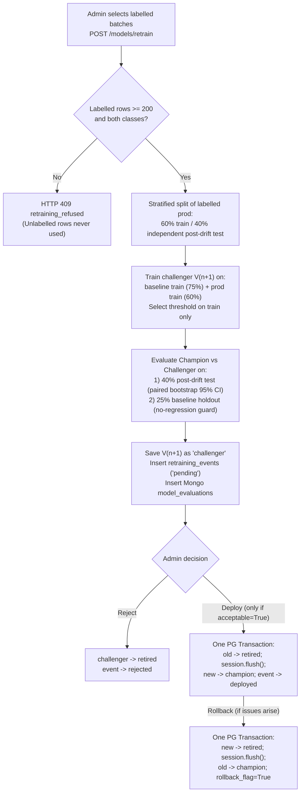

# 05 · Performance Monitoring, Decision Engine & Controlled Retraining

## 1. Labelled Performance Monitoring (`model.py → performance_state()`)

- **Why labels are required:** You cannot measure whether loan-default predictions were right or wrong until the loans mature and true `loan_default` (0/1) outcomes arrive.
- **Minimum label count:** `settings.min_labels = 200`. Below 200 labelled rows, `evaluate_model_health()` sets `has_production_labels = False` and `performance_state = "unknown"` (displayed as **Unknown – labels pending** in the UI).
- **Bootstrap 95% confidence interval of ROC-AUC:** Draws `settings.perf_bootstrap_b = 200` resamples with replacement from the labelled production rows, computes `roc_auc_score` on each resample, and takes `[2.5%, 97.5%]` quantiles `[lo, hi]`.
- **State rules** (comparing upper bound `hi` against `baseline_auc`):
  - `severe`: $\text{hi} < \text{baseline\_auc} - 0.05$ (`settings.perf_severe_drop = 0.05`)
  - `degraded`: $\text{hi} < \text{baseline\_auc} - 0.02$ (`settings.perf_meaningful_drop = 0.02`)
  - `stable`: otherwise (we cannot prove a meaningful drop)
  - `unknown`: fewer than 200 labels or single class

---

## 2. Four Distinct Drift Types (`analysis.py → classify_drift_types()`)

| Drift Type | How It Is Determined | Without Labels? |
|---|---|---|
| `data_drift` | Any feature has `severity != "low"` ($D \ge 0.15$) | Observable (`True` / `False`) |
| `prediction_drift` | ADWIN detected change on predicted-probability stream, **or** output KS $p < 0.01$ | Observable (`True` / `False`) |
| `concept_drift_suspected` | Labelled: (`confirmed_degradation` or ADWIN `error` stream change) **and** `drift_level == "low"` | **`None` (Unknown – labels pending)** |
| `confirmed_degradation` | Labelled: `performance_state` in `{"degraded", "severe"}` | **`None` (Unknown – labels pending)** |

Without labels, the last two are **always `None` (unknown)**, never `False`—because absence of labels is not proof that the model is healthy.

---

## 3. Decision Engine & Risk Assessment (`decision.py → decide()`, `risk.py → risk_assessment()`)

### Decision Matrix (`drift_level` × `performance_state`)

| `drift_level` (from Overall DIS) | `performance_state` | Risk Category | Alert Type & Level | Recommendation | Demo Batch Example |
|---|---|---|---|---|---|
| `low` (< 0.05) | `unknown` / `stable` | **LOW RISK** | None | Continue monitoring | `January_2026` (DIS 0.000) |
| `moderate` (0.05–0.25) | `unknown` | **MEDIUM RISK** | `drift-warning` (`moderate`) | Investigate and monitor closely; labels needed to confirm impact | `March_2026` (DIS 0.145) |
| `high` (≥ 0.25) | `unknown` | **HIGH RISK** | `drift-warning` (`high`) | Investigate affected features and data quality; labels needed to confirm impact | `June_2026` (DIS 1.000) |
| `high` (≥ 0.25) | `stable` | **HIGH RISK** | `drift-warning` (`high`) | Investigate affected features and data quality *(no label ask)* | `September_2026` (DIS 1.000, 1,800 labels) |
| Any | `degraded` | **HIGH RISK** | `confirmed-degradation` (`moderate`/`high`) | Consider retraining (or investigate concept drift if `low` drift) | — |
| Any | `severe` | **CRITICAL RISK** | `confirmed-degradation` (`high`) | Immediate model review and controlled retraining | `November_2026` (DIS 1.000, 1,600 labels) |

- **Low-impact strong-drift rule (`risk.py`):** If a feature has `severity == "high"` ($D \ge 0.50$) yet $\text{DIS} < 0.05$ (`batch_dis_moderate`), it does *not* raise model risk, **but** it is listed in `low_impact_drift_features` with an action `"Check data quality / upstream pipelines..."` and the batch is **never** described as "distributions remain stable".

---

## 4. Controlled Champion–Challenger Retraining (`app/services/monitoring/retraining.py`)

DriftGuard **never** retrains or deploys automatically. Retraining is a strict administrator-controlled workflow:

### The 3 Acceptance Criteria (All Must Pass Before Deploy)
1. `gain_meets_minimum`: $\text{AUC}_{\text{challenger}} - \text{AUC}_{\text{champion}} \ge 0.01$ (`settings.retrain_min_gain_auc`).
2. `gain_ci_excludes_zero`: lower bound of the 95% paired-bootstrap CI of AUC gain $> 0$.
3. `no_baseline_regression`: challenger's baseline-holdout AUC $\ge \text{champion baseline AUC} - 0.05$ (`settings.perf_severe_drop`).

*Live measured example (`November_2026`, Event #1):* 960 production train rows + 1,875 baseline train rows; 640 independent post-drift test rows; **0 unlabelled rows used**; AUC gain = **`+0.270`** (95% CI `[0.222, 0.336]`); all 3 criteria passed.

### Why `session.flush()` Is Required in `deploy()` and `rollback()`
PostgreSQL enforces `CREATE UNIQUE INDEX one_champion_per_dataset ON models(dataset_id) WHERE status='champion'`. Inside one transaction, if SQLAlchemy tried to set `new.status = 'champion'` before flushing `old.status = 'retired'` to PostgreSQL, the partial unique index would raise an `IntegrityError`. Calling `old.status = 'retired'; session.flush()` sends the `UPDATE` first (freeing the unique slot inside the open transaction), then sets `new.status = 'champion'` and `session.commit()` makes the swap atomic.

### Separation of the 6 Governance Capabilities

| Capability | Trigger | Code |
|---|---|---|
| 1. **Detect** | Analyst / Admin | `analysis.py → analyze_banking_drift()` |
| 2. **Recommend** | Automatic from report | `decision.py → decide()`, `risk.py → risk_assessment()` |
| 3. **Create retraining job** | Admin explicitly calls `/models/retrain` | `retraining.py → create_challenger()` |
| 4. **Train** | Inside `create_challenger` (labelled rows only) | `model.py → fit_pipeline()`, `select_threshold()` |
| 5. **Evaluate** | Paired bootstrap on 40% holdout + baseline guard | `retraining.py → _paired_auc_gain()` |
| 6. **Deploy / Reject / Rollback** | Separate Admin approval endpoints | `retraining.py → deploy()`, `reject()`, `rollback()` |
