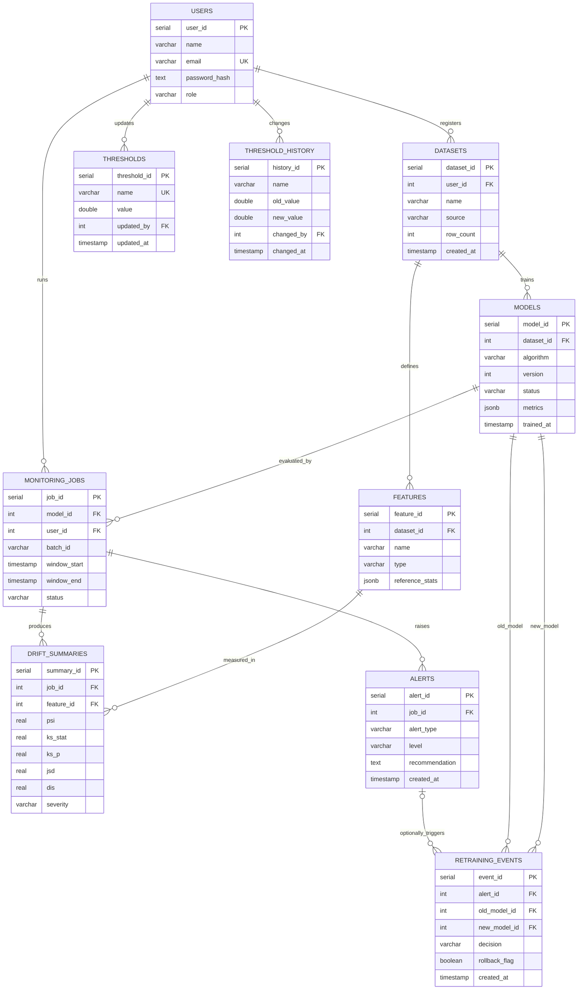

# 06 · Database Design (PostgreSQL + MongoDB — DBMS Deep Dive)

This is the core **CD252IA (DBMS Laboratory)** chapter. Every table, constraint, index, sample row, and query output below comes directly from `db/init.sql`, `db/mongo_init.js`, and the live Docker containers (`postgres:15` and `mongo:6`).

---

## 1. Entity–Relationship Diagram (Generated from `db/init.sql`)



---

## 2. PostgreSQL Schema Reference (All 10 Tables in `db/init.sql`)

| Table | Purpose | Key Constraints & Foreign Keys | Live Sample Row |
|---|---|---|---|
| `users` | Authenticated platform users | PK `user_id`; `UNIQUE(email)`; `CHECK(role IN ('analyst','administrator','reviewer'))` | `(1, 'Admin User', 'admin@example.com', 'administrator')` |
| `datasets` | Registered historical baselines | PK `dataset_id`; FK `user_id → users`; `CHECK(row_count >= 0)`; `UNIQUE(user_id, name)` | `(1, 1, '2020_Historical_Baseline', 2500)` |
| `features` | Monitored schema & baseline stats (`JSONB`) | PK `feature_id`; FK `dataset_id → datasets ON DELETE CASCADE`; `CHECK(type IN ('numerical','categorical'))`; `UNIQUE(dataset_id, name)` | `(1, 1, 'age', 'numerical')` |
| `models` | Versioned ML models & holdout metrics (`JSONB`) | PK `model_id`; FK `dataset_id → datasets`; `CHECK(status IN ('champion','challenger','retired'))`; `UNIQUE(dataset_id, algorithm, version)`; **Partial Unique Index** `one_champion_per_dataset ON models(dataset_id) WHERE status='champion'` | `(5, 1, 'xgboost', 5, 'champion', auc=0.700)` |
| `monitoring_jobs` | Each drift analysis execution | PK `job_id`; FK `model_id → models`, `user_id → users`; `CHECK(window_end >= window_start)` | `(14, 1, 1, 'November_2026', 'completed')` |
| `drift_summaries` | Associative M:N table (`jobs × features`) | PK `summary_id`; FK `job_id → monitoring_jobs ON DELETE CASCADE`, `feature_id → features`; `CHECK(severity IN ('low','moderate','high'))`; `UNIQUE(job_id, feature_id)` | `(154, 14, 7, psi=1.939, ks=0.345, jsd=0.194, dis=1.000, 'high')` |
| `alerts` | Raised warnings & degradation alerts | PK `alert_id`; FK `job_id → monitoring_jobs`; `CHECK(alert_type IN ('drift-warning','confirmed-degradation'))` | `(11, 14, 'confirmed-degradation', 'high', '[CRITICAL RISK]...')` |
| `retraining_events` | Champion–challenger audit lifecycle | PK `event_id`; FK `alert_id → alerts` (nullable), `old_model_id → models`, `new_model_id → models`; `CHECK(decision IN ('pending','deployed','rejected','rolled_back'))`; `CHECK(old_model_id <> new_model_id)` | `(1, NULL, 1, 2, 'rolled_back', t)` |
| `thresholds` | *(Schema reserved; runtime reads `.env`)* | PK `threshold_id`; `UNIQUE(name)`; FK `updated_by → users` | `0 rows` (**UI/API editing not implemented**) |
| `threshold_history` | *(Schema reserved for threshold audit)* | PK `history_id`; FK `changed_by → users` | `0 rows` (**UI/API editing not implemented**) |

### Relational Indexes & Why Each Exists
- `drift_summaries_job_id ON drift_summaries(job_id)`: fast lookup of all 12 feature rows for a given monitoring job.
- `monitoring_jobs_model_window ON monitoring_jobs(model_id, window_start)`: time-ordered job history per model.
- `alerts_job_created ON alerts(job_id, created_at)`: fast alert timeline queries.
- `one_champion_per_dataset ON models(dataset_id) WHERE status='champion'`: **database-level invariant** making it physically impossible for two models on the same dataset to be `champion` simultaneously—even under concurrent requests.

---

## 3. Normalisation Analysis (1NF → 2NF → 3NF) & Deliberate Denormalisation

- **1NF (Atomic attributes & primary keys):** Every table has a surrogate `SERIAL` primary key and no repeating column groups (e.g., features are rows in `features`, not `feature1..feature12` columns). Semi-structured `reference_stats` and `metrics` use PostgreSQL `JSONB` intentionally because numerical vs categorical stats have variable shapes.
- **2NF (No partial dependencies on composite keys):** Every non-key attribute depends on the full primary key. The M:N relationship between `monitoring_jobs` and `features` is cleanly resolved by the associative table `drift_summaries(job_id, feature_id)`.
- **3NF (No transitive dependencies):** User details (`name`, `email`, `role`) live only in `users` (referenced by `user_id`); feature metadata lives only in `features` (referenced by `feature_id`); model metadata lives only in `models` (referenced by `model_id`).
- **Deliberate denormalisation:** `drift_summaries.severity` is derivable from $D$ and the configured thresholds, yet is stored explicitly so historical jobs preserve the severity label *as judged at the time of the run*, even if thresholds in `.env` are later edited.

---

## 4. Transactions, Dual-Database Compensation & Failure Behaviour

- **Single-DB ACID (`retraining.py → deploy()`, `rollback()`):** Runs inside one SQLAlchemy/PostgreSQL transaction (`old.status='retired' → session.flush() → new.status='champion' → event.decision='deployed' → session.commit()`, with `session.rollback()` on any error).
- **Cross-DB Saga/Compensation (`store.py → complete_job()`):** Because PostgreSQL and MongoDB do not share a two-phase commit coordinator, `complete_job()` wraps *all* Mongo writes (`root_cause_reports.replace_one`, `drift_events.insert_many`, `stream_events.insert_many`) and `session.commit()` in one `try/except`. If **any** write fails (even `drift_events` failing after `root_cause_reports` succeeded), the `except` block rolls back PostgreSQL and deletes the report, drift events, and stream events for that `job_id`—preventing orphan documents (verified by `tests/test_audit_fixes.py::test_failed_mongo_event_write_leaves_no_orphan_report`).
- **If one DB is down:** `/health` immediately reports `degraded` (and the dashboard sidebar dot turns red). Endpoints fail gracefully with structured errors instead of corrupting state.

---

## 5. MongoDB Collections (8 Collections in `db/mongo_init.js` & `app/database/mongo.py`)

| Collection | Live Docs | Indexes | Links to PostgreSQL | Why MongoDB Instead of PostgreSQL? |
|---|---:|---|---|---|
| `banking_records` | `10,800` | `{owner: 1}` | `owner = "baseline:{dataset_id}"` or `"batch:{batch_id}"` | Unbounded raw customer rows; flexible schema for extra CSV columns |
| `baseline_registry` | `1` | `{dataset_id: 1}` (unique), `{content_sha256: 1}` | `dataset_id`, `model_id` | Stores preview arrays, `synthetic_columns`, content hashes |
| `production_batches` | `6` | `{batch_id: 1}` (unique), `{content_sha256: 1}` | `latest_job_id` | Stores variable-length `processing_history` array & batch metadata |
| `root_cause_reports` | `14` | `{job_id: 1}` (unique), `{batch_id: 1, analysed_at: -1}` | `job_id`, `model_id`, `alert_id` | Deep nested JSON (histograms, 12 feature details, SHAP, ablations, ADWIN) |
| `drift_events` | `168` | `{job_id: 1, feature: 1}` | `job_id` | Append-only per-feature telemetry with nested `floors`, `normalised`, `detector_agreement`, `histogram` |
| `stream_events` | `9` | `{job_id: 1, stream: 1}` | `job_id`, `model_id` | ADWIN streaming output (`first_detection_index`, `detection_indices`, window stats) |
| `model_evaluations` | `4` | `{event_id: 1}` (unique) | `event_id`, `champion_model_id`, `challenger_model_id` | Full champion-vs-challenger nested evaluation payload (post-drift + baseline holdout) |
| `monitoring_logs` | `47` | `{timestamp: -1}` | `user_id` | Append-only audit trail with event-specific `details` dict |

---

## 6. Live Demo Queries (10 SQL + 5 MongoDB — Real Measured Outputs)

Command used for SQL: `docker compose exec -T postgres psql -U driftguard -d driftguard -c "<query>"`

### SQL Q1 — Simple Projection & Filter (Baseline Features)
```sql
SELECT feature_id, name, type FROM features WHERE dataset_id = 1 ORDER BY feature_id LIMIT 5;
```
Output: `1 age (numerical)`, `2 monthly_income (numerical)`, `3 credit_score (numerical)`, `4 credit_limit (numerical)`, `5 outstanding_loan_amount (numerical)`.

### SQL Q2 — INNER JOIN + Ordering (Top 5 Drifting Features in `November_2026`, Job #14)
```sql
SELECT f.name, round(d.psi::numeric,3) AS psi, round(d.ks_stat::numeric,3) AS ks,
       round(d.jsd::numeric,3) AS jsd, round(d.dis::numeric,3) AS dis, d.severity
FROM drift_summaries d JOIN features f ON f.feature_id = d.feature_id
WHERE d.job_id = 14 ORDER BY d.dis DESC LIMIT 5;
```
Output: `debt_to_income (1.000, high)`, `outstanding_loan_amount (0.883, high)`, `employment_type (0.445, high)`, `monthly_income (0.443, high)`, `credit_score (0.345, high)`.

### SQL Q3 — GROUP BY + Conditional Aggregate (Severity Counts per Demo Batch)
```sql
SELECT j.job_id, j.batch_id,
       count(*) FILTER (WHERE d.severity='high') AS high_cnt,
       count(*) FILTER (WHERE d.severity='moderate') AS mod_cnt,
       round(max(d.dis)::numeric,3) AS max_dis
FROM monitoring_jobs j JOIN drift_summaries d ON d.job_id = j.job_id
WHERE j.batch_id IN ('January_2026','March_2026','June_2026','September_2026','November_2026')
GROUP BY j.job_id, j.batch_id ORDER BY j.job_id;
```
Output (latest seed jobs 10–14): `10 January_2026 (0 high, 0 mod, 0.000)`, `11 March_2026 (0 high, 2 mod, 0.145)`, `12 June_2026 (5 high, 0 mod, 1.000)`, `13 September_2026 (7 high, 0 mod, 1.000)`, `14 November_2026 (7 high, 0 mod, 1.000)`.

### SQL Q4 — 4-Table JOIN (Alerts with Batch, Model Version & User)
```sql
SELECT a.alert_id, j.batch_id, m.version AS model_v, u.email, a.alert_type, a.level
FROM alerts a
JOIN monitoring_jobs j ON j.job_id = a.job_id
JOIN models m ON m.model_id = j.model_id
JOIN users u ON u.user_id = j.user_id
ORDER BY a.alert_id DESC LIMIT 5;
```
Output: Alert #11 (`November_2026`, `v1`, `confirmed-degradation`, `high`), Alert #10 (`September_2026`, `drift-warning`, `high`), Alert #9 (`June_2026`, `drift-warning`, `high`), Alert #8 (`March_2026`, `drift-warning`, `moderate`).

### SQL Q5 — Self-JOIN + JSONB Extraction (Old vs New Model AUC per Retraining Event)
```sql
SELECT r.event_id, r.decision, r.rollback_flag,
       'v' || mo.version AS old_v, (mo.metrics->>'roc_auc')::numeric(5,3) AS old_auc,
       'v' || mn.version AS new_v, (mn.metrics->>'roc_auc')::numeric(5,3) AS new_auc
FROM retraining_events r
JOIN models mo ON mo.model_id = r.old_model_id
JOIN models mn ON mn.model_id = r.new_model_id ORDER BY r.event_id;
```
Output: Event 1 (`rolled_back`, `t`, `v1 0.664 → v2 0.744`), Event 2 (`rejected`, `f`, `v1 0.664 → v3 0.755`), Event 3 (`rolled_back`, `t`, `v1 0.664 → v4 0.755`), Event 4 (`deployed`, `f`, `v1 0.664 → v5 0.700`).

### SQL Q6 — Scalar Subquery (Features Above Average DIS in Job #14)
```sql
SELECT f.name, round(d.dis::numeric,3) AS dis
FROM drift_summaries d JOIN features f ON f.feature_id = d.feature_id
WHERE d.job_id = 14 AND d.dis > (SELECT avg(dis) FROM drift_summaries WHERE job_id = 14)
ORDER BY d.dis DESC;
```
Output: returns the 5 features above the job-14 mean DIS (`debt_to_income` `1.000` down to `credit_score` `0.345`).

### SQL Q7 — LEFT JOIN (Jobs With or Without Alerts)
```sql
SELECT j.job_id, j.batch_id, coalesce(a.alert_type, 'none') AS alert_type
FROM monitoring_jobs j LEFT JOIN alerts a ON a.job_id = j.job_id
WHERE j.batch_id IN ('January_2026','March_2026','June_2026','September_2026','November_2026')
ORDER BY j.job_id;
```
Output: shows `January_2026 → none`, `March/June/September → drift-warning`, `November → confirmed-degradation`.

### SQL Q8 — Window Function (`RANK() OVER`)
```sql
SELECT f.name, round(d.dis::numeric,3) AS dis, RANK() OVER (ORDER BY d.dis DESC) AS dis_rank
FROM drift_summaries d JOIN features f ON f.feature_id = d.feature_id WHERE d.job_id = 14 LIMIT 5;
```
Output: ranks `debt_to_income` (#1) through `credit_score` (#5).

### SQL Q9 — `HAVING` Clause (Persistently High-Drift Features)
```sql
SELECT f.name, count(*) AS high_jobs
FROM drift_summaries d JOIN features f ON f.feature_id = d.feature_id
WHERE d.severity = 'high' GROUP BY f.name HAVING count(*) >= 3 ORDER BY high_jobs DESC LIMIT 5;
```
Output: `debt_to_income`, `outstanding_loan_amount`, `credit_score`, `fd_balance`, `number_of_existing_loans` (each `9` high-severity jobs).

### SQL Q10 — Partial Unique Index Champion Lookup
```sql
SELECT model_id, dataset_id, algorithm, version, status, (metrics->>'roc_auc')::numeric(5,3) AS auc
FROM models WHERE status = 'champion';
```
Output: `(5, 1, 'xgboost', 5, 'champion', 0.700)` — guaranteed at most 1 row per dataset.

---

### MongoDB Queries (5 Live Queries via `mongosh driftguard`)

1. **M1 — Filtered Batch Ledger (`production_batches`):**
   ```javascript
   db.production_batches.find({batch_id: {$not: /^UI_Test_/}}, {_id:0, batch_id:1, batch_date:1, row_count:1, labelled_rows:1, status:1}).sort({batch_date:1});
   ```
   Returns the 5 demo batches (`January_2026` 1,000 rows → `November_2026` 1,600 rows, 1,600 labelled).
2. **M2 — Nested Field Projection (`drift_events`, Job #14):**
   ```javascript
   db.drift_events.find({job_id: 14, severity: 'high'}, {_id:0, feature:1, psi:1, dis:1, 'detector_agreement.status':1}).sort({dis:-1}).limit(4);
   ```
   Returns `debt_to_income` (`psi: 1.939`, `dis: 1`, `agree-drift`), `outstanding_loan_amount` (`0.883`), `employment_type` (`0.445`), `monthly_income` (`0.443`).
3. **M3 — ADWIN Detections (`stream_events`):**
   ```javascript
   db.stream_events.find({detected: true}, {_id:0, job_id:1, batch_id:1, stream:1, first_detection_index:1, reference_mean:1, production_mean:1});
   ```
   Returns 5 detections, including `November_2026` `prediction` (index `78`, `0.353 → 0.559`) and `error` (index `206`, `0.374 → 0.495`).
4. **M4 — Aggregation Pipeline (`$group` + `$cond` + `$sort` on `drift_events`):**
   ```javascript
   db.drift_events.aggregate([
     {$group: {_id: '$feature', avg_dis: {$avg: '$dis'}, conv_alerts: {$sum: {$cond: ['$exceeded_conventional', 1, 0]}}}},
     {$sort: {avg_dis: -1}}, {$limit: 5}
   ]);
   ```
   Output: `debt_to_income` (`avg_dis: 0.543`, `9` conv alerts), `outstanding_loan_amount` (`0.446`, `9`), `credit_score` (`0.283`, `9`), `monthly_income` (`0.169`, `9`), `employment_type` (`0.138`, `4`).
5. **M5 — Retraining Evaluations (`model_evaluations`):**
   ```javascript
   db.model_evaluations.find({}, {_id:0, event_id:1, challenger_version:1, acceptable:1, 'auc_gain.gain':1, 'data.unlabelled_rows_used':1}).sort({event_id:1});
   ```
   Output: Events 1–4, all with `unlabelled_rows_used: 0` and positive measured AUC gains (`+0.270`, `+0.064`, `+0.064`, `+0.118`).
