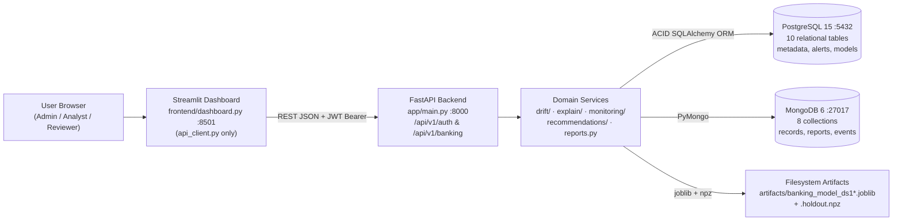
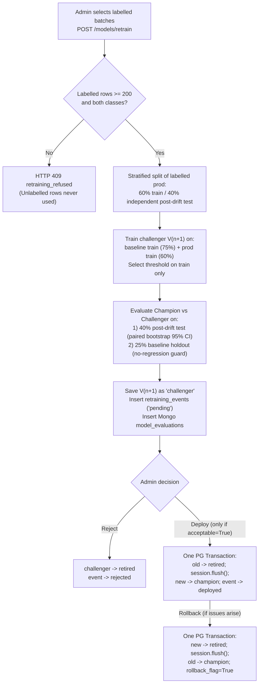
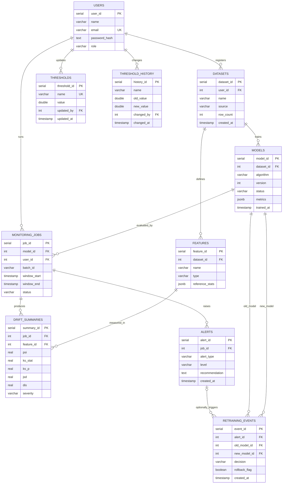

# DriftGuard — Complete Explanation & Viva Preparation Pack

**Course:** DBMS Laboratory (CD252IA) · RV College of Engineering  
**Merged PDF-ready edition**

## Table of Contents

- [01 · DriftGuard in One Page](#01-driftguard-in-one-page)
- [02 · Architecture, Folder Map & End-to-End Data Flow](#02-architecture-folder-map-end-to-end-data-flow)
- [03 · Drift Detection Mathematics (With Hand-Verified Code Examples)](#03-drift-detection-mathematics-with-hand-verified-code-examples)
- [04 · Credit Model, SHAP Importance, Sensitivity & DIS](#04-credit-model-shap-importance-sensitivity-dis)
- [05 · Performance Monitoring, Decision Engine & Controlled Retraining](#05-performance-monitoring-decision-engine-controlled-retraining)
- [06 · Database Design (PostgreSQL + MongoDB — DBMS Deep Dive)](#06-database-design-postgresql-+-mongodb-dbms-deep-dive)
- [07 · FastAPI Endpoints, Security & Dashboard Walkthrough](#07-fastapi-endpoints-security-dashboard-walkthrough)
- [08 · Research Experiment & Honest Contribution](#08-research-experiment-honest-contribution)
- [09 · Live Demo Script (10–12 Minutes)](#09-live-demo-script-10–12-minutes)
- [10 · Viva Questions & Model Answers (90 Questions)](#10-viva-questions-model-answers-90-questions)
- [11 · Glossary of Terms](#11-glossary-of-terms)

---

# 01 · DriftGuard in One Page

## 1. Spoken Pitches (Word-for-Word Scripts)

### One-Sentence Pitch
> **DriftGuard** is a dual-database (PostgreSQL + MongoDB) credit-risk monitoring platform that detects input data drift, prioritises which drifted features actually matter to the deployed ML model, separates drift warnings from label-confirmed performance drops, and manages human-approved champion–challenger retraining with rollback.

### 30-Second Version
> "When a bank deploys a loan-default prediction model, customer data changes over time—incomes rise, debt ratios grow, or credit scores shift. Traditional drift tools fire alerts on every changing column, even columns the model barely uses, which causes alert fatigue. DriftGuard solves this by combining three statistical detectors—PSI, KS, and JSD—with the model's own SHAP feature importance to rank which shifts actually matter. Crucially, DriftGuard never assumes drift means accuracy dropped: it waits for real loan outcomes before confirming degradation, and supports administrator-approved champion–challenger retraining backed by PostgreSQL transactions and MongoDB telemetry."

### 2-Minute Version
> "My project is **DriftGuard**, a database-backed monitoring framework for a credit-risk ML model built with FastAPI, Streamlit, PostgreSQL 15, and MongoDB 6.
>
> Here is the core problem: a bank trains an XGBoost loan-default classifier on 2020 customers and deploys it in 2026. Over time, applicant distributions shift—that is **data drift**. Standard monitoring tools check each feature independently with PSI or KS tests and alert on everything. That creates two failures: first, **alert fatigue**, because shifting a low-importance feature like `age` does not affect loan decisions the same way shifting `debt_to_income` does; second, **premature retraining**, because input drift does *not* automatically mean model accuracy dropped.
>
> DriftGuard addresses both. For every incoming production batch, it runs PSI, KS, and JSD against bootstrap sampling noise floors (`app/services/drift/calibration.py`), normalises them into a drift score $D \in [0, 1]$, and combines $D$ with TreeSHAP feature importance ($FI$) and permutation sensitivity ($S$) into a Drift Impact Score, $\text{DIS} = D \times FI \times S$. It also runs River's ADWIN streaming detector on the model's predicted probabilities and error stream (`app/services/drift/adwin.py`).
>
> For governance, DriftGuard strictly separates **drift warnings** from **confirmed degradation** (`app/services/recommendations/decision.py`). Without outcome labels, degradation is reported as *Unknown – labels pending*. Only when at least 200 labelled loan outcomes arrive and the bootstrap 95% confidence interval of ROC-AUC drops below baseline does it raise `confirmed-degradation`. An administrator can then train a challenger model on labelled data only, evaluate it on a 40% independent post-drift test split, and atomically deploy or roll it back in PostgreSQL.
>
> From a DBMS perspective, structured metadata, constraints, alerts, and model lifecycles live in 10 normalised PostgreSQL tables—including a partial unique index enforcing one champion per dataset—while large flexible records, histograms, ADWIN stream events, and full reports live in 8 MongoDB collections."

### 5-Minute Version (Structured Walkthrough)
1. **Motivation (45s):** Explain the 2020 → 2026 loan-default scenario. Emphasise that **data drift ≠ performance degradation** (a bank's applicants can get wealthier without breaking the model's ranking ability; conversely, **concept drift** can break accuracy even if input distributions barely move).
2. **Architecture & Hybrid DBMS (75s):** Walk through Streamlit (`frontend/dashboard.py`) → FastAPI (`app/api/banking.py`) → PostgreSQL (`db/init.sql`) + MongoDB (`db/mongo_init.js`). Explain *why* two databases: ACID transactions, foreign keys, CHECK constraints, and `one_champion_per_dataset` in PostgreSQL vs unbounded JSON records, histograms, and audit logs in MongoDB.
3. **Drift & Model-Aware Prioritisation (75s):** Explain PSI, KS, JSD, bootstrap noise-floor calibration (fixed during audit from n-vs-n to N-vs-n), TreeSHAP ($FI$), permutation sensitivity ($S$), $\text{DIS} = D \times FI \times S$, and ADWIN on prediction/error streams.
4. **Decision Engine & Retraining (60s):** Show how `decide()` in `app/services/recommendations/decision.py` maps `(drift_level, performance_state)` to `LOW / MEDIUM / HIGH / CRITICAL`. Walk through our live demo: January (`LOW`) → March (`MEDIUM`) → June (`HIGH`) → September (`HIGH`, labelled *stable*!) → November (`CRITICAL`, labelled *severe*). Show champion–challenger retraining on `November_2026` (+0.270 AUC gain on 640 independent test rows) with one-transaction deploy and rollback.
5. **Honest Research Findings & Limitations (45s):** Present the 10-seed, 70-batch counterfactual experiment (`scripts/experiments/dis_prioritisation.py`): model-aware weighting ($D \times FI$, NDCG@3 = `0.932`) and DIS (`0.910`) clearly beat conventional PSI ranking (`0.774`), while permutation sensitivity $S$ added no measurable gain over $D \times FI$. Also note that no drift score correlated with real AUC drop (Spearman `-0.180` to `-0.063`), proving labels are essential. Acknowledge synthetic data and single model family (XGBoost).

---

## 2. The Problem: Data Drift vs Model Degradation

Imagine a bank trains a credit-risk model on 2020 applicants to predict `loan_default` (0 = repaid, 1 = defaulted) from 12 attributes (`age`, `monthly_income`, `credit_score`, `credit_limit`, `outstanding_loan_amount`, `fd_balance`, `debt_to_income`, `loan_amount_requested`, `loan_tenure`, `number_of_existing_loans`, `interest_rate`, `employment_type`).

- **Data drift (covariate shift):** $P(X)$ changes—for example, in 2026 inflation raises `monthly_income` by 22% (Scenario B) or borrowers carry higher `debt_to_income` (Scenario C/D).
- **Concept drift:** $P(y \mid X)$ changes—the *relationship* between inputs and default changes (e.g., an economic shock makes previously safe borrowers default, as in `November_2026`).
- **Why "drift ≠ the model got worse":** In our live demo, `September_2026` has severe input drift (`Overall DIS = 1.000`, `7/12` features drifted), yet its 1,800 labelled outcomes confirm **stable** model performance (`ROC-AUC` does not drop). Retraining blindly on `September_2026` would waste effort. Conversely, `November_2026` has concept shift and its AUC collapses (`performance_state = severe`), genuinely justifying controlled retraining.

---

## 3. The 7 Questions DriftGuard Answers

| # | Question | How DriftGuard Answers It | Code Reference |
|---|---|---|---|
| 1 | **Has the input data changed?** | Compares production batch against 2020 baseline using PSI, KS, JSD + bootstrap noise floors | `app/services/drift/psi.py`, `ks.py`, `jsd.py`, `calibration.py` |
| 2 | **Which features changed?** | Evaluates all 12 monitored features individually and reports `detector_agreement` | `app/services/monitoring/analysis.py → compute_feature_drift()` |
| 3 | **How much did they change?** | Subtracts the 95th-percentile noise floor and scales to $D_i \in [0, 1]$ (`max` aggregation) | `app/services/drift/normalise.py → normalise()`, `aggregate_d()` |
| 4 | **Do those features matter to the model?** | Weights $D_i$ by TreeSHAP importance ($FI_i$) and permutation sensitivity ($S_i$) into $\text{DIS}_i$ | `app/services/monitoring/model.py → shap_importance()`, `permutation_sensitivity()`; `app/services/explain/dis.py → dis_variants()` |
| 5 | **Is model performance actually dropping?** | Requires ≥ 200 labels; computes bootstrap 95% CI of ROC-AUC vs baseline + ADWIN error stream | `app/services/monitoring/model.py → performance_state()`; `app/services/drift/adwin.py → adwin_stream()` |
| 6 | **What should the risk team investigate?** | Maps `(drift_level, performance_state)` to `LOW / MEDIUM / HIGH / CRITICAL`, action checklist, and `low_impact_drift_features` | `app/services/recommendations/decision.py → decide()`; `risk.py → risk_assessment()` |
| 7 | **Should we retrain, and is the new model better?** | Admin-triggered challenger trained on labelled rows only, tested on 40% holdout with paired bootstrap CI, atomic deploy & rollback | `app/services/monitoring/retraining.py → create_challenger()`, `deploy()`, `reject()`, `rollback()` |

---

## 4. Central Research Question & Honest Answer

**Exact wording** (from `FINAL_PROJECT_REPORT.md`, Section 1.3):
> *"Can combining multi-detector statistical drift magnitude with model-specific feature importance and observed empirical performance changes improve the prioritisation of potentially consequential drift compared with conventional unweighted drift alerts?"*

**Honest answer from our experiment** (`scripts/experiments/dis_prioritisation.py`, 10 seeds, 70 covariate-shift ranking batches, 110 total batches):
1. **Yes for model-aware weighting ($D \times FI$):** Weighting normalised drift by SHAP importance raises `NDCG@3` from **`0.774`** (conventional PSI) to **`0.932`** ($D \times FI$) and **`0.910`** (full DIS = $D \times FI \times S$).
2. **No for permutation sensitivity ($S$):** $D \times FI$ matched or beat full DIS in **88.6%** of batches because $S$ correlates strongly with $FI$ (Spearman `0.867–0.930` on our demo batches). Keeping $S$ in the UI is transparent, and replacing it with *shift-aware* sensitivity is documented as future work.
3. **Labels remain mandatory for degradation:** Batch-level drift scores had near-zero/negative correlation with actual AUC drop (Spearman `-0.180` to `-0.063`), confirming that drift alerts cannot replace labelled performance checks.

---

# 02 · Architecture, Folder Map & End-to-End Data Flow

## 1. System Architecture

DriftGuard follows a clean three-tier architecture: a **Streamlit** UI that performs *zero* statistical calculations, a **FastAPI** backend that orchestrates all ML/drift/governance logic, and a **hybrid storage layer** (PostgreSQL 15 + MongoDB 6 + filesystem model artifacts).



---

## 2. Repository Folder Structure

| Path | Responsibility |
|---|---|
| `app/main.py` | FastAPI app entry point, CORS (`localhost:8501`, `127.0.0.1:8501`), rate limiter, startup Mongo index creation, `/health` endpoint |
| `app/core/config.py` | Pydantic `Settings` reading `.env` (thresholds, bootstrap counts, DB URLs, ADWIN `delta`, retraining thresholds) |
| `app/core/security.py` | Argon2 password hashing (`hash_password`, `verify_password`), HS256 JWT (`create_token`, `current_user`), RBAC (`require_roles`) |
| `app/core/rate_limit.py` | `slowapi` rate limiter (`5/minute` on `/auth/login` and `/auth/register`) |
| `app/database/postgres.py` | SQLAlchemy engine, `SessionLocal`, `get_db()` dependency |
| `app/database/models.py` | ORM classes mirroring `db/init.sql` (`User`, `Dataset`, `Feature`, `Model`, `MonitoringJob`, `DriftSummary`, `Alert`, `RetrainingEvent`) |
| `app/database/mongo.py` | PyMongo client, `get_mongo_db()`, `ensure_indexes()` |
| `app/api/auth.py` | `/api/v1/auth/status`, `/register`, `/login`, `/me` |
| `app/api/banking.py` | All 28 `/api/v1/banking/*` routes (datasets, batches, analysis, overview, model health, recommendations, PDF reports, simulation, retraining) |
| `app/schemas/` | Pydantic request/response validators (`auth.py`, `banking.py`, `common.py`) |
| `app/services/datasets.py` | CSV schema validation, type checks, missing-value summaries, 12 monitored feature definitions |
| `app/services/drift/` | Statistical detectors: `psi.py`, `ks.py`, `jsd.py`, `calibration.py` (noise floors), `normalise.py`, `adwin.py` (River) |
| `app/services/explain/dis.py` | `dis_variants()` — computes DIS and 4 ablation scores (`d_only`, `d_fi`, `weighted_sum`, `rank_based`) |
| `app/services/monitoring/model.py` | XGBoost pipeline training, `save_model`/`load_holdout`, `shap_importance()`, `permutation_sensitivity()`, `performance_state()` |
| `app/services/monitoring/analysis.py` | Main pipeline `analyze_banking_drift()`, `compute_feature_drift()`, `stream_monitoring()`, `classify_drift_types()` |
| `app/services/monitoring/store.py` | Dual-database persistence (PostgreSQL + MongoDB) with compensation rollback in `complete_job()`, `settings_fingerprint()`, `audit()` |
| `app/services/monitoring/retraining.py` | Champion–challenger workflow: `create_challenger()`, `deploy()`, `reject()`, `rollback()` |
| `app/services/recommendations/` | `decision.py → decide()` (drift × performance matrix) and `risk.py → risk_assessment()` (LOW–CRITICAL, actions, `low_impact_drift_features`) |
| `app/services/reports.py` | `generate_committee_pdf()` — compiles ReportLab compliance PDF |
| `app/services/synthetic_data.py` | Synthetic banking generator for Scenarios A, B, C, D and concept shift |
| `db/init.sql`, `db/mongo_init.js` | PostgreSQL DDL (10 tables, constraints, indexes) and MongoDB index script |
| `frontend/dashboard.py` | Streamlit entry point: `st.navigation` grouped sidebar, strict login gating, live `/health` dots |
| `frontend/theme.py`, `components.py`, `api_client.py` | Design system tokens, Plotly template, reusable UI widgets, thin HTTP client |
| `frontend/sections/*.py` | The 9 authenticated dashboard pages + `shared.py` helpers |

---

## 3. End-to-End Request Trace: Upload CSV → Run Drift Analysis

Suppose an analyst uploads `March_2026.csv` and clicks **Register & Analyse**. Every step below happens in exact order:

```mermaid
sequenceDiagram
    actor User
    participant UI as Streamlit (frontend/)
    participant API as FastAPI (app/api/banking.py)
    participant VAL as datasets.py
    participant ANA as analysis.py + drift/ + model.py
    participant DEC as decision.py + risk.py
    participant ST as store.py
    participant PG as PostgreSQL
    participant MG as MongoDB

    User->>UI: Drop CSV & click Register
    UI->>API: POST /batches/upload (JWT)
    API->>VAL: prepare_banking_frame()
    API->>ST: register_batch()
    ST->>MG: insert banking_records & production_batches
    ST->>MG: audit("batch_uploaded")
    API-->>UI: 200 OK (registered)

    UI->>API: POST /analysis/run {batch_ids: ["March_2026"]}
    API->>ST: champion_model_id() + settings_fingerprint()
    API->>ST: find_reusable_report(input_signature)
    Note over API,ST: If unchanged signature & force=false, return cached report
    API->>ST: load_champion() & start_job()
    ST->>PG: INSERT monitoring_jobs (status='running')
    API->>ANA: analyze_banking_drift()
    ANA->>ANA: noise_floors() -> compute_feature_drift() (PSI, KS, JSD, D, agreement)
    ANA->>ANA: shap_importance() (FI) & permutation_sensitivity() (S)
    ANA->>ANA: dis_variants() -> overall_dis & batch_drift_level()
    ANA->>ANA: evaluate_model_health() -> performance_state() & adwin_stream()
    ANA->>ANA: classify_drift_types()
    ANA->>DEC: risk_assessment() -> decide()
    API->>ST: complete_job()
    ST->>PG: INSERT drift_summaries + alerts; UPDATE job='completed'
    ST->>MG: upsert root_cause_reports; insert drift_events & stream_events
    ST->>PG: COMMIT (on any error: PG rollback + delete Mongo docs)
    API-->>UI: 200 OK (full report JSON)
    UI-->>User: Render hero, KPIs, charts & feature table
```

### Exact Function-by-Function Call Order
1. **Upload route:** `app/api/banking.py → upload_batches()` checks `WRITE` role (`analyst` or `administrator`), reads bytes (enforcing `settings.max_upload_mb = 50`), validates via `app/services/datasets.py → prepare_banking_frame()`, and persists via `app/services/monitoring/store.py → register_batch()` into MongoDB `banking_records` and `production_batches` (recording `content_sha256`).
2. **Analysis route:** `app/api/banking.py → run_analysis()` calls `_run()`.
3. **Reuse check:** `_run()` resolves `champion_id = store.champion_model_id(session, base_meta)` and hashes `(mode, baseline_sha256, f"model:{champion_id}", store.settings_fingerprint(), batch_sha256s)`. If a completed report with that signature exists and `force=False`, `store.find_reusable_report()` returns it immediately (`reused=True`).
4. **Job start:** `store.load_champion()` loads the `.joblib` model (LRU-cached); `store.start_job()` inserts a `monitoring_jobs` row in PostgreSQL with `status="running"`.
5. **Core analysis (`app/services/monitoring/analysis.py → analyze_banking_drift()`):**
   - Computes or fetches cached bootstrap noise floors via `app/services/drift/calibration.py → noise_floors()`.
   - Loops over all 12 monitored features calling `compute_feature_drift()` → `psi()`/`categorical_psi()`, `ks()`, `jsd_from_counts()`, `normalise()`, `aggregate_d()`, `severity_of()`, and computes `detector_agreement`.
   - Computes model-specific weights: `model.shap_importance()` ($FI$) and `model.permutation_sensitivity()` ($S$).
   - Computes DIS and ablations via `app/services/explain/dis.py → dis_variants()`, `overall_dis = max(DIS_i)`, and `batch_drift_level()`.
   - Evaluates model health via `evaluate_model_health()` → `model.predict_proba()`, `stream_monitoring()` (ADWIN on `prediction` and `error` streams + KS on predicted probabilities), and if `n_labels >= 200`, `model.classification_metrics()` and `model.performance_state()` (bootstrap AUC CI).
   - Separates drift types via `classify_drift_types()`.
   - Computes risk category, alert type, recommendation, and `low_impact_drift_features` via `app/services/recommendations/risk.py → risk_assessment()` → `decision.py → decide()`.
6. **Atomic dual-store write (`store.complete_job()`):** Inserts `drift_summaries` and optional `alerts` in PostgreSQL, writes `root_cause_reports`, `drift_events`, and `stream_events` in MongoDB, and commits PostgreSQL inside a single `try/except` block. If *any* write fails, PostgreSQL rolls back and MongoDB deletes the partial documents for that `job_id`.
7. **Response & UI:** Returns the JSON report to `frontend/api_client.py → post()`, which bumps `st.session_state["data_version"]` so cached GETs refresh, and Streamlit renders the updated widgets.

---

## 4. Authentication & Role-Based Access Control (RBAC)

- **Password hashing (`app/core/security.py`):** Uses **Argon2** (`argon2.PasswordHasher`), a memory-hard hashing algorithm resistant to GPU brute-forcing. Plaintext passwords are never stored.
- **Bootstrap rule (`app/api/auth.py → register()`):** When `users` is empty, the first user *must* register as `administrator` (otherwise HTTP 403). Once any user exists, only an authenticated `administrator` can create additional users.
- **JWT tokens (`create_token()` / `current_user()`):** On `POST /api/v1/auth/login` (rate-limited to `5/minute`), the backend verifies the Argon2 hash and returns an HS256-signed JWT containing `sub` (user_id), `role`, `iat`, and `exp` (`access_token_expire_minutes = 60`). Every protected endpoint extracts `Authorization: Bearer <token>`, verifies signature and expiry, and loads the `User` from PostgreSQL.
- **Three roles (`require_roles()`):**

| Role | Read Views & PDF | Upload Batches & Run Analysis | Register Baseline, Seed Demo, Create Users, Retrain / Deploy / Rollback |
|---|---|---|---|
| `reviewer` | Yes | No (403) | No (403) |
| `analyst` | Yes | Yes | No (403) |
| `administrator` | Yes | Yes | Yes |

---

# 03 · Drift Detection Mathematics (With Hand-Verified Code Examples)

Every detector in DriftGuard answers a slightly different question about how a production batch differs from the 2020 baseline. All Python outputs below were produced by running DriftGuard's own functions in `.venv`.

---

## 1. Population Stability Index (PSI)

- **Plain English & analogy:** Imagine sorting 2020 customers into 10 equal buckets by income (each bucket holds 10% of customers). Now drop 2026 customers into those *exact same* dollar brackets. If each bracket still holds ~10%, nothing changed (PSI ≈ 0). If the top bracket now holds 35% and the bottom holds 2%, PSI jumps.
- **Formula:** For bins $k = 1, \dots, K$, let $q_k$ be the reference (baseline) share and $p_k$ be the production share (each clipped to $\ge 10^{-4}$ to prevent $\log(0)$):
  $$\text{PSI} = \sum_{k=1}^{K} (p_k - q_k) \ln\!\left(\frac{p_k}{q_k}\right)$$
- **Worked example by hand (categorical, 3 categories A, B, C):**
  - Baseline $q = [0.5, 0.3, 0.2]$ (50 A, 30 B, 20 C); Production $p = [0.2, 0.3, 0.5]$ (20 A, 30 B, 50 C).
  - Term A: $(0.2 - 0.5) \ln(0.2 / 0.5) = (-0.3)(-0.91629) = 0.274887$.
  - Term B: $(0.3 - 0.3) \ln(1) = 0$.
  - Term C: $(0.5 - 0.2) \ln(0.5 / 0.2) = (0.3)(0.91629) = 0.274887$.
  - Unseen-category bucket: $p_{\text{unseen}}=0 \to 10^{-4}, q_{\text{unseen}}=0 \to 10^{-4}$, contributes $0$.
  - **Total by hand:** $0.274887 + 0 + 0.274887 = \mathbf{0.549774}$.
- **Verified with DriftGuard code (`app/services/drift/psi.py → categorical_psi()`):**
  ```python
  import numpy as np
  from app.services.drift.psi import categorical_psi
  ref = np.array(["A"]*50 + ["B"]*30 + ["C"]*20)
  prod = np.array(["A"]*20 + ["B"]*30 + ["C"]*50)
  round(categorical_psi(ref, prod), 6)  # -> 0.549774  (exact match!)
  ```
- **Code implementation details (`app/services/drift/psi.py`):**
  - `_clean()` drops `NaN`/infinite values and requires at least **30** finite observations (`minimum_rows=30`).
  - `binned_proportions()` builds `settings.psi_bins = 10` quantile edges from the reference, replacing the outer edges with `(-inf, +inf)` so production values outside the 2020 min/max are never silently dropped.
  - Uses **natural log** (`np.log`) and clips both $p, q$ to `1e-4`.
  - `categorical_psi()` adds an explicit unseen-category bucket so brand-new categories in production contribute to PSI.
- **Pros / limitations:** Industry standard in banking credit risk; easy to explain. Limitation: depends on binning and ignores within-bin shape changes.
- **Conventional rule of thumb:** `PSI > 0.25` (`settings.conventional_psi = 0.25`).

---

## 2. Kolmogorov–Smirnov (KS) Two-Sample Test

- **Plain English & analogy:** Line up 2020 incomes from smallest to largest and plot the cumulative percentage (ECDF). Do the same for 2026 incomes. The **KS statistic** is the single largest vertical gap between the two curves (0 = identical, 1 = completely separated).
- **Formula:**
  $$D_{\text{KS}} = \sup_{x} \left| F_{\text{ref}}(x) - F_{\text{prod}}(x) \right|$$
- **Worked example by hand:**
  - Reference: 30 values — six each of `{1, 2, 3, 4, 5}`. Production: 30 values — six each of `{3, 4, 5, 6, 7}`.
  - At $x = 2$: $F_{\text{ref}}(2) = 12/30 = 0.40$, while $F_{\text{prod}}(2) = 0.00$. Gap = $|0.40 - 0.00| = \mathbf{0.40}$ (maximum gap).
- **Verified with DriftGuard code (`app/services/drift/ks.py → ks()`):**
  ```python
  import numpy as np
  from app.services.drift.ks import ks
  x = np.repeat([1.0, 2.0, 3.0, 4.0, 5.0], 6)
  y = np.repeat([3.0, 4.0, 5.0, 6.0, 7.0], 6)
  ks(x, y)  # -> (0.4, 0.015643390496754332)  (exact match!)
  ```
- **Code implementation details:** Wraps `scipy.stats.ks_2samp(_clean(reference), _clean(production))`. Returns `(None, None)` for categorical features (`numerical=False`), because categories have no numeric ordering.
- **Magnitude vs statistical significance (critical viva point!):**
  - `ks_stat` measures **effect size** (how big the gap is, in `[0, 1]`).
  - `ks_p` is the **p-value** (probability of seeing that gap by chance if there is no drift).
  - **Large-sample trap:** With $n = 10,000$ rows, a tiny, meaningless 1% shift can produce `ks_p = 1e-8 < 0.01` ("statistically significant"!), even though `ks_stat = 0.02` is practically tiny. That is why DriftGuard normalises the **statistic** (`ks_stat`) above its bootstrap noise floor rather than relying on `ks_p < 0.01` alone.
- **Conventional rule of thumb:** `ks_p < 0.01` (`settings.conventional_ks_p = 0.01`).

---

## 3. Jensen–Shannon Divergence (JSD)

- **Plain English & analogy:** KL divergence measures how surprised you are when you expect distribution $Q$ but see $P$, but KL is asymmetric and can blow up to $\infty$. **JSD** averages $P$ and $Q$ into a midpoint $M = \frac{1}{2}(P + Q)$ and measures the average KL distance from both to $M$. It is symmetric and always bounded in $[0, 1]$ (with base-2 log).
- **Formula:**
  $$\text{JSD}(P \parallel Q) = \frac{1}{2} D_{\text{KL}}(P \parallel M) + \frac{1}{2} D_{\text{KL}}(Q \parallel M), \quad M = \frac{P + Q}{2}$$
  where $D_{\text{KL}}(P \parallel M) = \sum_k p_k \log_2(p_k / m_k)$.
- **Worked example by hand:**
  - $q = [0.5, 0.3, 0.2]$, $p = [0.2, 0.3, 0.5]$, so midpoint $m = [0.35, 0.30, 0.35]$.
  - $D_{\text{KL}}(p \parallel m) = 0.2 \log_2(0.2/0.35) + 0 + 0.5 \log_2(0.5/0.35) = -0.16147 + 0.25729 = 0.09582$.
  - By symmetry $D_{\text{KL}}(q \parallel m) = 0.09582$, so $\text{JSD} = \mathbf{0.09582}$.
- **Verified with DriftGuard code (`app/services/drift/jsd.py → jsd_from_counts()`):**
  ```python
  import numpy as np
  from app.services.drift.jsd import jsd_from_counts
  round(jsd_from_counts(np.array([0.5, 0.3, 0.2]), np.array([0.2, 0.3, 0.5])), 6)
  # -> 0.095816  (exact match!)
  ```
- **Code implementation details:** Adds `1e-8` smoothing, normalises both vectors to sum to 1, calls `scipy.spatial.distance.jensenshannon(..., base=2) ** 2` (SciPy returns the square root, the JS *distance*, so squaring recovers the divergence in `[0, 1]`). Works on both numerical (using PSI's binned proportions) and categorical features.
- **Conventional rule of thumb:** `JSD > 0.10` (`settings.conventional_jsd = 0.1`).

---

## 4. Bootstrap Noise Floor, Normalisation, D (Max) & Severity

- **Plain English & analogy:** Even if 2026 customers come from the *exact same* distribution as 2020, random sampling noise produces a non-zero PSI (e.g., `0.02`) and KS (`0.04`). Before calling something "drift", we ask: *"How big can PSI/KS/JSD get purely by random luck for this batch size?"* That 95th percentile is the **noise floor**.
- **How `app/services/drift/calibration.py` computes it:**
  - `_draw_pair(ref, n, rng)` draws two samples *with replacement* from the reference: one of size $N$ (full reference size) and one of size $n$ (production batch size), repeated `b = 200` times (`settings.null_bootstrap_b`).
  - Takes the `0.95` quantile (`settings.null_quantile`) of the 200 simulated PSI, KS, and JSD values. Batch sizes are rounded to 2 significant figures via `batch_size_bucket()` so floors can be cached.
- **The Audit Bug Fix (great viva story!):**
  - *Before the audit:* `_draw_pair` drew two **batch-sized** ($n$ vs $n$) samples. That inflated sampling variance ($\sim 2/n$ instead of $1/n + 1/N$), making noise floors too high (~0% false alarms instead of 5%) and biasing $D$ downward.
  - *After the fix:* Drawing $N$ vs $n$ matches the real comparison (full reference $N$ vs batch $n$). Averaged across 10 reference samples ($N=2500, n=1000, b=300$), false-alarm rates moved from `0.55%` (PSI) / `0.85%` (KS) to `7.35%` / `4.10%` (around the nominal 5%).
- **Normalisation (`app/services/drift/normalise.py → normalise()`):**
  $$Dn_m = \text{clip}\!\left(\frac{s_m - \text{floor}_m}{\text{cap}_m - \text{floor}_m},\; 0,\; 1\right)$$
  with caps `norm_cap_psi = 0.5`, `norm_cap_ks = 0.5`, `norm_cap_jsd = 0.3`. Anything at or below the noise floor maps cleanly to `0.0`.
- **Worked numerical example (run through DriftGuard):**
  - Reference: 1,000 draws from $\mathcal{N}(50000, 10000^2)$; Production: 1,000 draws from $\mathcal{N}(60000, 10000^2)$ (+1 SD shift).
  - Observed: `PSI = 0.8304` (floor `0.0329` → `norm = 1.0000`), `KS = 0.3940` (`p = 1.14e-69`, floor `0.0580` → `norm = 0.7602`), `JSD = 0.1398` (floor `0.0059` → `norm = 0.4553`).
  - Aggregated $D = \max(1.0000, 0.7602, 0.4553) = \mathbf{1.0000}$ → `severity = "high"`.
- **Why `max` instead of `mean`, and how disagreement is exposed:**
  - PSI, KS, and JSD have different sensitivities (e.g., KS catches a median shift that coarse bins might blur; PSI catches tail shifts). Averaging them would dilute a genuine shift caught strongly by one detector.
  - Using `max` (`settings.d_aggregation = "max"`) is conservative, and to avoid hiding disagreement, `compute_feature_drift()` attaches `detector_agreement`: `agree-drift` (all detectors > floor), `agree-stable` (none > floor), or `disagree` (only a subset > floor).
- **Severity bands (`app/services/monitoring/analysis.py → severity_of()`):**
  - `low` (`Stable`): $D < 0.15$
  - `moderate` (`Moderate Drift`): $0.15 \le D < 0.50$
  - `high` (`Significant Drift`): $D \ge 0.50$

---

## 5. ADWIN (Adaptive Windowing — Streaming Detector)

- **Plain English & analogy:** Imagine watching a stream of daily temperatures. ADWIN keeps a sliding window of recent values and continuously checks if splitting the window into an "older half" and a "newer half" shows a statistically significant difference in their averages. When it does, it drops the old half and flags a change.
- **Crucial scope boundary:** ADWIN works on a **single bounded numeric stream**, NOT feature histograms. DriftGuard never uses ADWIN for feature-distribution drift. Instead, `app/services/drift/adwin.py → adwin_stream()` runs River's `ADWIN(delta=0.002)` on two explicitly defined model streams:
  1. **`prediction` stream:** predicted default probability $p \in [0, 1]$ per record (detects **prediction drift**, needs no labels).
  2. **`error` stream:** absolute error $|y - p| \in [0, 1]$ per labelled record (detects **error-level shift**, needs labels).
- **Reference segment:** Each stream feeds the champion's **baseline holdout** signal (shuffled with fixed seed 42 so it is stationary) followed by the production batch in record order. Only detections after the boundary count as production detections (`first_detection_index`, 0-based inside production); detections inside the reference segment are counted separately (`n_detections_reference`, ideally `0`).
- **Worked example (verified in code):**
  - 500 draws from $\text{Beta}(2, 8)$ (mean `0.1918`) followed by 500 draws from $\text{Beta}(5, 5)$ (mean `0.4985`):
  - `adwin_stream(...)` → `detected=True`, `first_detection_index=43`, `n_detections_production=1`, `n_detections_reference=0`.
- **Live demo output (`November_2026`, job #14):**
  - `prediction` stream: detected at production record `78` (`reference_mean = 0.353 → production_mean = 0.559`).
  - `error` stream: detected at production record `206` (`reference_mean = 0.374 → production_mean = 0.495`).

---

# 04 · Credit Model, SHAP Importance, Sensitivity & DIS

## 1. The Baseline Credit-Risk Model (`app/services/monitoring/model.py`)

DriftGuard monitors a binary credit-risk classifier predicting `loan_default` (`0` = repaid, `1` = defaulted).

### Features (12 Monitored Attributes — `app/services/datasets.py`)
- **11 Numerical:** `age`, `monthly_income`, `credit_score`, `credit_limit`, `outstanding_loan_amount`, `fd_balance`, `debt_to_income`, `loan_amount_requested`, `loan_tenure`, `number_of_existing_loans`, `interest_rate`.
- **1 Categorical:** `employment_type` (`salaried`, `self-employed`, `contract`, `unemployed`).

### Preprocessing & Model Pipeline (`_build_pipeline()`)
1. **Numerical branch:** `SimpleImputer(strategy="median")` handles missing numbers without leaking production data.
2. **Categorical branch:** `SimpleImputer(strategy="most_frequent")` → `OneHotEncoder(handle_unknown="ignore", sparse_output=False)` safely encodes unseen production categories as all-zeros instead of crashing.
3. **Classifier:** `XGBClassifier(n_estimators=250, max_depth=4, learning_rate=0.05, subsample=0.9, colsample_bytree=0.9, eval_metric="logloss", random_state=42)`.
4. **Class imbalance handling (`fit_pipeline()`):** Defaults are the minority class (~17–20% in the 2020 baseline). `scale_pos_weight = (len(y_tr) - pos) / pos` weights minority defaults proportionally so the model does not lazily predict "repaid" for everyone.
5. **Train/Holdout split & Threshold (`split_labelled()`, `select_threshold()`):**
   - Deterministic 75% / 25% stratified split (`test_size=0.25`, `random_state=42`). Requires at least `MIN_TRAIN_LABELS = 100` labelled rows and both classes.
   - Decision threshold is chosen on a 91-point grid `[0.05, 0.95]` to maximise F1 **on the training split only**, so the 25% holdout metrics remain an honest out-of-sample estimate.
   - Saved to `artifacts/banking_model_ds{id}[_v{n}].joblib` alongside `.holdout.npz` (holdout probabilities & labels used as the ADWIN reference segment).

### Real Measured Holdout Metrics (from Live PostgreSQL `models` Table)

| Model | Evaluation Split | Accuracy | Precision | Recall | F1-score | ROC-AUC | Confusion Matrix `[[TN, FP], [FN, TP]]` |
|---|---|---|---|---|---|---|---|
| **v1 (2020 baseline)** | 25% holdout (625 rows) | `0.760` | — | — | `0.342` | `0.664` | `[[436, 61], [89, 39]]` |
| **v5 (current champion)** | 40% post-drift test (1,360 rows) | `0.658` | `0.661` | `0.878` | `0.755` | `0.700` | `[[180, 366], [99, 715]]` |

**How to explain these metrics to your professor (using v1's real confusion matrix `[[436, 61], [89, 39]]`, total 625 holdout customers):**
- **TN = 436** (repaid loans correctly predicted repaid), **FP = 61** (repaid loans falsely flagged as default), **FN = 89** (missed defaults), **TP = 39** (caught defaults).
- **Accuracy** $= (436 + 39) / 625 = \mathbf{76.0\%}$ — overall share correct (misleading on imbalanced data).
- **Precision** $= 39 / (39 + 61) = \mathbf{39.0\%}$ — of loans flagged risky, how many actually defaulted.
- **Recall** $= 39 / (39 + 89) = \mathbf{30.5\%}$ — of actual defaults, how many the model caught.
- **F1-score** $= 2 \cdot \frac{0.390 \times 0.305}{0.390 + 0.305} = \mathbf{0.342}$ — harmonic mean balancing precision and recall.
- **ROC-AUC = 0.664** — probability that a randomly chosen defaulter gets a higher predicted default score than a randomly chosen repayer (threshold-independent: `0.5` is coin-flip, `1.0` is perfect).

---

## 2. SHAP Feature Importance ($FI$) (`model.py → shap_importance()`)

- **Intuition (team-game analogy):** Imagine 12 players (features) play a game whose score is a customer's predicted default probability. **SHAP** (SHapley Additive exPlanations) computes each player's fair average contribution across all subsets of teammates.
- **Implementation:**
  1. Subsamples up to `settings.shap_sample_size = 2000` rows from the production batch.
  2. Transforms through `pre` (`ColumnTransformer`) and runs `shap.TreeExplainer(clf).shap_values(xt)` (exact polynomial-time algorithm for gradient-boosted trees).
  3. Computes $\text{mean}(|\phi_{j,k}|)$ across rows for each encoded column.
  4. **One-hot aggregation:** Because `employment_type` expands into 4 one-hot columns (`cat__employment_type_salaried`, etc.), the code sums their mean $|\text{SHAP}|$ back into the single original feature `employment_type`.
  5. **Normalisation:** Divides every feature's score by the maximum feature score so $FI_i \in [0, 1]$ and the most important feature always has $FI = 1.0$.
- **Global vs Local:** Each individual $\phi_{j,k}$ is a *local* explanation (why customer $j$ got score 0.72). Averaging $|\phi_{j,k}|$ across the batch produces a *global* importance ranking ($FI_i$).
- **Crucial caveat:** **SHAP measures model attribution, not real-world causation.** It tells you what the XGBoost model relies on—even if the model learned a spurious proxy.

---

## 3. Permutation Sensitivity ($S$) (`model.py → permutation_sensitivity()`)

- **Plain English:** Take the production batch, compute baseline predictions $p_0$, then randomly shuffle column $i$ across customers (breaking its link to each customer while keeping its marginal distribution intact) and re-score $p_{\text{shuf}}$. Measure $\text{mean}(|p_{\text{shuf}} - p_0|)$. Repeat `settings.sensitivity_repeats = 5` times, average, and divide by the maximum so $S_i \in [0, 1]$.
- **Small worked example:** If shuffling `debt_to_income` changes average predicted default probability by `0.120` (highest of all 12 features) and shuffling `age` changes it by `0.036`, then $S_{\text{dti}} = 0.120 / 0.120 = 1.000$ and $S_{\text{age}} = 0.036 / 0.120 = 0.300$.
- **Honest audit finding (redundancy with $FI$):** On our 5 live demo batches, the Spearman rank correlation between $FI$ and $S$ is **`0.867` to `0.930`** (`January: 0.923`, `March: 0.923`, `June: 0.867`, `September: 0.930`, `November: 0.895`). Because both measure how much the model responds to a feature globally, $S$ is largely redundant with $FI$ (making $\text{DIS} \approx D \times FI^2$).

---

## 4. Drift Impact Score ($\text{DIS} = D \times FI \times S$)

### Worked Example with 3 Real Features from `November_2026` (Job #14, Live DB)

| Feature | PSI | KS | JSD | $D$ | $FI$ | $S$ | $\text{DIS} = D \times FI \times S$ | $D \times FI$ | Weighted Sum |
|---|---:|---:|---:|---:|---:|---:|---:|---:|---:|
| `debt_to_income` | 1.939 | 0.345 | 0.194 | **1.000** | **1.000** | **1.000** | **1.000** | 1.000 | 1.000 |
| `outstanding_loan_amount` | 1.035 | 0.413 | 0.171 | **1.000** | **0.888** | **0.994** | **0.883** | 0.888 | 0.971 |
| `employment_type` | 0.358 | n/a | 0.063 | **0.711** | **0.753** | **0.831** | **0.445** | 0.535 | 0.752 |

Check the arithmetic on `employment_type`: $0.711 \times 0.753 \times 0.831 = 0.4449 \approx \mathbf{0.445}$.

### Ablation Variants (`app/services/explain/dis.py → dis_variants()`)
To test whether multiplying all three factors helps, the code computes 5 scores per feature:
1. `dis` $= D \cdot FI \cdot S$ (zero if *any* factor is zero)
2. `d_only` $= D$ (model-blind baseline)
3. `d_fi` $= D \cdot FI$ (drift × SHAP importance, without $S$)
4. `weighted_sum` $= 0.50 D + 0.25 FI + 0.25 S$ (additive; can stay high even when $D = 0$!)
5. `rank_based` $= 1 - (\bar{R}_i - 1)/(K - 1)$ (average rank fusion)

### Batch-Level DIS & Why June, September, and November All Saturate at `1.000`
- **Batch-level DIS** (`analysis.py`): $\text{Overall DIS} = \max_i(\text{DIS}_i)$, categorised by `batch_drift_level()` using `settings.batch_dis_moderate = 0.05` and `settings.batch_dis_high = 0.25`.
- **Why saturation happens:** Because `debt_to_income` is the #1 most important *and* #1 most sensitive feature (`FI = 1.0`, `S = 1.0`), as soon as its PSI crosses the cap `0.50` (June PSI = `1.119`, September = `1.928`, November = `1.939`), its $D$ clips to `1.000`, so $\text{DIS}_{\text{dti}} = 1 \times 1 \times 1 = 1.000$, and `max` saturates at `1.000`. That is why the dashboard also shows the **number of drifting features** (`June: 5/12`, `September: 7/12`, `November: 7/12`) and per-feature PSI/KS/JSD so operators can distinguish severity beyond the cap.

---

# 05 · Performance Monitoring, Decision Engine & Controlled Retraining

## 1. Labelled Performance Monitoring (`model.py → performance_state()`)

- **Why labels are required:** You cannot measure whether loan-default predictions were right or wrong until the loans mature and true `loan_default` (0/1) outcomes arrive.
- **Minimum label count:** `settings.min_labels = 200`. Below 200 labelled rows, `evaluate_model_health()` sets `has_production_labels = False` and `performance_state = "unknown"` (displayed as **Unknown – labels pending** in the UI).
- **Bootstrap 95% confidence interval of ROC-AUC:** Draws `settings.perf_bootstrap_b = 200` resamples with replacement from the labelled production rows, computes `roc_auc_score` on each resample, and takes `[2.5%, 97.5%]` quantiles `[lo, hi]`.
- **State rules** (comparing upper bound `hi` against `baseline_auc`):
  - `severe`: $\text{hi} < \text{baseline\_auc} - 0.05$ (`settings.perf_severe_drop = 0.05`)
  - `degraded`: $\text{hi} < \text{baseline\_auc} - 0.02$ (`settings.perf_meaningful_drop = 0.02`)
  - `stable`: otherwise (we cannot prove a meaningful drop)
  - `unknown`: fewer than 200 labels or single class

---

## 2. Four Distinct Drift Types (`analysis.py → classify_drift_types()`)

| Drift Type | How It Is Determined | Without Labels? |
|---|---|---|
| `data_drift` | Any feature has `severity != "low"` ($D \ge 0.15$) | Observable (`True` / `False`) |
| `prediction_drift` | ADWIN detected change on predicted-probability stream, **or** output KS $p < 0.01$ | Observable (`True` / `False`) |
| `concept_drift_suspected` | Labelled: (`confirmed_degradation` or ADWIN `error` stream change) **and** `drift_level == "low"` | **`None` (Unknown – labels pending)** |
| `confirmed_degradation` | Labelled: `performance_state` in `{"degraded", "severe"}` | **`None` (Unknown – labels pending)** |

Without labels, the last two are **always `None` (unknown)**, never `False`—because absence of labels is not proof that the model is healthy.

---

## 3. Decision Engine & Risk Assessment (`decision.py → decide()`, `risk.py → risk_assessment()`)

### Decision Matrix (`drift_level` × `performance_state`)

| `drift_level` (from Overall DIS) | `performance_state` | Risk Category | Alert Type & Level | Recommendation | Demo Batch Example |
|---|---|---|---|---|---|
| `low` (< 0.05) | `unknown` / `stable` | **LOW RISK** | None | Continue monitoring | `January_2026` (DIS 0.000) |
| `moderate` (0.05–0.25) | `unknown` | **MEDIUM RISK** | `drift-warning` (`moderate`) | Investigate and monitor closely; labels needed to confirm impact | `March_2026` (DIS 0.145) |
| `high` (≥ 0.25) | `unknown` | **HIGH RISK** | `drift-warning` (`high`) | Investigate affected features and data quality; labels needed to confirm impact | `June_2026` (DIS 1.000) |
| `high` (≥ 0.25) | `stable` | **HIGH RISK** | `drift-warning` (`high`) | Investigate affected features and data quality *(no label ask)* | `September_2026` (DIS 1.000, 1,800 labels) |
| Any | `degraded` | **HIGH RISK** | `confirmed-degradation` (`moderate`/`high`) | Consider retraining (or investigate concept drift if `low` drift) | — |
| Any | `severe` | **CRITICAL RISK** | `confirmed-degradation` (`high`) | Immediate model review and controlled retraining | `November_2026` (DIS 1.000, 1,600 labels) |

- **Low-impact strong-drift rule (`risk.py`):** If a feature has `severity == "high"` ($D \ge 0.50$) yet $\text{DIS} < 0.05$ (`batch_dis_moderate`), it does *not* raise model risk, **but** it is listed in `low_impact_drift_features` with an action `"Check data quality / upstream pipelines..."` and the batch is **never** described as "distributions remain stable".

---

## 4. Controlled Champion–Challenger Retraining (`app/services/monitoring/retraining.py`)

DriftGuard **never** retrains or deploys automatically. Retraining is a strict administrator-controlled workflow:



### The 3 Acceptance Criteria (All Must Pass Before Deploy)
1. `gain_meets_minimum`: $\text{AUC}_{\text{challenger}} - \text{AUC}_{\text{champion}} \ge 0.01$ (`settings.retrain_min_gain_auc`).
2. `gain_ci_excludes_zero`: lower bound of the 95% paired-bootstrap CI of AUC gain $> 0$.
3. `no_baseline_regression`: challenger's baseline-holdout AUC $\ge \text{champion baseline AUC} - 0.05$ (`settings.perf_severe_drop`).

*Live measured example (`November_2026`, Event #1):* 960 production train rows + 1,875 baseline train rows; 640 independent post-drift test rows; **0 unlabelled rows used**; AUC gain = **`+0.270`** (95% CI `[0.222, 0.336]`); all 3 criteria passed.

### Why `session.flush()` Is Required in `deploy()` and `rollback()`
PostgreSQL enforces `CREATE UNIQUE INDEX one_champion_per_dataset ON models(dataset_id) WHERE status='champion'`. Inside one transaction, if SQLAlchemy tried to set `new.status = 'champion'` before flushing `old.status = 'retired'` to PostgreSQL, the partial unique index would raise an `IntegrityError`. Calling `old.status = 'retired'; session.flush()` sends the `UPDATE` first (freeing the unique slot inside the open transaction), then sets `new.status = 'champion'` and `session.commit()` makes the swap atomic.

### Separation of the 6 Governance Capabilities

| Capability | Trigger | Code |
|---|---|---|
| 1. **Detect** | Analyst / Admin | `analysis.py → analyze_banking_drift()` |
| 2. **Recommend** | Automatic from report | `decision.py → decide()`, `risk.py → risk_assessment()` |
| 3. **Create retraining job** | Admin explicitly calls `/models/retrain` | `retraining.py → create_challenger()` |
| 4. **Train** | Inside `create_challenger` (labelled rows only) | `model.py → fit_pipeline()`, `select_threshold()` |
| 5. **Evaluate** | Paired bootstrap on 40% holdout + baseline guard | `retraining.py → _paired_auc_gain()` |
| 6. **Deploy / Reject / Rollback** | Separate Admin approval endpoints | `retraining.py → deploy()`, `reject()`, `rollback()` |

---

# 06 · Database Design (PostgreSQL + MongoDB — DBMS Deep Dive)

This is the core **CD252IA (DBMS Laboratory)** chapter. Every table, constraint, index, sample row, and query output below comes directly from `db/init.sql`, `db/mongo_init.js`, and the live Docker containers (`postgres:15` and `mongo:6`).

---

## 1. Entity–Relationship Diagram (Generated from `db/init.sql`)



---

## 2. PostgreSQL Schema Reference (All 10 Tables in `db/init.sql`)

| Table | Purpose | Key Constraints & Foreign Keys | Live Sample Row |
|---|---|---|---|
| `users` | Authenticated platform users | PK `user_id`; `UNIQUE(email)`; `CHECK(role IN ('analyst','administrator','reviewer'))` | `(1, 'Admin User', 'admin@example.com', 'administrator')` |
| `datasets` | Registered historical baselines | PK `dataset_id`; FK `user_id → users`; `CHECK(row_count >= 0)`; `UNIQUE(user_id, name)` | `(1, 1, '2020_Historical_Baseline', 2500)` |
| `features` | Monitored schema & baseline stats (`JSONB`) | PK `feature_id`; FK `dataset_id → datasets ON DELETE CASCADE`; `CHECK(type IN ('numerical','categorical'))`; `UNIQUE(dataset_id, name)` | `(1, 1, 'age', 'numerical')` |
| `models` | Versioned ML models & holdout metrics (`JSONB`) | PK `model_id`; FK `dataset_id → datasets`; `CHECK(status IN ('champion','challenger','retired'))`; `UNIQUE(dataset_id, algorithm, version)`; **Partial Unique Index** `one_champion_per_dataset ON models(dataset_id) WHERE status='champion'` | `(5, 1, 'xgboost', 5, 'champion', auc=0.700)` |
| `monitoring_jobs` | Each drift analysis execution | PK `job_id`; FK `model_id → models`, `user_id → users`; `CHECK(window_end >= window_start)` | `(14, 1, 1, 'November_2026', 'completed')` |
| `drift_summaries` | Associative M:N table (`jobs × features`) | PK `summary_id`; FK `job_id → monitoring_jobs ON DELETE CASCADE`, `feature_id → features`; `CHECK(severity IN ('low','moderate','high'))`; `UNIQUE(job_id, feature_id)` | `(154, 14, 7, psi=1.939, ks=0.345, jsd=0.194, dis=1.000, 'high')` |
| `alerts` | Raised warnings & degradation alerts | PK `alert_id`; FK `job_id → monitoring_jobs`; `CHECK(alert_type IN ('drift-warning','confirmed-degradation'))` | `(11, 14, 'confirmed-degradation', 'high', '[CRITICAL RISK]...')` |
| `retraining_events` | Champion–challenger audit lifecycle | PK `event_id`; FK `alert_id → alerts` (nullable), `old_model_id → models`, `new_model_id → models`; `CHECK(decision IN ('pending','deployed','rejected','rolled_back'))`; `CHECK(old_model_id <> new_model_id)` | `(1, NULL, 1, 2, 'rolled_back', t)` |
| `thresholds` | *(Schema reserved; runtime reads `.env`)* | PK `threshold_id`; `UNIQUE(name)`; FK `updated_by → users` | `0 rows` (**UI/API editing not implemented**) |
| `threshold_history` | *(Schema reserved for threshold audit)* | PK `history_id`; FK `changed_by → users` | `0 rows` (**UI/API editing not implemented**) |

### Relational Indexes & Why Each Exists
- `drift_summaries_job_id ON drift_summaries(job_id)`: fast lookup of all 12 feature rows for a given monitoring job.
- `monitoring_jobs_model_window ON monitoring_jobs(model_id, window_start)`: time-ordered job history per model.
- `alerts_job_created ON alerts(job_id, created_at)`: fast alert timeline queries.
- `one_champion_per_dataset ON models(dataset_id) WHERE status='champion'`: **database-level invariant** making it physically impossible for two models on the same dataset to be `champion` simultaneously—even under concurrent requests.

---

## 3. Normalisation Analysis (1NF → 2NF → 3NF) & Deliberate Denormalisation

- **1NF (Atomic attributes & primary keys):** Every table has a surrogate `SERIAL` primary key and no repeating column groups (e.g., features are rows in `features`, not `feature1..feature12` columns). Semi-structured `reference_stats` and `metrics` use PostgreSQL `JSONB` intentionally because numerical vs categorical stats have variable shapes.
- **2NF (No partial dependencies on composite keys):** Every non-key attribute depends on the full primary key. The M:N relationship between `monitoring_jobs` and `features` is cleanly resolved by the associative table `drift_summaries(job_id, feature_id)`.
- **3NF (No transitive dependencies):** User details (`name`, `email`, `role`) live only in `users` (referenced by `user_id`); feature metadata lives only in `features` (referenced by `feature_id`); model metadata lives only in `models` (referenced by `model_id`).
- **Deliberate denormalisation:** `drift_summaries.severity` is derivable from $D$ and the configured thresholds, yet is stored explicitly so historical jobs preserve the severity label *as judged at the time of the run*, even if thresholds in `.env` are later edited.

---

## 4. Transactions, Dual-Database Compensation & Failure Behaviour

- **Single-DB ACID (`retraining.py → deploy()`, `rollback()`):** Runs inside one SQLAlchemy/PostgreSQL transaction (`old.status='retired' → session.flush() → new.status='champion' → event.decision='deployed' → session.commit()`, with `session.rollback()` on any error).
- **Cross-DB Saga/Compensation (`store.py → complete_job()`):** Because PostgreSQL and MongoDB do not share a two-phase commit coordinator, `complete_job()` wraps *all* Mongo writes (`root_cause_reports.replace_one`, `drift_events.insert_many`, `stream_events.insert_many`) and `session.commit()` in one `try/except`. If **any** write fails (even `drift_events` failing after `root_cause_reports` succeeded), the `except` block rolls back PostgreSQL and deletes the report, drift events, and stream events for that `job_id`—preventing orphan documents (verified by `tests/test_audit_fixes.py::test_failed_mongo_event_write_leaves_no_orphan_report`).
- **If one DB is down:** `/health` immediately reports `degraded` (and the dashboard sidebar dot turns red). Endpoints fail gracefully with structured errors instead of corrupting state.

---

## 5. MongoDB Collections (8 Collections in `db/mongo_init.js` & `app/database/mongo.py`)

| Collection | Live Docs | Indexes | Links to PostgreSQL | Why MongoDB Instead of PostgreSQL? |
|---|---:|---|---|---|
| `banking_records` | `10,800` | `{owner: 1}` | `owner = "baseline:{dataset_id}"` or `"batch:{batch_id}"` | Unbounded raw customer rows; flexible schema for extra CSV columns |
| `baseline_registry` | `1` | `{dataset_id: 1}` (unique), `{content_sha256: 1}` | `dataset_id`, `model_id` | Stores preview arrays, `synthetic_columns`, content hashes |
| `production_batches` | `6` | `{batch_id: 1}` (unique), `{content_sha256: 1}` | `latest_job_id` | Stores variable-length `processing_history` array & batch metadata |
| `root_cause_reports` | `14` | `{job_id: 1}` (unique), `{batch_id: 1, analysed_at: -1}` | `job_id`, `model_id`, `alert_id` | Deep nested JSON (histograms, 12 feature details, SHAP, ablations, ADWIN) |
| `drift_events` | `168` | `{job_id: 1, feature: 1}` | `job_id` | Append-only per-feature telemetry with nested `floors`, `normalised`, `detector_agreement`, `histogram` |
| `stream_events` | `9` | `{job_id: 1, stream: 1}` | `job_id`, `model_id` | ADWIN streaming output (`first_detection_index`, `detection_indices`, window stats) |
| `model_evaluations` | `4` | `{event_id: 1}` (unique) | `event_id`, `champion_model_id`, `challenger_model_id` | Full champion-vs-challenger nested evaluation payload (post-drift + baseline holdout) |
| `monitoring_logs` | `47` | `{timestamp: -1}` | `user_id` | Append-only audit trail with event-specific `details` dict |

---

## 6. Live Demo Queries (10 SQL + 5 MongoDB — Real Measured Outputs)

Command used for SQL: `docker compose exec -T postgres psql -U driftguard -d driftguard -c "<query>"`

### SQL Q1 — Simple Projection & Filter (Baseline Features)
```sql
SELECT feature_id, name, type FROM features WHERE dataset_id = 1 ORDER BY feature_id LIMIT 5;
```
Output: `1 age (numerical)`, `2 monthly_income (numerical)`, `3 credit_score (numerical)`, `4 credit_limit (numerical)`, `5 outstanding_loan_amount (numerical)`.

### SQL Q2 — INNER JOIN + Ordering (Top 5 Drifting Features in `November_2026`, Job #14)
```sql
SELECT f.name, round(d.psi::numeric,3) AS psi, round(d.ks_stat::numeric,3) AS ks,
       round(d.jsd::numeric,3) AS jsd, round(d.dis::numeric,3) AS dis, d.severity
FROM drift_summaries d JOIN features f ON f.feature_id = d.feature_id
WHERE d.job_id = 14 ORDER BY d.dis DESC LIMIT 5;
```
Output: `debt_to_income (1.000, high)`, `outstanding_loan_amount (0.883, high)`, `employment_type (0.445, high)`, `monthly_income (0.443, high)`, `credit_score (0.345, high)`.

### SQL Q3 — GROUP BY + Conditional Aggregate (Severity Counts per Demo Batch)
```sql
SELECT j.job_id, j.batch_id,
       count(*) FILTER (WHERE d.severity='high') AS high_cnt,
       count(*) FILTER (WHERE d.severity='moderate') AS mod_cnt,
       round(max(d.dis)::numeric,3) AS max_dis
FROM monitoring_jobs j JOIN drift_summaries d ON d.job_id = j.job_id
WHERE j.batch_id IN ('January_2026','March_2026','June_2026','September_2026','November_2026')
GROUP BY j.job_id, j.batch_id ORDER BY j.job_id;
```
Output (latest seed jobs 10–14): `10 January_2026 (0 high, 0 mod, 0.000)`, `11 March_2026 (0 high, 2 mod, 0.145)`, `12 June_2026 (5 high, 0 mod, 1.000)`, `13 September_2026 (7 high, 0 mod, 1.000)`, `14 November_2026 (7 high, 0 mod, 1.000)`.

### SQL Q4 — 4-Table JOIN (Alerts with Batch, Model Version & User)
```sql
SELECT a.alert_id, j.batch_id, m.version AS model_v, u.email, a.alert_type, a.level
FROM alerts a
JOIN monitoring_jobs j ON j.job_id = a.job_id
JOIN models m ON m.model_id = j.model_id
JOIN users u ON u.user_id = j.user_id
ORDER BY a.alert_id DESC LIMIT 5;
```
Output: Alert #11 (`November_2026`, `v1`, `confirmed-degradation`, `high`), Alert #10 (`September_2026`, `drift-warning`, `high`), Alert #9 (`June_2026`, `drift-warning`, `high`), Alert #8 (`March_2026`, `drift-warning`, `moderate`).

### SQL Q5 — Self-JOIN + JSONB Extraction (Old vs New Model AUC per Retraining Event)
```sql
SELECT r.event_id, r.decision, r.rollback_flag,
       'v' || mo.version AS old_v, (mo.metrics->>'roc_auc')::numeric(5,3) AS old_auc,
       'v' || mn.version AS new_v, (mn.metrics->>'roc_auc')::numeric(5,3) AS new_auc
FROM retraining_events r
JOIN models mo ON mo.model_id = r.old_model_id
JOIN models mn ON mn.model_id = r.new_model_id ORDER BY r.event_id;
```
Output: Event 1 (`rolled_back`, `t`, `v1 0.664 → v2 0.744`), Event 2 (`rejected`, `f`, `v1 0.664 → v3 0.755`), Event 3 (`rolled_back`, `t`, `v1 0.664 → v4 0.755`), Event 4 (`deployed`, `f`, `v1 0.664 → v5 0.700`).

### SQL Q6 — Scalar Subquery (Features Above Average DIS in Job #14)
```sql
SELECT f.name, round(d.dis::numeric,3) AS dis
FROM drift_summaries d JOIN features f ON f.feature_id = d.feature_id
WHERE d.job_id = 14 AND d.dis > (SELECT avg(dis) FROM drift_summaries WHERE job_id = 14)
ORDER BY d.dis DESC;
```
Output: returns the 5 features above the job-14 mean DIS (`debt_to_income` `1.000` down to `credit_score` `0.345`).

### SQL Q7 — LEFT JOIN (Jobs With or Without Alerts)
```sql
SELECT j.job_id, j.batch_id, coalesce(a.alert_type, 'none') AS alert_type
FROM monitoring_jobs j LEFT JOIN alerts a ON a.job_id = j.job_id
WHERE j.batch_id IN ('January_2026','March_2026','June_2026','September_2026','November_2026')
ORDER BY j.job_id;
```
Output: shows `January_2026 → none`, `March/June/September → drift-warning`, `November → confirmed-degradation`.

### SQL Q8 — Window Function (`RANK() OVER`)
```sql
SELECT f.name, round(d.dis::numeric,3) AS dis, RANK() OVER (ORDER BY d.dis DESC) AS dis_rank
FROM drift_summaries d JOIN features f ON f.feature_id = d.feature_id WHERE d.job_id = 14 LIMIT 5;
```
Output: ranks `debt_to_income` (#1) through `credit_score` (#5).

### SQL Q9 — `HAVING` Clause (Persistently High-Drift Features)
```sql
SELECT f.name, count(*) AS high_jobs
FROM drift_summaries d JOIN features f ON f.feature_id = d.feature_id
WHERE d.severity = 'high' GROUP BY f.name HAVING count(*) >= 3 ORDER BY high_jobs DESC LIMIT 5;
```
Output: `debt_to_income`, `outstanding_loan_amount`, `credit_score`, `fd_balance`, `number_of_existing_loans` (each `9` high-severity jobs).

### SQL Q10 — Partial Unique Index Champion Lookup
```sql
SELECT model_id, dataset_id, algorithm, version, status, (metrics->>'roc_auc')::numeric(5,3) AS auc
FROM models WHERE status = 'champion';
```
Output: `(5, 1, 'xgboost', 5, 'champion', 0.700)` — guaranteed at most 1 row per dataset.

---

### MongoDB Queries (5 Live Queries via `mongosh driftguard`)

1. **M1 — Filtered Batch Ledger (`production_batches`):**
   ```javascript
   db.production_batches.find({batch_id: {$not: /^UI_Test_/}}, {_id:0, batch_id:1, batch_date:1, row_count:1, labelled_rows:1, status:1}).sort({batch_date:1});
   ```
   Returns the 5 demo batches (`January_2026` 1,000 rows → `November_2026` 1,600 rows, 1,600 labelled).
2. **M2 — Nested Field Projection (`drift_events`, Job #14):**
   ```javascript
   db.drift_events.find({job_id: 14, severity: 'high'}, {_id:0, feature:1, psi:1, dis:1, 'detector_agreement.status':1}).sort({dis:-1}).limit(4);
   ```
   Returns `debt_to_income` (`psi: 1.939`, `dis: 1`, `agree-drift`), `outstanding_loan_amount` (`0.883`), `employment_type` (`0.445`), `monthly_income` (`0.443`).
3. **M3 — ADWIN Detections (`stream_events`):**
   ```javascript
   db.stream_events.find({detected: true}, {_id:0, job_id:1, batch_id:1, stream:1, first_detection_index:1, reference_mean:1, production_mean:1});
   ```
   Returns 5 detections, including `November_2026` `prediction` (index `78`, `0.353 → 0.559`) and `error` (index `206`, `0.374 → 0.495`).
4. **M4 — Aggregation Pipeline (`$group` + `$cond` + `$sort` on `drift_events`):**
   ```javascript
   db.drift_events.aggregate([
     {$group: {_id: '$feature', avg_dis: {$avg: '$dis'}, conv_alerts: {$sum: {$cond: ['$exceeded_conventional', 1, 0]}}}},
     {$sort: {avg_dis: -1}}, {$limit: 5}
   ]);
   ```
   Output: `debt_to_income` (`avg_dis: 0.543`, `9` conv alerts), `outstanding_loan_amount` (`0.446`, `9`), `credit_score` (`0.283`, `9`), `monthly_income` (`0.169`, `9`), `employment_type` (`0.138`, `4`).
5. **M5 — Retraining Evaluations (`model_evaluations`):**
   ```javascript
   db.model_evaluations.find({}, {_id:0, event_id:1, challenger_version:1, acceptable:1, 'auc_gain.gain':1, 'data.unlabelled_rows_used':1}).sort({event_id:1});
   ```
   Output: Events 1–4, all with `unlabelled_rows_used: 0` and positive measured AUC gains (`+0.270`, `+0.064`, `+0.064`, `+0.118`).

---

# 07 · FastAPI Endpoints, Security & Dashboard Walkthrough

## 1. Complete API Route Reference (33 Routes from Live `/openapi.json`)

| Group | Method | Path | Role | Purpose |
|---|---|---|---|---|
| Health | `GET` | `/health` | Public | Returns `{status, postgres, mongo}` |
| Auth | `GET` | `/api/v1/auth/status` | Public | Checks whether any user exists (first-admin bootstrap) |
| Auth | `POST` | `/api/v1/auth/register` | Public (1st admin) / Admin | Creates user with Argon2 password hash (201 / 401 / 403 / 409) |
| Auth | `POST` | `/api/v1/auth/login` | Public (5/min) | Verifies password, returns HS256 JWT bearer token (200 / 401 / 429) |
| Auth | `GET` | `/api/v1/auth/me` | Any auth | Returns current user identity |
| Datasets | `POST` | `/api/v1/banking/datasets/validate` | Analyst+ | Validates CSV schema, types, missing values, preview |
| Datasets | `GET` | `/api/v1/banking/datasets/baseline` | Reviewer+ | Returns active baseline summary & champion model metrics |
| Datasets | `POST` | `/api/v1/banking/datasets/baseline` | Admin | Registers baseline CSV, profiles features, trains v1 XGBoost |
| Batches | `GET` | `/api/v1/banking/batches` | Reviewer+ | Lists all production batches with latest analysis summary |
| Batches | `POST` | `/api/v1/banking/batches/upload` | Analyst+ | Uploads one or more production batch CSVs |
| Batches | `GET` | `/api/v1/banking/batches/{batch_id}` | Reviewer+ | Returns batch detail and record preview |
| Analysis | `POST` | `/api/v1/banking/analysis/run` | Analyst+ | Runs individual or combined drift analysis (reuses unchanged signature) |
| Analysis | `POST` | `/api/v1/banking/analysis/run-all` | Analyst+ | Runs analysis on all unanalysed batches |
| Analysis | `GET` | `/api/v1/banking/analysis/history` | Reviewer+ | Returns `latest_per_batch`, `runs`, and `first_drift` milestones |
| Analysis | `GET` | `/api/v1/banking/analysis/latest/{batch_id}` | Reviewer+ | Latest full root-cause report for a batch |
| Analysis | `GET` | `/api/v1/banking/analysis/{job_id}` | Reviewer+ | Full root-cause report for a specific job |
| Analysis | `GET` | `/api/v1/banking/analysis/{job_id}/features/{feature}` | Reviewer+ | Per-feature detail & histogram |
| Analysis | `GET` | `/api/v1/banking/compare` | Reviewer+ | Direct A→B drift comparison between two batches |
| Views | `GET` | `/api/v1/banking/overview` | Reviewer+ | KPIs, DIS trend, heatmap, distributions, default rates |
| Views | `GET` | `/api/v1/banking/model-health` | Reviewer+ | Champion holdout + per-batch labelled production evaluation |
| Views | `GET` | `/api/v1/banking/recommendations/{job_id}` | Reviewer+ | Decision engine risk category, actions, evidence, `low_impact_drift_features` |
| Views | `GET` | `/api/v1/banking/reports/{job_id}/pdf` | Reviewer+ | Generates & streams ReportLab committee PDF |
| Views | `GET` | `/api/v1/banking/audit-logs` | Reviewer+ | Monitoring jobs (PostgreSQL) + audit events (MongoDB) |
| Simulation | `GET` | `/api/v1/banking/simulation/scenarios` | Reviewer+ | Describes Scenarios A, B, C, D |
| Simulation | `POST` | `/api/v1/banking/simulation/generate-baseline` | Admin | Generates synthetic 2020 baseline |
| Simulation | `POST` | `/api/v1/banking/simulation/generate-batch` | Analyst+ | Generates one synthetic scenario batch |
| Simulation | `POST` | `/api/v1/banking/simulation/seed-demo` | Admin | Seeds & analyses full 2020 + 2026 Jan/Mar/Jun/Sep/Nov demo |
| Retraining | `GET` | `/api/v1/banking/models` | Reviewer+ | Lists all model versions (`champion`/`challenger`/`retired`) |
| Retraining | `GET` | `/api/v1/banking/models/retraining` | Reviewer+ | Lists retraining events joined with Mongo `model_evaluations` |
| Retraining | `POST` | `/api/v1/banking/models/retrain` | Admin | Trains & evaluates challenger (labelled data only, 201 / 409) |
| Retraining | `POST` | `/api/v1/banking/models/retraining/{event_id}/deploy` | Admin | Promotes acceptable challenger in one PG transaction |
| Retraining | `POST` | `/api/v1/banking/models/retraining/{event_id}/reject` | Admin | Retires pending challenger without deploying |
| Retraining | `POST` | `/api/v1/banking/models/retraining/{event_id}/rollback` | Admin | Restores previous champion and sets `rollback_flag = true` |

---

## 2. Security Controls

- **Password hashing:** Argon2 (`argon2-cffi`) via `app/core/security.py`. Password policy enforced by Pydantic in `app/schemas/auth.py` (min 8 chars, letter + digit).
- **JWT authentication:** HS256 tokens expiring in `60` minutes (`settings.access_token_expire_minutes`). Outside `APP_ENV=dev`, `Settings.validate_production_secret()` refuses default/short `SECRET_KEY`.
- **RBAC:** Enforced on every endpoint via `Depends(require_roles(...))`.
- **Rate limiting:** `slowapi` limits `POST /auth/login` to `5/minute` per IP (`app/core/rate_limit.py`).
- **Upload validation:** Enforces `max_upload_mb = 50`, `max_batch_rows = 50000`, required banking columns, and regex `BATCH_ID_PATTERN`.
- **CORS (`app/main.py`):** Explicitly restricted to `["http://localhost:8501", "http://127.0.0.1:8501"]` (no wildcard `*` with credentials).
- **SQL injection prevention:** All PostgreSQL queries use SQLAlchemy 2.0 ORM (`select(...)`, bound parameters)—no raw string-interpolated SQL anywhere.

---

## 3. Dashboard Walkthrough (10 Pages — Zero UI Statistics)

All dashboard pages live in `frontend/sections/` and call `frontend/api_client.py` only. Shared styling and Plotly templates live in `frontend/theme.py` and `frontend/components.py`. Screenshots are saved in `~/DriftGuard_extras/docs/screenshots/`.

| Page | API Endpoints Used | What to Show & Say in the Demo |
|---|---|---|
| **Login** (`dashboard.py`) | `/health`, `/auth/status`, `/auth/login` | Show strict login gating (`st.navigation` hides all app pages without a JWT) and sign in as Administrator. |
| **Overview** (`overview.py`) | `/overview`, `/batches`, `/analysis/latest/{id}`, `/models`, `/audit-logs` | Point to the single-batch hero (`November_2026`, `CRITICAL`, `DIS 1.000`, `Severe degradation`), the 4-row Drift Types panel, 5 KPI cards, DIS trend with labelled threshold bands, Top 5 `evidence_row` mini-bars, and Recent Alerts. |
| **Batch Monitoring** (`batch_monitoring.py`) | `/batches`, `/datasets/validate`, `/batches/upload`, `/compare`, `/audit-logs` | Show the sortable batch ledger with DIS progress bars, drag-and-drop CSV upload, population A-vs-B comparison, and combined pooling. |
| **Customer Drift Analysis** (`drift_analysis.py`) | `/batches`, `/analysis/latest/{id}` | Show `ProgressColumn` bars for D/FI/S/DIS, `detector_agreement`, ADWIN detection caption (record 78), and the feature distribution overlay vs bootstrap noise floors. |
| **Drift Impact Score** (`drift_impact.py`) | `/analysis/history`, `/analysis/{job_id}` | Show the `D × FI × S = DIS` diagram, `"Why is Debt-to-Income ranked #1?"` box, sorted DIS chart, ablation table, and the honest experiment note on `D×FI` vs `S`. |
| **Model Health** (`model_health.py`) | `/model-health`, `/models` | Show Champion card, Production ROC-AUC (95% CI) error-bar chart vs baseline dashed line (`September` stable vs `November` severe), confusion matrices, and the unlabelled empty state on `March_2026`. |
| **Model Versions & Retraining** (`model_versions.py`) | `/models`, `/models/retraining`, `/models/retrain`, `/{id}/deploy\|reject\|rollback` | Show the `v1 → v5` version timeline, champion-vs-challenger comparison with CI bar & ✓/✗ criteria, and `@st.dialog` confirmation modals. |
| **Risk Recommendations** (`recommendations.py`) | `/batches`, `/recommendations/{job_id}` | Show per-batch risk cards, action checklists, affected-feature chips, and the separate `"Check data quality"` callout for low-impact strong drift. |
| **Reports** (`reports.py`) | `/analysis/history`, `/reports/{job_id}/pdf`, `/audit-logs` | Compile and download a committee PDF report and show the audit log entry. |
| **Dataset Management** (`datasets.py`) | `/datasets/baseline`, `/batches`, `/simulation/*` | Show baseline schema table, upload validation, and the smart synthetic batch form (auto-prefilled ID + scenario mismatch & future-date warnings). |

---

# 08 · Research Experiment & Honest Contribution

## 1. Research Question & Hypothesis

**Research Question:** *Can combining multi-detector statistical drift magnitude with model-specific feature importance and observed empirical performance changes improve the prioritisation of potentially consequential drift compared with conventional unweighted drift alerts?*

**Hypothesis:** Ranking drifted features by model-aware scores ($D \times FI$ or $\text{DIS} = D \times FI \times S$) will put features that actually change credit decisions at the top of the list much more accurately than ranking by conventional PSI or KS alone.

---

## 2. Experiment Design (`scripts/experiments/dis_prioritisation.py`)

- **Scale:** 10 random seeds × 11 synthetic batches per seed = **110 batches** (`3` designed covariate-shift scenarios B, C, D; `4` concept-shift variants A–D; `4` random multi-feature drifts shifting 2–5 random attributes). Feature ranking is evaluated on the **70 covariate-shift batches** (`runtime: 69.9 s`).
- **Counterfactual Ground Truth (used *only* for evaluation, never by the system):**
  - For production batch $X_p$ and feature $i$, we construct $X_p^{(i)}$ by **undoing feature $i$'s drift**: numerical values are rank-preserving quantile-mapped back onto the reference marginal; categorical values are resampled from reference proportions.
  - Then $\text{impact}_i = \text{mean}|f(X_p) - f(X_p^{(i)})|$ and $\text{flip}_i = \text{share of approve/decline decisions that flip}$.
  - A feature is labelled *consequential* if $\text{flip}_i \ge 1\%$ or $\text{impact}_i \ge 0.01$.
- **Evaluation Metrics (with tiny intuitive meanings):**
  - **Spearman $\rho$:** Rank correlation between predicted feature order and true impact order (`1.0` = identical ranking).
  - **Precision@3:** Fraction of the top-3 ranked features that truly belong in the ground-truth top-3 (e.g., 2 of 3 right = `0.667`).
  - **NDCG@3:** Like Precision@3, but rewards putting the #1 most impactful feature at rank 1 rather than rank 3 (`1.0` = ideal).
  - **Top-1 Hit:** Fraction of batches where the #1 ranked feature matches the true #1 impactful feature.
  - **Alert Precision & Recall:** Of flagged features, how many were truly consequential (precision), and of all consequential features, how many were flagged (recall).

---

## 3. Measured Results (`dis_prioritisation_results.json`)

Command: `PYTHONPATH=. python scripts/experiments/dis_prioritisation.py`

### Feature Ranking vs Counterfactual Prediction Impact (70 Batches, Mean [95% Bootstrap CI])

| Method | Spearman | Precision@3 | NDCG@3 | Top-1 Hit |
|---|---:|---:|---:|---:|
| `conventional_psi` | 0.626 | 0.638 | 0.774 `[0.729, 0.817]` | 0.429 |
| `ks_statistic` | 0.611 | 0.648 | 0.791 `[0.748, 0.831]` | 0.429 |
| `d_only` | 0.665 | 0.695 | 0.829 `[0.795, 0.862]` | 0.443 |
| **`d_x_fi`** | **0.704** | 0.824 | **0.932** `[0.910, 0.953]` | **0.786** |
| **`dis` ($D \times FI \times S$)** | 0.702 | **0.833** | 0.910 `[0.876, 0.938]` | 0.643 |
| `weighted_sum` | 0.691 | 0.690 | 0.861 `[0.817, 0.901]` | 0.671 |
| `rank_based` | 0.619 | 0.567 | 0.709 `[0.645, 0.772]` | 0.400 |

### Alert Quality & Batch-Level AUC-Drop Correlation

| Alert Rule | Total Alerts | True Positives | Precision | Recall |
|---|---:|---:|---:|---:|
| `conventional_alerts` (PSI>0.25 / KS p<0.01 / JSD>0.1) | 291 | 272 | `0.935` | `0.549` |
| `dis_alerts` (DIS ≥ 0.05) | 196 | 196 | **`1.000`** | `0.396` |

- **Batch-level Spearman correlation with real AUC drop (all 110 batches):** `overall_dis = -0.106`, `conventional_alert_count = -0.063`, `max_psi = -0.180`.

---

## 4. Honest Interpretation, Limitations & Novelty

### What Is Supported vs Not Supported
1. **Supported:** Adding model-specific SHAP importance (**$D \times FI$**) clearly beats conventional PSI ranking (`NDCG@3`: `0.932` vs `0.774`, paired DIS-vs-PSI gain `+0.136`, DIS better in `62.9%` of batches and equal in `12.9%`).
2. **Not supported:** Permutation sensitivity **$S$** adds no measurable gain over $D \times FI$ (paired DIS vs $D \times FI$ mean `-0.023`; $D \times FI$ matched or beat DIS in **88.6%** of batches) because $S$ correlates strongly with $FI$ (Spearman `0.87–0.93`).
3. **Confirmed governance boundary:** Zero positive correlation between drift scores and real AUC drop (`-0.180` to `-0.063`) proves covariate shift does not automatically lower AUC and concept shift can drop AUC without large input drift. **Labels are indispensable.**

### Limitations & Future Work
- All data is **synthetic** (`app/services/synthetic_data.py`), evaluated on **one model family** (XGBoost).
- The counterfactual ground truth measures model-output change, which aligns with "consequential to the model" but naturally favours model-aware rankings.
- Future work: replace global permutation $S$ with **shift-aware sensitivity** (model response specifically to the *observed* shift), add multivariate drift tests (MMD/classifier two-sample test), and wire the reserved `thresholds` / `threshold_history` tables to the UI (**Not implemented**).

### What Is Novel vs Existing (Defensible Viva Statement)
- **Existing techniques we built on:** PSI, KS, JSD, TreeSHAP (Lundberg & Lee, 2017), ADWIN (Bifet & Gavaldà, 2007 / River), XGBoost, and the champion–challenger pattern.
- **Our contribution:** (1) An **integrated, dual-database governance platform** enforcing relational invariants (`one_champion_per_dataset`, CHECK/FK constraints, cross-DB compensation) alongside NoSQL telemetry; (2) **calibrated noise-floor normalisation** combined with model-aware prioritisation ($D \times FI$); (3) **strict separation** of drift warnings from label-confirmed degradation; and (4) an **honest empirical ablation** showing that $D \times FI$ works while permutation $S$ is redundant.

---

# 09 · Live Demo Script (10–12 Minutes)

## 1. Pre-Demo Checklist (5 Minutes Before Viva)

1. Open **Docker Desktop** and wait until the engine is running.
2. Start the stack:
   ```bash
   cd /Users/animesh/projects/DriftGuard
   ./start.sh
   ```
3. Verify health in terminal:
   ```bash
   curl -s http://localhost:8000/health
   # Expected: {"status":"ok","postgres":"connected","mongo":"connected"}
   ```
4. Open three browser tabs:
   - Tab 1: `http://localhost:8501` (DriftGuard Dashboard — sign in as **Administrator**; confirm **"Hide test batches (`UI_Test_*`)"** is ON in the sidebar)
   - Tab 2: `http://localhost:8000/docs` (FastAPI Swagger UI)
   - Tab 3: Terminal ready for `psql` and `mongosh` queries.

---

## 2. Step-by-Step Spoken Walkthrough (~11 Minutes)

### Step 1 · Login & Role-Based Security (1 min)
- **Click:** Show the Login screen (`http://localhost:8501`), click **Administrator (Full)**.
- **Say:** *"Without a valid HS256 JWT token, `st.navigation` hides every application page. Passwords are hashed with Argon2 and `/auth/login` is rate-limited to 5 attempts per minute. The sidebar footer shows live health dots from `/health` for PostgreSQL, MongoDB, and FastAPI."*

### Step 2 · Overview — Single-Batch Hero & Progression (2 min)
- **Click:** Stay on **Overview**. Point to the Hero Banner, Drift Types panel, 5 KPI cards, DIS Trend chart, Top 5 Features mini-bars, and Recent Alerts.
- **Say:** *"Here is our 2020 baseline vs five 2026 production batches totalling 7,100 customers. The DIS Trend shows the exact lifecycle: `January_2026` is LOW RISK (DIS 0.000), `March_2026` is MEDIUM RISK (0.145, income +22%), `June_2026` and `September_2026` are HIGH RISK (1.000), and `November_2026` escalates to CRITICAL RISK because true default labels arrived and confirmed severe degradation. Notice `September_2026` is HIGH drift but its performance is STABLE—proving drift does not automatically mean degradation."*

### Step 3 · Customer Drift Analysis & ADWIN (1.5 min)
- **Click:** Sidebar → **Customer Drift Analysis**. Keep `November_2026` selected in the top-right global batch selector; scroll to the `ProgressColumn` feature table and select `Debt-to-Income` in the Feature Detail Inspector. Then switch the header selector to `March_2026`.
- **Say:** *"Every feature shows PSI, KS, JSD against its 95th-percentile bootstrap noise floor, normalised D, SHAP importance FI, sensitivity S, DIS, and whether the detectors agree. Above the table, ADWIN from River detected prediction-stream drift at production record 78 (`0.353 → 0.559`). When I switch to unlabelled `March_2026`, notice Concept Drift and Confirmed Degradation read **Unknown – labels pending**, never 'No'."*

### Step 4 · Drift Impact Score & Honest Research Finding (1.5 min)
- **Click:** Sidebar → **Drift Impact Score** (select `November_2026`).
- **Say:** *"This page decomposes $\text{DIS} = D \times FI \times S$ and explains why `Debt-to-Income` ranks #1. On the right is our ablation comparison. In our 10-seed counterfactual experiment, weighting drift by SHAP importance ($D \times FI$, NDCG@3 = 0.932) clearly beat conventional PSI ranking (0.774), whereas permutation sensitivity $S$ added no gain because it correlates 0.87–0.93 with $FI$."*

### Step 5 · Model Health — Labels Confirm Degradation (1.5 min)
- **Click:** Sidebar → **Model Health**.
- **Say:** *"The Production ROC-AUC chart plots bootstrap 95% confidence intervals against the dashed baseline line. `September_2026` stays on the baseline line (stable despite high drift), while `November_2026` drops well below it (confirmed severe degradation). Below are the side-by-side confusion matrices."*

### Step 6 · Champion–Challenger Retraining & Rollback (1.5 min)
- **Click:** Sidebar → **Model Versions & Retraining**. Expand Event #1 (`rolled_back`) or Event #4 (`deployed`).
- **Say:** *"DriftGuard never retrains automatically. An administrator trains a challenger using **only labelled rows** (0 unlabelled rows used), holding out 40% as an independent post-drift test set. Event #1 on `November_2026` gained +0.270 AUC (95% CI `[0.222, 0.336]`) with no baseline regression. Deploying runs in a single PostgreSQL transaction using `session.flush()` to satisfy the `one_champion_per_dataset` partial unique index, and Rollback restores the prior champion."*

### Step 7 · Live DBMS Queries (PostgreSQL + MongoDB) & PDF Report (2 min)
- **Click:** Switch to Terminal and run 2 PostgreSQL queries (Q2 top-5 JOIN + Q5 retraining self-JOIN with JSONB) and 1 MongoDB aggregation (M4). Then click **Reports** in the dashboard and click **Compile PDF Report** → **Download PDF**.
- **Say:** *"PostgreSQL enforces BCNF-style relational integrity, CHECK constraints, and atomic transactions; MongoDB stores nested histograms, ADWIN stream events, and model evaluations. Finally, the Reports page compiles a committee-ready PDF directly from the backend."*

---

## 3. Backup Plan If Anything Fails Live

- **Dashboard or API stops responding:** Run `./stop.sh && ./start.sh` (takes ~10 seconds; all Docker volumes are preserved).
- **Docker or network issue:** Open the pre-captured `1440px` PNG screenshots in `~/DriftGuard_extras/docs/screenshots/` (`overview.png`, `drift_analysis.png`, `drift_impact.png`, `model_health.png`, `model_versions.png`, `reports.png`) and walk through the exact same script.

---

# 10 · Viva Questions & Model Answers (90 Questions)

Each question is tagged **[Easy]**, **[Medium]**, or **[Hard]** with a concise, honest answer grounded in DriftGuard's real code and measured numbers.

---

## Section A · Project Basics & Problem Motivation (15 Questions)

1. **[Easy] What problem does DriftGuard solve?**  
   It monitors a deployed credit-risk ML model (`XGBClassifier`) when incoming customer data changes over time. Instead of firing unranked alerts on every changing feature, it prioritises features by model impact (`DIS`), waits for true labels before confirming accuracy loss, and manages administrator-approved retraining.
2. **[Easy] What is the difference between data drift and concept drift?**  
   Data drift (covariate shift) means the input distribution $P(X)$ changed (e.g., applicant incomes rose 22% in `March_2026`). Concept drift means the relationship $P(y \mid X)$ changed—borrowers with the same attributes now default at a different rate (as in `November_2026`).
3. **[Easy] Why does "data drift" not automatically mean the model got worse?**  
   A model can still rank risky vs safe borrowers accurately even when inputs shift—for example, `September_2026` has `Overall DIS = 1.000` (7/12 features drifted) yet its 1,800 labelled outcomes confirm **stable** ROC-AUC. Only real labels can confirm performance degradation.
4. **[Easy] What is alert fatigue in ML monitoring?**  
   Conventional rules (`PSI > 0.25`, `KS p < 0.01`, `JSD > 0.1`) flag every shifted column equally, including low-importance columns like `age` or `fd_balance`. Weighting by model importance (`D × FI` / `DIS`) raised alert precision from `0.935` to `1.000` in our experiment.
5. **[Easy] What domain and dataset does DriftGuard use?**  
   Synthetic banking credit-risk data (`app/services/synthetic_data.py`): a 2,500-row 2020 baseline and 2026 production batches with 12 monitored features (11 numerical, 1 categorical `employment_type`) and binary target `loan_default`.
6. **[Easy] Why is the UI built in Streamlit while all logic is in FastAPI?**  
   Keeping all statistics, ML, and database writes inside FastAPI (`app/`) ensures one authoritative backend, enforces RBAC/JWT security on every call, and lets the Streamlit frontend (`frontend/api_client.py`) stay a thin presentation layer that computes zero statistics.
7. **[Easy] What are the 5 demo batches and what do they show?**  
   `January_2026` (Scenario A, `LOW RISK`, DIS 0.000), `March_2026` (Scenario B, `MEDIUM RISK`, DIS 0.145), `June_2026` (Scenario C, `HIGH RISK`, DIS 1.000), `September_2026` (Scenario D with labels, `HIGH RISK`, performance `stable`), and `November_2026` (Scenario D + concept shift with labels, `CRITICAL RISK`, performance `severe`).
8. **[Medium] What happens when a batch has no `loan_default` labels?**  
   DriftGuard still computes PSI, KS, JSD, $D$, $FI$, $S$, DIS, and ADWIN prediction drift, but sets `performance_state = "unknown"` and `confirmed_degradation = None` / `concept_drift_suspected = None` (displayed as *Unknown – labels pending*, never "No").
9. **[Medium] Why did you separate "prediction drift" from "data drift" and "concept drift"?**  
   Because they have different causes and remedies (`analysis.py → classify_drift_types()`). Data drift means inputs shifted; prediction drift (ADWIN/KS on predicted probabilities) means model outputs shifted; suspected concept drift means error rose while input drift stayed low; confirmed degradation requires labelled AUC drop.
10. **[Medium] Does DriftGuard ever retrain or deploy models automatically?**  
    No. Both `decision.py` and `retraining.py` enforce human-in-the-loop governance: only an administrator can trigger `POST /models/retrain`, inspect the independent test evaluation, and explicitly call `/deploy`, `/reject`, or `/rollback`.
11. **[Medium] What is the `UI_Test_ScenarioC` batch and why was it hidden?**  
    MongoDB logs showed it was generated during a UI test with Scenario A (*Stable population*, 1,200 rows) and default future date `2026-12-31`, which legitimately gave DIS `0.000` and shadowed `November_2026`. Rather than deleting DB records, we added a sidebar toggle **"Hide test batches (`UI_Test_*`)"** (default ON).
12. **[Medium] How does DriftGuard avoid recomputing identical analyses?**  
    `app/api/banking.py → _run()` hashes `(mode, baseline_sha256, model:{champion_id}, settings_fingerprint(), batch_sha256s)`. If a completed report matches and `force=False`, `store.find_reusable_report()` returns it (`reused=True`).
13. **[Medium] What happens if a feature drifts strongly (`high` D) but has tiny DIS?**  
    `risk.py → risk_assessment()` keeps model risk low, but adds the feature to `low_impact_drift_features`, recommends checking upstream data quality/pipelines, and never tells the user "distributions remain stable".
14. **[Hard] Why not just retrain the model on a fixed monthly schedule?**  
    Scheduled retraining wastes compute and risks deploying a worse model when no concept shift occurred (e.g., `September_2026` was stable despite high drift), and it cannot train safely if true default labels haven't matured yet. DriftGuard retrains only when justified and only if the challenger beats the champion on an independent test set.
15. **[Hard] Can DriftGuard monitor a regression model or image data?**  
    **Not implemented.** The current codebase (`app/services/datasets.py`, `model.py`) is built specifically for tabular binary classification (`XGBClassifier`) with the 12 banking attributes. Extending to regression or unstructured data is future work.

---

## Section B · Drift Statistics & ADWIN (15 Questions)

16. **[Easy] What does PSI measure and what is its formula?**  
    Population Stability Index (`app/services/drift/psi.py`) measures binned distribution shift: $\text{PSI} = \sum (p_k - q_k)\ln(p_k / q_k)$, using 10 baseline quantile bins with open-ended outer edges `(-inf, +inf)` and `1e-4` clipping.
17. **[Easy] Why are the outer PSI bins set to `(-inf, +inf)`?**  
    So production values smaller than the 2020 minimum or larger than the 2020 maximum are counted in the first/last bin instead of being silently dropped by `np.histogram()`.
18. **[Easy] How does DriftGuard handle categorical features like `employment_type`?**  
    `categorical_psi()` adds an explicit unseen-category bucket (reference proportion `0.0` clipped to `1e-4`), `jsd_from_counts()` computes JSD on category shares, and `ks()` returns `(None, None)` because categories have no numeric order.
19. **[Easy] What does the KS test measure?**  
    `app/services/drift/ks.py → ks()` wraps `scipy.stats.ks_2samp` to compute the maximum vertical distance between the reference and production empirical CDFs ($D_{\text{KS}} \in [0, 1]$) plus its p-value.
20. **[Easy] Why use JSD in addition to PSI and KS?**  
    JSD (`app/services/drift/jsd.py → jsd_from_counts()`) is symmetric ($\text{JSD}(P\|Q)=\text{JSD}(Q\|P)$) and strictly bounded in $[0, 1]$ (using base-2 log, squaring SciPy's JS distance), whereas PSI is unbounded.
21. **[Medium] Why do you require at least 30 finite rows in `_clean()`?**  
    With fewer than 30 values, 10-bin histograms and KS statistics become too noisy to interpret; `compute_feature_drift()` catches the `ValueError` and marks the feature `"Insufficient data"` with $D = 0$.
22. **[Medium] What is the difference between KS statistic and KS p-value?**  
    `ks_stat` is the **effect size** (magnitude of shift); `ks_p` is statistical significance. With large $n$ (e.g., 10,000 rows), even a negligible shift yields $p < 0.01$. That is why DriftGuard normalises `ks_stat` above its noise floor rather than trusting $p < 0.01$ alone.
23. **[Medium] What is a bootstrap noise floor (`calibration.py`)?**  
    It is the 95th percentile (`settings.null_quantile = 0.95`) of PSI, KS, and JSD across `b = 200` no-drift pairs drawn with replacement from the baseline. Any production statistic at or below the floor normalises to `0.0`.
24. **[Medium] Explain the noise-floor bug found during the audit and how you fixed it.**  
    Originally `_draw_pair()` drew two batch-sized ($n$ vs $n$) samples, inflating variance ($\sim 2/n$ vs $1/n + 1/N$) and giving ~0.55% (PSI) / 0.85% (KS) false alarms instead of 5%. Fixing it to draw ($N$ vs $n$) with replacement calibrated false alarms to ~7.35% / 4.10% around the nominal 5%.
25. **[Medium] Why does `aggregate_d()` use `max` instead of `mean`?**  
    PSI, KS, and JSD capture different shift shapes (bin tails vs median shift). Taking `max` ensures a real shift caught by one detector isn't diluted, while `detector_agreement` (`agree-drift`, `disagree`, `agree-stable`) makes any disagreement transparent.
26. **[Medium] What are the normalisation caps and severity thresholds in `config.py`?**  
    Caps: `norm_cap_psi = 0.5`, `norm_cap_ks = 0.5`, `norm_cap_jsd = 0.3`. Feature severity: `low` ($D < 0.15$), `moderate` ($0.15 \le D < 0.50$), `high` ($D \ge 0.50$).
27. **[Medium] What is ADWIN and how does DriftGuard use it?**  
    ADWIN (Adaptive Windowing, `river.drift.ADWIN(delta=0.002)` in `app/services/drift/adwin.py`) detects mean shifts in a bounded numeric stream. DriftGuard runs it on two model streams: `prediction` ($p \in [0,1]$, no labels) and `error` ($|y-p|$, labelled only), prepended with the shuffled champion holdout as reference.
28. **[Medium] Why is ADWIN *not* used for feature-distribution drift?**  
    ADWIN tracks the running mean of a single bounded stream; it is not a histogram/CDF test for multi-modal feature shifts and assumes a stream order. PSI/KS/JSD handle feature distributions; ADWIN handles model output and error streams.
29. **[Hard] Why do you shuffle the ADWIN reference segment with a fixed seed?**  
    The baseline holdout has no natural time order, so shuffling with `settings.random_seed = 42` makes it stationary by construction; any detection inside the reference segment (`n_detections_reference`) acts as a sanity check (ideally `0`).
30. **[Hard] Can univariate detectors miss multivariate drift?**  
    Yes. If `monthly_income` and `loan_amount_requested` keep their exact marginal distributions while their correlation reverses, univariate PSI/KS/JSD can miss it. Multivariate tests (MMD / classifier two-sample test) are documented as future work (**Not implemented**).

---

## Section C · ML Model, SHAP, Sensitivity & DIS (15 Questions)

31. **[Easy] Which ML algorithm does DriftGuard train and why?**  
    `XGBClassifier` (`n_estimators=250, max_depth=4, learning_rate=0.05`) inside a scikit-learn `Pipeline` (`app/services/monitoring/model.py`). Gradient-boosted trees perform strongly on tabular banking data and support exact, fast `TreeExplainer` SHAP values.
32. **[Easy] How do you handle missing values and unseen categories in the ML pipeline?**  
    Numerical columns use `SimpleImputer(strategy="median")`; categorical columns use `SimpleImputer(strategy="most_frequent")` followed by `OneHotEncoder(handle_unknown="ignore")`.
33. **[Easy] How is class imbalance handled?**  
    `fit_pipeline()` sets `scale_pos_weight = (len(y_tr) - pos) / pos`, weighting defaults proportionally to non-defaults, and `select_threshold()` picks the F1-maximising threshold on `[0.05, 0.95]` using the **training split only**.
34. **[Easy] Why select the decision threshold on the training split instead of the holdout?**  
    Tuning the threshold on the holdout would leak holdout information into the decision rule and make holdout F1/accuracy optimistically biased.
35. **[Easy] What are the baseline v1 model's real holdout metrics?**  
    On the 25% stratified holdout (625 rows): `ROC-AUC = 0.664`, `Accuracy = 0.760`, `F1 = 0.342`, confusion matrix `[[436, 61], [89, 39]]`.
36. **[Hard] Why is your baseline ROC-AUC only ~0.66 instead of 0.90+?**  
    Because our synthetic banking generator (`app/services/synthetic_data.py`) adds realistic stochastic noise to loan defaults (credit default in real banking is inherently noisy, where AUCs of 0.65–0.75 are typical). We did not fabricate an inflated 0.85+ AUC; the monitoring framework works identically at any baseline AUC.
37. **[Easy] What is SHAP and how is $FI$ computed?**  
    SHAP attributes each prediction to input features using Shapley values (`shap.TreeExplainer`). `shap_importance()` computes $\text{mean}(|\text{SHAP}|)$ on up to 2,000 production rows, sums one-hot columns back to `employment_type`, and divides by the max so $FI_i \in [0, 1]$.
38. **[Medium] Why sum one-hot SHAP values back to the original feature?**  
    Because SHAP values are additive in log-odds space; summing `cat__employment_type_*` attributions gives the total contribution of `employment_type` so it aligns 1-to-1 with its drift score $D$.
39. **[Medium] Does SHAP prove causal impact?**  
    No. SHAP explains how the *trained XGBoost model* uses features (attribution), not real-world causality.
40. **[Medium] How is permutation sensitivity $S$ computed?**  
    `permutation_sensitivity()` shuffles column $i$ across the batch `5` times (`settings.sensitivity_repeats`), computes $\text{mean}(|\Delta \hat{p}|)$, and divides by the maximum so $S_i \in [0, 1]$.
41. **[Hard] Why does $S$ exist in the formula if your experiment showed it doesn't help?**  
    The initial design hypothesised that $S$ would capture non-linear sensitivity beyond SHAP $FI$. Our empirical experiment tested that hypothesis honestly and found $S$ correlates `0.87–0.93` with $FI$, so $D \times FI$ (`NDCG@3 = 0.932`) slightly outperformed $D \times FI \times S$ (`0.910`). We kept `DIS = D × FI × S` intact for comparability and documented redefining $S$ as *shift-aware* sensitivity as future work.
42. **[Easy] Write the DIS formula and explain why it is multiplicative.**  
    $\text{DIS}_i = D_i \times FI_i \times S_i \in [0, 1]$. Multiplication acts like a logical AND: if drift $D_i = 0$ (no shift) OR importance $FI_i = 0$ (model ignores the feature), $\text{DIS}_i = 0$. An additive weighted sum fails this property.
43. **[Medium] Why do June, September, and November all show `Overall DIS = 1.000`?**  
    Because `Overall DIS = max(DIS_i)` and `debt_to_income` has `FI = 1.0`, `S = 1.0`, and PSI > 0.50 cap (`1.12` to `1.94`) in all three batches, saturating $D = 1.0$ and $\text{DIS} = 1.0$. The UI pairs Overall DIS with drifting-feature counts (`5/12` vs `7/12`) and raw PSI/KS/JSD.
44. **[Medium] What happens to DIS if the baseline has no `loan_default` labels?**  
    No model can be trained, so `dis_mode` falls back to `"drift_only"` ($FI = 1, S = 1$, so $\text{DIS} = D$) and the dashboard displays a warning banner.
45. **[Medium] What are the 4 DIS ablation variants in `dis.py`?**  
    `d_only` ($D$), `d_fi` ($D \times FI$), `weighted_sum` ($0.5D + 0.25FI + 0.25S$), and `rank_based` (normalised mean rank across $D, FI, S$).

---

## Section D · Database Design & DBMS Concepts (20 Questions)

46. **[Easy] Why did you use *both* PostgreSQL and MongoDB instead of one database?**  
    PostgreSQL enforces strict relational integrity (ACID transactions, FKs, CHECKs, `one_champion_per_dataset`) for structured metadata, alerts, and model lifecycles. MongoDB handles high-volume, variable-schema documents (10,800 customer records, nested histograms, ADWIN arrays, full root-cause JSON reports) without rigid migrations.
47. **[Easy] How many tables are in PostgreSQL and how many collections are in MongoDB?**  
    10 tables in PostgreSQL (`db/init.sql`)—8 actively written by the app plus 2 reserved (`thresholds`, `threshold_history`)—and 8 collections in MongoDB (`db/mongo_init.js`).
48. **[Easy] What are the primary keys and foreign keys in `drift_summaries`?**  
    PK is `summary_id` (`SERIAL`); FKs are `job_id → monitoring_jobs(job_id) ON DELETE CASCADE` and `feature_id → features(feature_id)`, plus `UNIQUE(job_id, feature_id)`.
49. **[Easy] What M:N relationship exists in your schema and how is it resolved?**  
    `monitoring_jobs` ↔ `features` is Many-to-Many (one job measures 12 features; each feature is measured in many jobs), resolved by the associative entity `drift_summaries`.
50. **[Easy] What `CHECK` constraints exist in `db/init.sql`?**  
    `users.role IN ('analyst','administrator','reviewer')`, `datasets.row_count >= 0`, `features.type IN ('numerical','categorical')`, `models.status IN ('champion','challenger','retired')`, `monitoring_jobs.window_end >= window_start`, `drift_summaries.severity IN ('low','moderate','high')`, `alerts.alert_type IN ('drift-warning','confirmed-degradation')`, `retraining_events.decision IN (...)`, and `old_model_id <> new_model_id`.
51. **[Medium] Explain how your schema satisfies 1NF, 2NF, and 3NF.**  
    1NF: atomic rows with surrogate PKs, no repeating feature columns. 2NF: no partial dependencies on composite keys (`drift_summaries` resolves M:N). 3NF: no transitive dependencies (user/feature/model attributes live only in their parent tables).
52. **[Medium] Is there any deliberate denormalisation in your schema?**  
    Yes: `drift_summaries.severity` could be recomputed from `D` and thresholds, but storing it preserves the exact historical severity judgment even if `.env` thresholds change later.
53. **[Medium] What is the partial unique index `one_champion_per_dataset`?**  
    `CREATE UNIQUE INDEX one_champion_per_dataset ON models(dataset_id) WHERE status='champion'`. Unlike a normal `UNIQUE(dataset_id, status)`, it allows unlimited `retired` or `challenger` models per dataset while guaranteeing **at most one** `champion`.
54. **[Medium] Why do `deploy()` and `rollback()` call `session.flush()` between updating the two models?**  
    Without `session.flush()`, SQLAlchemy might emit the `new -> champion` UPDATE before `old -> retired`, violating `one_champion_per_dataset`. Flushing sends `old -> retired` first inside the same uncommitted transaction, then promotes `new`, then commits atomically.
55. **[Medium] Why does `features` have `ON DELETE CASCADE` from `datasets`?**  
    A feature's reference statistics belong exclusively to its parent baseline dataset; if a dataset is deleted, orphaned feature rows make no sense, so cascading maintains referential integrity.
56. **[Medium] Why do `models` and `features` use `JSONB` instead of plain `TEXT`?**  
    `JSONB` stores binary-parsed JSON, validates syntax on write, and allows SQL extraction operators like `(metrics->>'roc_auc')::numeric` (used in SQL Q5/Q10) and GIN indexing if needed.
57. **[Medium] Explain ACID properties in the context of DriftGuard's `deploy()` transaction.**  
    **Atomicity:** both model status flips and `retraining_events.decision` commit together or roll back together. **Consistency:** `CHECK` and `one_champion_per_dataset` are preserved. **Isolation:** concurrent readers never see zero or two champions mid-swap. **Durability:** once committed, the new champion survives container restarts via the `pg_data` Docker volume.
58. **[Medium] How are PostgreSQL and MongoDB linked?**  
    By application-level foreign references: MongoDB documents store PostgreSQL integer IDs (`job_id`, `dataset_id`, `model_id`, `event_id`, `user_id`), indexed with unique indexes (`root_cause_reports.job_id`, `model_evaluations.event_id`) for fast O(log N) lookups.
59. **[Hard] What happens if MongoDB fails halfway through writing a monitoring job?**  
    In `app/services/monitoring/store.py → complete_job()`, all Mongo writes (`root_cause_reports`, `drift_events`, `stream_events`) and `session.commit()` sit inside one `try/except`. On any failure, PostgreSQL rolls back, MongoDB deletes all documents for that `job_id`, and `fail_job()` marks the job `failed`—leaving zero orphan reports (verified by `test_failed_mongo_event_write_leaves_no_orphan_report`).
60. **[Medium] What is the difference between `INNER JOIN` and `LEFT JOIN` in your demo queries?**  
    In Q2 (`drift_summaries JOIN features`), every summary has a feature so `INNER JOIN` is exact. In Q7 (`monitoring_jobs LEFT JOIN alerts`), stable jobs like `January_2026` have *no* alert row, so `LEFT JOIN` keeps them and displays `'none'` via `COALESCE`.
61. **[Medium] How does your `drift_summaries_job_id` index speed up queries?**  
    It creates a B-tree index on `job_id` so filtering `WHERE job_id = 14` jumps directly to the 12 matching rows instead of scanning the entire table.
62. **[Medium] Give an example of a self-join in DriftGuard.**  
    SQL Q5 joins `retraining_events` to `models` **twice** (`mo` on `old_model_id` and `mn` on `new_model_id`) to compare the old champion's AUC against the challenger's AUC in one row.
63. **[Medium] Give an example of a MongoDB aggregation pipeline in DriftGuard.**  
    Query M4 runs `$group` on `drift_events` by `$feature` to compute `avg_dis` and count conventional alerts (`$sum` with `$cond`), then `$sort` descending and `$limit: 5`.
64. **[Easy] Why are `thresholds` and `threshold_history` currently empty (0 rows)?**  
    They were designed in `db/init.sql` for future dashboard threshold editing (**Not implemented**); currently all thresholds are read from `.env` via `app/core/config.py`, and `settings_fingerprint()` invalidates cached analyses whenever `.env` changes.
65. **[Hard] Why didn't you use Two-Phase Commit (2PC) between PostgreSQL and MongoDB?**  
    MongoDB and PostgreSQL do not share a native XA/2PC coordinator. Using a compensating transaction (saga pattern) in `complete_job()` is simpler, avoids distributed lock blocking, and guarantees clean rollback in both stores on failure.

---

## Section E · Backend, API & Security (8 Questions)

66. **[Easy] How are passwords stored?**  
    Hashed with Argon2 (`argon2-cffi`) in `app/core/security.py → hash_password()`. Plaintext passwords are never stored or logged.
67. **[Easy] How does JWT authentication work?**  
    `POST /api/v1/auth/login` verifies the Argon2 hash and returns an HS256-signed JWT (`sub`, `role`, `iat`, `exp = +60 min`). Clients send `Authorization: Bearer <token>`; `current_user()` validates signature, expiry, and loads the user.
68. **[Easy] How is RBAC enforced?**  
    Via FastAPI dependency injection `Depends(require_roles("administrator"))` (or `"analyst"`, `"reviewer"`). Unauthorized roles receive HTTP 403 (`forbidden`).
69. **[Easy] How do you prevent SQL injection?**  
    All PostgreSQL access goes through SQLAlchemy 2.0 ORM (`select(...)` with bound parameters)—never string-formatted SQL.
70. **[Medium] How do you prevent brute-force login attacks?**  
    `slowapi` (`app/core/rate_limit.py`) enforces `5/minute` per IP on `POST /api/v1/auth/login`, returning HTTP 429 on excess requests.
71. **[Medium] Why did you restrict CORS in `app/main.py`?**  
    Previously `allow_origins` had `"*"` alongside `allow_credentials=True`, which is unsafe. It now allows only `http://localhost:8501` and `http://127.0.0.1:8501`.
72. **[Medium] What happens if someone tries to register as the first user with role `analyst`?**  
    `app/api/auth.py → register()` rejects it with HTTP 403 (`"First user must be administrator"`). After that, only an authenticated admin can create users.
73. **[Medium] How does `settings_fingerprint()` prevent stale cached analyses?**  
    `store.py → settings_fingerprint()` hashes all 22 result-affecting settings in `config.py` into `cfg:<16 hex>` and includes it in `input_signature`, so changing any threshold in `.env` automatically forces fresh computation.

---

## Section F · Retraining & MLOps Governance (7 Questions)

74. **[Easy] Can unlabelled production rows ever be used for retraining?**  
    Never. `retraining.py → _labelled_production()` filters `df[LABEL_COLUMN].notna()` and refuses with HTTP 409 if fewer than `200` labelled rows exist; `model_evaluations` explicitly logs `unlabelled_rows_used: 0`.
75. **[Easy] How is the post-drift test set kept independent?**  
    `create_challenger()` splits labelled production records 60% train / 40% stratified test (`POST_DRIFT_TEST_SHARE = 0.4`). The 40% test set is never used for fitting or threshold selection.
76. **[Medium] What are the 3 criteria a challenger must pass before deployment is allowed?**  
    (1) `AUC gain >= 0.01` (`retrain_min_gain_auc`), (2) paired-bootstrap 95% CI lower bound `> 0`, and (3) challenger baseline-holdout AUC `>= champion baseline AUC - 0.05` (no catastrophic forgetting).
77. **[Medium] What happens if an admin tries to deploy a challenger that failed the criteria?**  
    `retraining.py → deploy()` refuses with HTTP 409 (`"unvalidated models are never deployed"`), and the dashboard disables the Approve & Deploy button.
78. **[Medium] What is `leakage_warning` in a monitoring report?**  
    After v2+ is deployed, `app/api/banking.py → _run()` checks whether any analysed `batch_id` overlaps `metrics["training_batches"]`. If so, it sets `leakage_warning` and the dashboard warns that performance on that batch is optimistic.
79. **[Medium] After deploying v2, does the drift reference population change?**  
    No. The drift reference stays the registered 2020 baseline; only the active model (SHAP FI, sensitivity S, performance reference AUC, ADWIN holdout reference) updates to v2. Re-baselining is an explicit separate action.
80. **[Hard] Can two challengers be pending at the same time for the same champion?**  
    No. `create_challenger()` checks PostgreSQL `retraining_events` and refuses with HTTP 409 if a `pending` challenger already exists for the current champion.

---

## Section G · Research Experiment & Honest Limitations (10 Questions)

81. **[Hard] Is DIS your invention?**  
    Combining statistical drift with SHAP feature importance is a known idea in recent ML monitoring literature, not a brand-new theorem. Our specific contribution is the calibrated noise-floor formulation, the end-to-end dual-database governance platform, and the empirical ablation showing what actually works ($D \times FI$) vs what doesn't ($S$).
82. **[Hard] Your data is synthetic, so how do you know it works on real banking data?**  
    We do not claim generalisation to all real-world banks—that is an explicit limitation in our report. Synthetic data lets us control exact ground-truth shifts (covariate vs concept shift) and test every failure mode reproducibly; validating on a real historical credit dataset is future work.
83. **[Medium] How did you define "ground truth" in the DIS prioritisation experiment?**  
    For each feature $i$, we undid only feature $i$'s drift via rank-preserving quantile mapping back onto the baseline marginal and measured `mean |f(X) - f(X_undone)|` and decision flip rate.
84. **[Medium] What were the headline NDCG@3 numbers from your experiment?**  
    Across 70 covariate-shift batches (10 seeds): `conventional_psi = 0.774`, `d_only = 0.829`, `dis = 0.910`, and `d_x_fi = 0.932` (best overall).
85. **[Medium] What did the experiment show about alert precision and recall?**  
    DIS alerts (`DIS >= 0.05`) achieved `1.000` precision (`196/196` true positives) vs `0.935` for conventional alerts (`272/291`), at lower recall (`0.396` vs `0.549`)—a classic threshold trade-off.
86. **[Hard] Why did batch-level DIS have a negative correlation (`-0.106`) with real AUC drop?**  
    Because our 110-batch pool includes both pure covariate-shift batches (high DIS `1.0`, zero AUC drop) and concept-shift batches (low/moderate DIS, large AUC drop). That proves mathematically why input drift cannot substitute for labelled performance monitoring.
87. **[Medium] How many automated tests does DriftGuard have and what do they cover?**  
    **77 pytest tests** (all passing, `0` failed, `0` skipped) covering exact math vs hand calculations (`test_drift_methods.py`), auth/RBAC/JWT/rate-limiting (`test_api_auth.py`), full banking workflow (`test_banking_platform.py`), and audit regressions including noise-floor calibration, ADWIN, partial-write compensation, CORS, and retraining (`test_audit_fixes.py`).
88. **[Medium] What is the main weakness of your counterfactual ground truth?**  
    Because it measures how much the *deployed model's* predictions change, it aligns directly with "consequential to this model" but partially favours model-aware scores ($D \times FI$, DIS) over model-blind scores.
89. **[Medium] How would you improve sensitivity $S$ in future work?**  
    Replace global random permutation with *shift-aware* sensitivity—measuring prediction change specifically under the observed reference-to-production shift rather than uniform shuffling across the whole range.
90. **[Easy] What are the top 3 features listed as "Not implemented" / future work?**  
    (1) Multivariate drift detection (MMD / classifier test), (2) dashboard threshold editing using the reserved `thresholds`/`threshold_history` tables, and (3) automated background scheduling / email alerts.

---

# 11 · Glossary of Terms

| Term | Plain-English Definition | Where It Appears in Code |
|---|---|---|
| **ACID** | Atomicity, Consistency, Isolation, Durability — guarantees that a PostgreSQL transaction succeeds completely or rolls back cleanly. | `app/services/monitoring/retraining.py → deploy()`, `rollback()` |
| **ADWIN** | Adaptive Windowing: streaming change detector that splits a sliding window into two sub-windows and flags a statistically significant mean shift. | `app/services/drift/adwin.py → adwin_stream()` |
| **Argon2** | Memory-hard password hashing algorithm resistant to GPU brute-force attacks. | `app/core/security.py → hash_password()` |
| **Associative Entity** | Bridge table resolving a Many-to-Many relationship (here `monitoring_jobs` ↔ `features`). | `db/init.sql → drift_summaries` |
| **Bootstrap** | Repeatedly resampling data with replacement to estimate uncertainty (noise floors or confidence intervals) without assuming a normal distribution. | `app/services/drift/calibration.py`, `model.py → performance_state()` |
| **Champion / Challenger** | Deployment pattern where the live model (`champion`) is compared against a newly trained candidate (`challenger`) on an independent test set before promotion. | `app/services/monitoring/retraining.py` |
| **CHECK Constraint** | Relational rule enforced by PostgreSQL rejecting invalid values (e.g., `severity IN ('low','moderate','high')`). | `db/init.sql` |
| **Concept Drift** | Change in the true input-to-target relationship $P(y \mid X)$ over time (same customer profile now defaults differently). | `app/services/monitoring/analysis.py → classify_drift_types()` |
| **Confusion Matrix** | 2×2 table of `[[TN, FP], [FN, TP]]` comparing predicted vs actual loan defaults. | `app/services/monitoring/model.py → classification_metrics()` |
| **CORS** | Cross-Origin Resource Sharing — browser security header restricting which web origins can call the API. | `app/main.py` |
| **Data Drift (Covariate Shift)** | Change in the distribution of input features $P(X)$ between training baseline and production. | `app/services/drift/*` |
| **Detector Agreement** | Summary of whether PSI, KS, and JSD agree (`agree-drift`, `agree-stable`, or `disagree`) relative to their noise floors. | `app/services/monitoring/analysis.py → compute_feature_drift()` |
| **DIS** | Drift Impact Score $= D \times FI \times S \in [0, 1]$, ranking drifted features by model impact. | `app/services/explain/dis.py → dis_variants()` |
| **F1-score** | Harmonic mean of precision and recall; used to choose the classification threshold on the training split. | `app/services/monitoring/model.py → select_threshold()` |
| **FI (Feature Importance)** | Normalised mean $|\text{SHAP}|$ attribution per feature on the production batch ($\in [0, 1]$). | `app/services/monitoring/model.py → shap_importance()` |
| **JSONB** | PostgreSQL's binary JSON column type supporting schema flexibility plus SQL key extraction (`->>`). | `db/init.sql → features.reference_stats`, `models.metrics` |
| **JSD** | Jensen–Shannon Divergence (base 2, $\in [0, 1]$): symmetric, bounded distribution distance derived from KL divergence. | `app/services/drift/jsd.py → jsd_from_counts()` |
| **JWT** | JSON Web Token — cryptographically signed (HS256) bearer token carrying user ID, role, and expiry. | `app/core/security.py → create_token()` |
| **KL Divergence** | Asymmetric information-theoretic measure of how one probability distribution diverges from another; basis of PSI and JSD. | `app/services/drift/psi.py`, `jsd.py` |
| **KS Test** | Kolmogorov–Smirnov two-sample test: maximum vertical gap between two empirical CDFs (`ks_stat`) plus its `p-value`. | `app/services/drift/ks.py → ks()` |
| **NDCG@3** | Normalised Discounted Cumulative Gain at top 3: ranking metric rewarding correct placement of the most consequential features at the top. | `scripts/experiments/dis_prioritisation.py → ndcg_at_k()` |
| **Noise Floor** | 95th-percentile drift value expected purely from random sampling under no drift; subtracted before scaling $D$. | `app/services/drift/calibration.py → numerical_noise_floors()` |
| **Normal Forms (1NF–3NF)** | Relational design rules eliminating repeating groups (1NF), partial dependencies (2NF), and transitive dependencies (3NF). | `db/init.sql` |
| **ORM** | Object–Relational Mapper (SQLAlchemy 2.0) mapping Python classes to PostgreSQL tables with parameterised queries. | `app/database/models.py` |
| **p-value** | Probability of observing a test statistic at least as extreme under the null hypothesis of no drift (not the same as effect size). | `app/services/drift/ks.py` |
| **Partial Unique Index** | Unique index applied only to rows matching a `WHERE` filter (e.g., `WHERE status='champion'`). | `db/init.sql → one_champion_per_dataset` |
| **Prediction Drift** | Shift in the model's predicted default probability distribution, detectable without outcome labels. | `app/services/monitoring/analysis.py → stream_monitoring()` |
| **PSI** | Population Stability Index: sum of $(p_k - q_k)\ln(p_k/q_k)$ across baseline quantile bins. | `app/services/drift/psi.py → psi()` |
| **RBAC** | Role-Based Access Control restricting endpoints to `reviewer`, `analyst`, or `administrator`. | `app/core/security.py → require_roles()` |
| **ROC-AUC** | Area Under the ROC Curve ($\in [0, 1]$): probability a random defaulter scores higher than a random repayer. | `app/services/monitoring/model.py → classification_metrics()` |
| **S (Model Sensitivity)** | Normalised mean $|\Delta \hat{p}|$ when permuting a feature 5 times within the production batch. | `app/services/monitoring/model.py → permutation_sensitivity()` |
| **SHAP** | SHapley Additive exPlanations: game-theoretic attribution of predictions to input features via `TreeExplainer`. | `app/services/monitoring/model.py → shap_importance()` |
