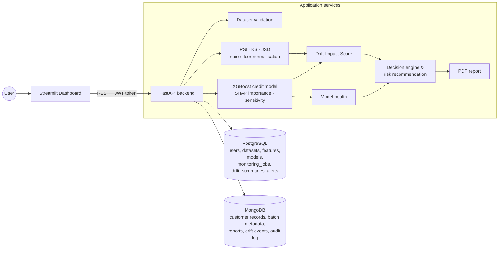
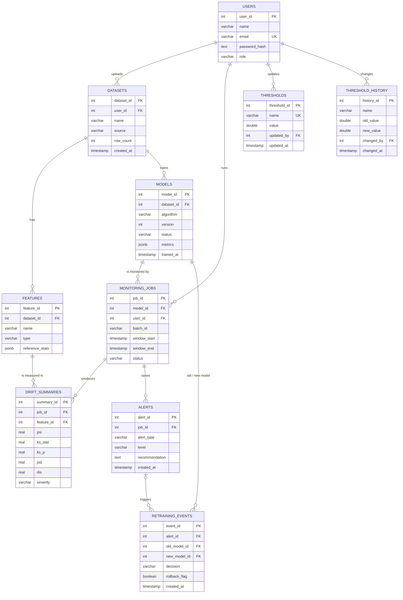
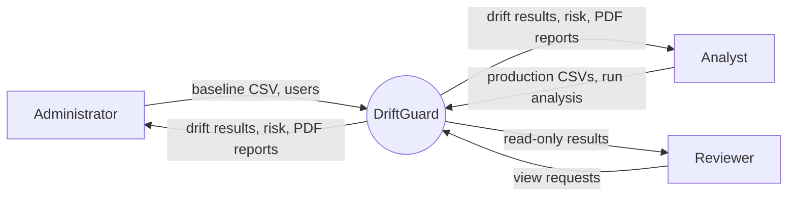
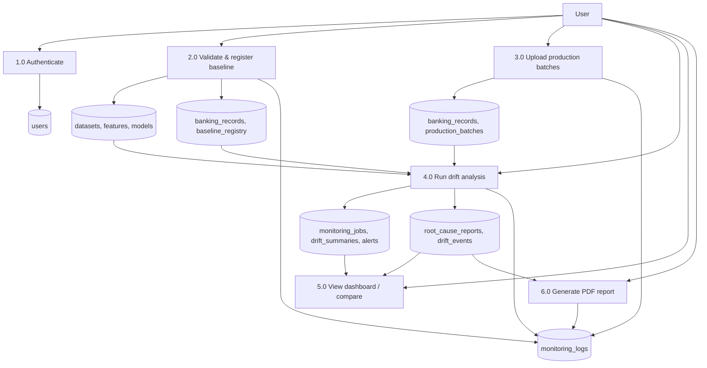
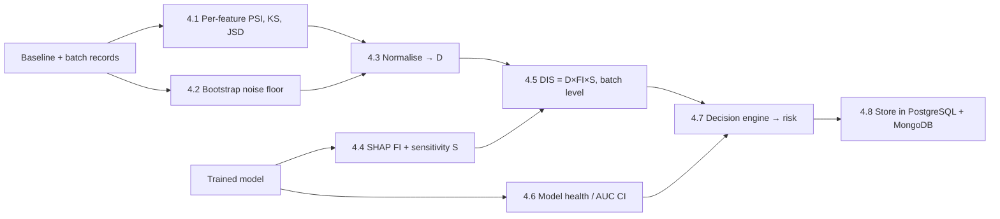

# DriftGuard
## Banking Customer Data & Credit-Model Drift Monitoring System

**Project Report — Database Management Systems (DBMS) Lab Project**

| | |
|---|---|
| **Project title** | DriftGuard – Banking Customer Data & Model Drift Monitoring System |
| **Domain** | Banking / Credit Risk, Machine-Learning Model Monitoring |
| **Databases used** | PostgreSQL 15 (relational) + MongoDB 6 (document / NoSQL) |
| **Languages & frameworks** | Python 3.11, FastAPI, Streamlit, SQLAlchemy, PyMongo, scikit-learn, XGBoost, SHAP |
| **Submitted by** | _(Student name / Roll number)_ |
| **Submitted to** | _(Teacher name)_ |
| **Date** | November 2026 |

---

## Table of Contents

1. [Abstract](#1-abstract)
2. [Introduction](#2-introduction)
3. [Problem Statement](#3-problem-statement)
4. [Objectives](#4-objectives)
5. [Scope of the Project](#5-scope-of-the-project)
6. [Background Concepts](#6-background-concepts)
7. [Requirement Specification](#7-requirement-specification)
8. [System Architecture](#8-system-architecture)
9. [Technology Stack](#9-technology-stack)
10. [Project Structure (Modules)](#10-project-structure-modules)
11. [Database Design](#11-database-design)
12. [Normalization](#12-normalization)
13. [Sample SQL and NoSQL Queries](#13-sample-sql-and-nosql-queries)
14. [Data Flow Diagrams](#14-data-flow-diagrams)
15. [Dataset Format and Validation](#15-dataset-format-and-validation)
16. [Drift Detection Methodology](#16-drift-detection-methodology)
17. [Credit-Risk Model and Drift Impact Score](#17-credit-risk-model-and-drift-impact-score)
18. [Risk Assessment and Decision Engine](#18-risk-assessment-and-decision-engine)
19. [Security](#19-security)
20. [REST API](#20-rest-api)
21. [User Interface (Dashboard)](#21-user-interface-dashboard)
22. [Results on the Sample Data](#22-results-on-the-sample-data)
23. [Testing](#23-testing)
24. [Installation and Running](#24-installation-and-running)
25. [Limitations](#25-limitations)
26. [Future Enhancements](#26-future-enhancements)
27. [Conclusion](#27-conclusion)
28. [References](#28-references)
29. [Glossary](#29-glossary)

---

## 1. Abstract

Banks use machine-learning models to decide whether a loan applicant is likely to default. Such a model learns from historical customers. Over time the customers applying for loans change: incomes rise with inflation, credit scores fall during an economic slowdown, debt levels grow. When today's applicants no longer look like the customers the model was trained on, the model's predictions may become unreliable. This problem is called **data drift**.

**DriftGuard** is a full-stack system that monitors this drift. A bank registers its **2020 historical customer data** (the *baseline*) and then uploads **2026 production customer batches**. For every batch DriftGuard:

1. measures how much each financial attribute has changed using three statistical tests — **Population Stability Index (PSI)**, **Kolmogorov–Smirnov (KS) test** and **Jensen–Shannon Divergence (JSD)**;
2. weighs that change by how much the credit model actually depends on the attribute, giving a **Drift Impact Score (DIS)**;
3. checks the model's real accuracy when actual loan outcomes are available;
4. assigns a risk category (**LOW / MEDIUM / HIGH / CRITICAL**) with recommended actions;
5. stores everything in a **hybrid database** — PostgreSQL for structured, relational data and MongoDB for large, flexible documents — and generates a PDF report.

From a DBMS point of view the project demonstrates ER modelling, a normalized relational schema with primary/foreign keys, unique and check constraints, indexes (including a partial unique index), a document database with indexes, coordinated writes across the two databases with rollback, role-based access, and an audit log. The system has **66 automated tests, all passing**.

---

## 2. Introduction

### 2.1 What is a credit-risk model?
When a customer applies for a loan, the bank must estimate the probability that the customer will fail to repay (**default**). A credit-risk model takes attributes such as monthly income, credit score, existing loans and debt-to-income ratio and outputs a default probability. If the probability is above a threshold, the application is flagged as risky.

### 2.2 Why do models stop working?
A model is a summary of patterns in its training data. It assumes the future looks like the past. In reality:

- **Inflation** raises incomes and loan sizes, so a "high income" in 2020 is ordinary in 2026.
- **Economic stress** lowers credit scores and FD (fixed deposit) balances and raises debt.
- **Changes in the job market** shift the mix of salaried, self-employed and contract workers.

When the input distribution changes, the model is applied to customers unlike those it learned from. This is **data drift** (also called *covariate shift*). If additionally the relationship between attributes and default changes, it is **concept drift**.

### 2.3 What DriftGuard does
DriftGuard is a monitoring tool for the bank's credit risk team. It answers three questions for every new batch of customers:

1. **Has the customer population changed?** (statistical drift)
2. **Does the change matter for the model?** (Drift Impact Score)
3. **Has the model actually become worse?** (performance check with real outcomes)

It never changes the model or the loan policy by itself; it gives evidence and recommendations to humans.

---

## 3. Problem Statement

> A bank trained its loan-default model on 2020 customer data. By 2026 incomes, credit scores, credit limits, outstanding loans, FD balances and debt-to-income ratios have shifted. The bank needs a system that stores historical and current customer data, detects which attributes have drifted and by how much, judges which drifts are dangerous for the model, confirms real performance when loan outcomes arrive, and keeps a complete, auditable record of every analysis.

Problems with the usual approach:

- **Simple threshold alerts** (for example "PSI > 0.25") fire on every changed attribute, even ones the model barely uses, causing alert fatigue.
- Different statistics (PSI, KS, JSD) are on **different scales** and cannot be compared directly.
- On small batches, random sampling noise alone produces non-zero drift values, causing **false alarms**.
- Drift results, model metrics and decisions are often kept in spreadsheets with **no audit trail**.

---

## 4. Objectives

1. Design a **hybrid database** (PostgreSQL + MongoDB) that stores datasets, features, models, monitoring jobs, drift results, alerts, users, customer records, reports and audit logs.
2. Validate uploaded CSV files and reject or warn about bad data.
3. Compute **PSI, KS and JSD** for every monitored attribute.
4. Remove sampling noise with a **bootstrap noise floor** and put all three statistics on a common 0–1 scale.
5. Train a baseline **XGBoost** credit model and compute **SHAP feature importance** and **permutation sensitivity**.
6. Compute the **Drift Impact Score** `DIS = D × FI × S` per attribute.
7. Evaluate model performance (accuracy, precision, recall, F1, ROC-AUC) when outcome labels exist.
8. Assign a **risk category** with explainable evidence using a documented decision table.
9. Provide a secure, role-based **dashboard** and a downloadable **PDF report**.
10. Keep an **audit log** of every upload, analysis and report.

---

## 5. Scope of the Project

**In scope**
- Upload of one historical baseline and many production batches (CSV).
- Feature-by-feature drift analysis, individual and combined (pooled) batches.
- Baseline credit model training, explanation and performance evaluation.
- Risk recommendation, PDF reports, audit trail.
- Synthetic demo data (clearly marked as synthetic).
- User accounts with three roles.

**Out of scope**
- Automatic retraining of the model or automatic changes to loan thresholds (deliberately left to humans).
- Real customer data (all bundled data is synthetic).
- Multivariate drift (drift is measured one attribute at a time).

---

## 6. Background Concepts

| Term | Meaning in this project |
|---|---|
| **Baseline / reference data** | The 2020 customer data the model was trained on. |
| **Production batch** | A set of 2026 customers (e.g. *March_2026*) to compare with the baseline. |
| **Feature / attribute** | A column such as `monthly_income` or `credit_score`. |
| **Distribution** | How the values of a feature are spread (e.g. how many customers earn 20k, 40k, 60k…). |
| **Drift** | A change in a feature's distribution between baseline and production. |
| **Label** | The real outcome `loan_default` (1 = defaulted, 0 = repaid). Known only months later. |
| **SHAP** | A method that says how much each feature contributed to a model's prediction. |
| **ROC-AUC** | A model quality score between 0.5 (random guessing) and 1.0 (perfect). |
| **Bootstrap** | Repeated random resampling to estimate how much a statistic varies by chance. |

---

## 7. Requirement Specification

### 7.1 Hardware requirements
- Any modern laptop/desktop (macOS or Linux), 8 GB RAM recommended, ~3 GB free disk (Docker images + Python packages).

### 7.2 Software requirements
- Python 3.11 or newer
- Docker Desktop (runs PostgreSQL 15 and MongoDB 6)
- bash and curl
- A web browser

### 7.3 Functional requirements

| ID | Requirement |
|---|---|
| FR1 | The first user must create an **administrator** account; afterwards only administrators can add users. |
| FR2 | Users log in with email and password and receive a time-limited token. |
| FR3 | An administrator can upload and register the **historical baseline** CSV. |
| FR4 | The system validates every CSV (columns, types, size, labels) and shows errors/warnings before saving. |
| FR5 | A baseline credit model is trained automatically if the baseline has labels. |
| FR6 | Analysts can upload **several production CSVs at once**; duplicates are detected. |
| FR7 | The user can run drift analysis on one batch, on several batches individually, or on the combined batches. |
| FR8 | The system computes PSI, KS, JSD, normalised drift D, FI, S and DIS for every feature. |
| FR9 | The system evaluates model performance on batches with ≥ 200 labelled outcomes. |
| FR10 | The system assigns a risk category and recommended actions with evidence. |
| FR11 | The user can compare a batch with the baseline or with another batch. |
| FR12 | The user can download a PDF monitoring report. |
| FR13 | Every upload, analysis and report generation is written to an audit log. |
| FR14 | An administrator can generate clearly flagged synthetic demo data. |

### 7.4 Non-functional requirements

| Category | Requirement |
|---|---|
| Security | Argon2 password hashing, JWT tokens (60 min), role checks on every endpoint, login rate limit 5/min. |
| Integrity | Primary/foreign keys, unique and check constraints; Mongo and PostgreSQL never disagree about a completed job. |
| Reliability | Database outages return a clean "503 database unavailable" error, never a crash or leaked SQL. |
| Performance | Upload limit 50 MB / 50,000 rows; noise floors cached; records inserted in chunks of 5,000. |
| Usability | One dashboard; one command to start (`./start.sh`) and stop (`./stop.sh`). |
| Honesty | Synthetic data is always flagged; missing results are shown as "Insufficient data", never invented. |
| Maintainability | All thresholds come from configuration (`.env`); code is linted (ruff) and formatted (black). |

---

## 8. System Architecture

DriftGuard has a **three-tier architecture**:

1. **Presentation tier** – a Streamlit web dashboard. It only displays data; it never computes statistics.
2. **Application tier** – a FastAPI backend that validates data, runs the drift analysis, trains and uses the model, applies the decision rules and builds reports.
3. **Data tier** – PostgreSQL (structured relational data) and MongoDB (large/flexible documents).



**How a request flows (example: "Run drift analysis on March_2026")**
1. The user clicks *Run drift analysis* in the dashboard.
2. The dashboard sends `POST /api/v1/analysis/run` with the user's token.
3. The API checks the token and the user's role.
4. It loads the baseline records and the batch records from MongoDB, and the trained model file.
5. It inserts a `monitoring_jobs` row in PostgreSQL with status `running`.
6. It computes all statistics, DIS, model health and the risk category.
7. It writes one `drift_summaries` row per feature and an `alerts` row (PostgreSQL), plus the full report and drift events (MongoDB), and commits. If the commit fails, the MongoDB documents are deleted again and the job is marked `failed`.
8. The dashboard shows the result.

---

## 9. Technology Stack

| Layer | Technology | Why it was chosen |
|---|---|---|
| Dashboard | **Streamlit**, **Plotly** | Quick interactive web UI in Python; interactive charts. |
| Backend API | **FastAPI**, Uvicorn, **Pydantic v2** | Fast, typed REST API with automatic request validation. |
| Relational DB | **PostgreSQL 15**, SQLAlchemy 2, psycopg2 | ACID transactions, foreign keys, constraints, JSONB. |
| Document DB | **MongoDB 6**, PyMongo | Stores thousands of customer records and large nested reports flexibly. |
| Statistics | pandas, NumPy, **SciPy** | Data handling, KS test, Jensen–Shannon distance. |
| Machine learning | **scikit-learn**, **XGBoost**, **SHAP** | Pipeline, gradient-boosted trees, feature attribution. |
| Reports | **ReportLab** | Generates PDF files with tables and charts. |
| Security | **Argon2**, **PyJWT**, slowapi | Password hashing, tokens, login rate limiting. |
| Infrastructure | **Docker Compose** | Runs both databases with one command. |
| Quality | pytest, mongomock, ruff, black | Automated tests, linting, formatting. |

---

## 10. Project Structure (Modules)

```
DriftGuard/
├── start.sh / stop.sh           One-command start and stop
├── docker-compose.yml           PostgreSQL + MongoDB containers
├── .env.example                 Configuration template
├── db/
│   ├── init.sql                 PostgreSQL schema (tables, constraints, indexes)
│   └── mongo_init.js            MongoDB collections and indexes
├── app/                         FastAPI backend
│   ├── main.py                  App creation, error handlers, /health
│   ├── api/auth.py              Register, login, current user
│   ├── api/banking.py           Datasets, batches, analysis, reports, audit, demo data
│   ├── core/                    Config, JWT + roles, logging, rate limiter
│   ├── database/                PostgreSQL engine, MongoDB client, ORM models
│   ├── schemas/                 Request validation models
│   └── services/
│       ├── datasets.py          CSV schema, cleaning, validation
│       ├── drift/               psi.py, ks.py, jsd.py, normalise.py, calibration.py
│       ├── explain/dis.py       Drift Impact Score
│       ├── monitoring/          analysis.py (pipeline), model.py (XGBoost), store.py (persistence)
│       ├── recommendations/     decision.py (decision table), risk.py (risk category)
│       ├── reports.py           PDF report
│       └── synthetic_data.py    Demo scenarios A–D
├── frontend/                    Streamlit dashboard
│   ├── dashboard.py             Sign-in and navigation
│   ├── api_client.py            Calls to the backend
│   ├── components.py            Shared styling, KPI cards, chart helpers
│   └── sections/                One file per screen (A–H)
├── data/                        Sample synthetic CSVs (baseline_2020 + four 2026 batches)
├── scripts/generate_sample_data.py
├── tests/                       Automated tests (66)
└── docs/                        Design decisions and course deliverables
```

### Module descriptions

| Module | Responsibility |
|---|---|
| `app/main.py` | Creates the FastAPI app, registers routers under `/api/v1`, converts every error into a uniform `{"detail", "code"}` body, maps database outages to HTTP 503, and exposes `/health` (reports whether each database is reachable). |
| `app/core/config.py` | All settings (database URLs, upload limits, every threshold) read from `.env`. Refuses to start outside development with a weak `SECRET_KEY`. |
| `app/core/security.py` | Argon2 hashing, JWT creation/verification, `require_roles(...)` dependency. |
| `app/services/datasets.py` | Column normalisation, required-column checks, type parsing, plausibility ranges, label checks. |
| `app/services/drift/` | Statistical detectors and the bootstrap noise floor. |
| `app/services/monitoring/model.py` | Train XGBoost, choose threshold, SHAP importance, permutation sensitivity, bootstrap AUC. |
| `app/services/monitoring/analysis.py` | The end-to-end analysis pipeline for one comparison. |
| `app/services/monitoring/store.py` | All reads/writes to PostgreSQL and MongoDB, content hashing, audit logging. |
| `app/services/recommendations/` | Decision table and mapping to banking risk categories. |
| `app/services/reports.py` | 11-section PDF committee report. |
| `frontend/` | Dashboard screens; talks to the backend only through `api_client.py`. |

---

## 11. Database Design

### 11.1 Why two databases (hybrid design)?

| Data | Characteristics | Best store |
|---|---|---|
| Users, datasets, features, models, jobs, drift summaries, alerts | Small, structured, strongly related, need integrity (FKs, uniqueness) and SQL joins | **PostgreSQL** |
| Customer records (thousands per batch), full analysis reports with nested histograms, per-feature drift events, audit log | Large volume, nested/variable structure, append-heavy, mostly read by key | **MongoDB** |

The two databases are linked by **shared identifiers**: `job_id` (PostgreSQL `monitoring_jobs`) appears in MongoDB `root_cause_reports` and `drift_events`; `dataset_id` appears in `baseline_registry`; `batch_id` appears in both `monitoring_jobs` and `production_batches`.

### 11.2 Entity–Relationship diagram (PostgreSQL)



### 11.3 Entities and relationships explained

| Relationship | Cardinality | Meaning |
|---|---|---|
| users → datasets | 1 : N | A user uploads many datasets (baselines). |
| users → monitoring_jobs | 1 : N | A user runs many analyses. |
| datasets → features | 1 : N | A baseline has 12 monitored features. |
| datasets → models | 1 : N | A baseline can have several model versions. |
| models → monitoring_jobs | 1 : N | Each analysis is done against one model. |
| monitoring_jobs → drift_summaries | 1 : N | One row per feature per analysis. |
| features → drift_summaries | 1 : N | A feature is measured in many analyses. |
| monitoring_jobs ↔ features | **M : N** (resolved by `drift_summaries`) | `drift_summaries` is the associative entity. |
| monitoring_jobs → alerts | 1 : N | An analysis may raise an alert. |
| alerts → retraining_events | 1 : N (optional) | Optional link from an alert to the retraining it triggered (champion–challenger workflow). |

### 11.4 Relational schema (from `db/init.sql`)

**users** (`user_id` PK, `name`, `email` UNIQUE, `password_hash`, `role` CHECK IN ('analyst','administrator','reviewer'))

**datasets** (`dataset_id` PK, `user_id` FK→users, `name`, `source`, `row_count` CHECK ≥ 0, `created_at`, UNIQUE(`user_id`,`name`))

**features** (`feature_id` PK, `dataset_id` FK→datasets ON DELETE CASCADE, `name`, `type` CHECK IN ('numerical','categorical'), `reference_stats` JSONB, UNIQUE(`dataset_id`,`name`))

**models** (`model_id` PK, `dataset_id` FK→datasets, `algorithm`, `version`, `status` CHECK IN ('champion','challenger','retired'), `metrics` JSONB, `trained_at`, UNIQUE(`dataset_id`,`algorithm`,`version`))

**monitoring_jobs** (`job_id` PK, `model_id` FK→models, `user_id` FK→users, `batch_id`, `window_start`, `window_end`, `status`, CHECK(`window_end` ≥ `window_start`))

**drift_summaries** (`summary_id` PK, `job_id` FK→monitoring_jobs ON DELETE CASCADE, `feature_id` FK→features, `psi`, `ks_stat`, `ks_p`, `jsd`, `dis`, `severity` CHECK IN ('low','moderate','high'), UNIQUE(`job_id`,`feature_id`))

**alerts** (`alert_id` PK, `job_id` FK→monitoring_jobs, `alert_type` CHECK IN ('drift-warning','confirmed-degradation'), `level`, `recommendation`, `created_at`)

**retraining_events** (`event_id` PK, `alert_id` FK→alerts, `old_model_id` FK→models, `new_model_id` FK→models, `decision` CHECK IN ('pending','deployed','rejected','rolled_back'), `rollback_flag`, `created_at`, CHECK(`old_model_id` <> `new_model_id`))

**thresholds** (`threshold_id` PK, `name` UNIQUE, `value`, `updated_by` FK→users, `updated_at`)

**threshold_history** (`history_id` PK, `name`, `old_value`, `new_value`, `changed_by` FK→users, `changed_at`)

> **Note:** `retraining_events`, `thresholds` and `threshold_history` are part of the designed schema for future features (controlled retraining and editable thresholds). The current application does not write to them; thresholds are read from configuration.

### 11.5 Constraints used (integrity rules)

| Constraint type | Examples | Purpose |
|---|---|---|
| **Primary key** | every `*_id SERIAL PRIMARY KEY` | Unique row identity. |
| **Foreign key** | `drift_summaries.job_id → monitoring_jobs` | Referential integrity: no orphan results. |
| **ON DELETE CASCADE** | features, drift_summaries | Deleting a dataset/job removes its dependent rows. |
| **UNIQUE** | `users.email`; (`job_id`,`feature_id`); (`dataset_id`,`algorithm`,`version`) | No duplicate users, no duplicate result per feature per job, no duplicate model version. |
| **CHECK (domain)** | `role IN (...)`, `severity IN (...)`, `row_count >= 0` | Only valid values can be stored. |
| **CHECK (row-level)** | `window_end >= window_start`, `old_model_id <> new_model_id` | Business rules across columns. |
| **NOT NULL** | names, roles, statuses | Mandatory data. |

### 11.6 Indexes

| Index | On | Why |
|---|---|---|
| `drift_summaries_job_id` | `drift_summaries(job_id)` | Fetch all feature results of one job fast. |
| `monitoring_jobs_model_window` | `monitoring_jobs(model_id, window_start)` | Time-ordered history per model. |
| `alerts_job_created` | `alerts(job_id, created_at)` | Alerts of a job in time order. |
| `one_champion_per_dataset` | **partial unique index** on `models(dataset_id) WHERE status='champion'` | Guarantees at most one active (champion) model per dataset — a business rule enforced by the database itself. |

### 11.7 MongoDB collections

| Collection | One document per | Key fields | Indexes |
|---|---|---|---|
| `banking_records` | customer row | `owner` (`baseline:<id>` or `batch:<id>`), all 13 attributes, `loan_default` | `owner` |
| `baseline_registry` | registered baseline | `dataset_id`, `content_sha256`, file name, row count, validation summary, synthetic flag | `dataset_id` (unique), `content_sha256` |
| `production_batches` | production batch | `batch_id`, batch date, row/label counts, `content_sha256`, processing history, `latest_job_id` | `batch_id` (unique), `content_sha256` |
| `root_cause_reports` | completed analysis | `job_id`, full report: every feature's statistics, histograms, model health, risk, evidence | `job_id` (unique), (`batch_id`, `analysed_at` desc) |
| `drift_events` | feature per analysis | `job_id`, `feature`, PSI/KS/JSD, floors, normalised values, D, DIS, severity, histogram | (`job_id`, `feature`) |
| `monitoring_logs` | audit event | `timestamp`, `event`, `level`, user id/email/role, details | `timestamp` desc |

**Design choices**
- Customer records are stored **one document per row** (not one big document per batch) to stay well below MongoDB's 16 MB document limit and to allow inserts in chunks of 5,000.
- The **SHA-256 hash** of each file's cleaned content is stored and indexed, so identical files uploaded under a different name are detected.

### 11.8 Transactions and consistency across the two databases

A single analysis writes to both databases. `store.complete_job()` keeps them consistent:

1. Add `drift_summaries` and `alerts` rows to the open PostgreSQL transaction (not yet committed).
2. Write the report and drift events to MongoDB.
3. **Commit** PostgreSQL.
4. If the commit fails → **rollback** PostgreSQL **and delete** the MongoDB report and events for that `job_id`, then mark the job `failed`.

So a job is either fully stored in both databases or recorded as failed — the two stores never disagree. This is tested in `test_database_failure_marks_job_failed`.

PostgreSQL `REAL` columns hold 4-byte floats, so tiny values (for example a KS p-value of 1e-300) are clamped to the REAL range in `drift_summaries`; the full-precision value stays in the MongoDB report.

---

## 12. Normalization

Starting point — an **unnormalised** record as an analyst might keep it in a spreadsheet:

| job | analyst_email | analyst_role | batch | model | dataset | features (psi, ks, jsd, dis…) | alert |
|---|---|---|---|---|---|---|---|
| 7 | a@bank.com | analyst | March_2026 | xgboost v1 | baseline_2020 | {income: 0.36, 0.24 …}, {credit_limit: 0.21 …}, … | drift-warning |

**1NF – atomic values, no repeating groups.**
The repeating group "features" is split so each row holds one feature's values:
`(job_id, feature_name, analyst_email, analyst_role, batch_id, model_name, dataset_name, psi, ks_stat, ks_p, jsd, dis, severity, alert_type)`, key = (`job_id`, `feature_name`).

**2NF – no partial dependency on part of the key.**
Attributes depending only on `job_id` (analyst, batch, model, alert) are moved out:
- `MONITORING_JOBS(job_id, user_id, model_id, batch_id, window_start, window_end, status)`
- `DRIFT_SUMMARIES(job_id, feature_id, psi, ks_stat, ks_p, jsd, dis, severity)`
- `FEATURES(feature_id, dataset_id, name, type, reference_stats)`
- `ALERTS(alert_id, job_id, alert_type, level, recommendation)`

**3NF – no transitive dependency.**
In jobs, `user_id → analyst_email, analyst_role`, and `model_id → dataset_id → dataset_name`. These are moved to their own tables:
- `USERS(user_id, name, email, password_hash, role)`
- `MODELS(model_id, dataset_id, algorithm, version, status, metrics)`
- `DATASETS(dataset_id, user_id, name, source, row_count)`

**BCNF – every determinant is a candidate key.**
Check the non-trivial functional dependencies:
- `users`: `user_id → all`, `email → all` — both are keys (`email` is UNIQUE). ✔
- `features`: `feature_id → all`, (`dataset_id`,`name`) → all — both keys. ✔
- `models`: `model_id → all`, (`dataset_id`,`algorithm`,`version`) → all — both keys. ✔
- `drift_summaries`: `summary_id → all`, (`job_id`,`feature_id`) → all — both keys. ✔

All determinants are candidate keys, so the relational schema is in **BCNF**.

*JSONB columns* (`reference_stats`, `metrics`) store a self-contained profile/metric set that is always read and written as a whole and is never queried by part to identify rows; this is a deliberate, documented denormalisation for flexibility.

---

## 13. Sample SQL and NoSQL Queries

These queries run against the actual schema.

### 13.1 SQL (PostgreSQL)

**Q1. All analyses with the user who ran them and their alert (3-table join)**
```sql
SELECT j.job_id, j.batch_id, u.name AS analyst, j.status,
       a.alert_type, a.level
FROM monitoring_jobs j
JOIN users u        ON u.user_id = j.user_id
LEFT JOIN alerts a  ON a.job_id  = j.job_id
ORDER BY j.window_start;
```

**Q2. Feature results of one analysis, highest DIS first**
```sql
SELECT f.name, d.psi, d.ks_stat, d.jsd, d.dis, d.severity
FROM drift_summaries d
JOIN features f ON f.feature_id = d.feature_id
WHERE d.job_id = 3
ORDER BY d.dis DESC;
```

**Q3. How often each feature drifted (aggregation + GROUP BY + HAVING)**
```sql
SELECT f.name,
       COUNT(*)                                   AS analyses,
       SUM(CASE WHEN d.severity <> 'low' THEN 1 ELSE 0 END) AS times_drifted,
       ROUND(AVG(d.dis)::numeric, 3)              AS avg_dis
FROM drift_summaries d
JOIN features f ON f.feature_id = d.feature_id
GROUP BY f.name
HAVING SUM(CASE WHEN d.severity <> 'low' THEN 1 ELSE 0 END) > 0
ORDER BY avg_dis DESC;
```

**Q4. Batches whose maximum DIS is high (subquery)**
```sql
SELECT j.batch_id, MAX(d.dis) AS overall_dis
FROM monitoring_jobs j
JOIN drift_summaries d ON d.job_id = j.job_id
GROUP BY j.batch_id
HAVING MAX(d.dis) >= 0.25;
```

**Q5. The champion model and its holdout AUC (JSONB access)**
```sql
SELECT m.model_id, ds.name AS baseline, m.algorithm, m.version,
       (m.metrics->>'roc_auc')::float AS holdout_auc
FROM models m
JOIN datasets ds ON ds.dataset_id = m.dataset_id
WHERE m.status = 'champion';
```

**Q6. Reference mean income stored in the feature profile**
```sql
SELECT name, reference_stats->>'mean' AS reference_mean
FROM features
WHERE name = 'monthly_income';
```

**Q7. Number of analyses per user role**
```sql
SELECT u.role, COUNT(j.job_id) AS jobs
FROM users u LEFT JOIN monitoring_jobs j ON j.user_id = u.user_id
GROUP BY u.role;
```

**Q8. Constraint demonstration – this insert is rejected**
```sql
INSERT INTO drift_summaries (job_id, feature_id, severity)
VALUES (1, 1, 'extreme');   -- ERROR: violates check constraint (severity)
```

### 13.2 NoSQL (MongoDB)

```javascript
// N1. Number of customer records in a batch
db.banking_records.countDocuments({ owner: "batch:March_2026" })

// N2. Average monthly income and credit score per batch (aggregation pipeline)
db.banking_records.aggregate([
  { $group: { _id: "$owner",
              avg_income: { $avg: "$monthly_income" },
              avg_score:  { $avg: "$credit_score" },
              customers:  { $sum: 1 } } },
  { $sort: { _id: 1 } }
])

// N3. Latest report for a batch (uses the batch_id + analysed_at index)
db.root_cause_reports.find({ batch_id: "June_2026" })
  .sort({ analysed_at: -1 }).limit(1)

// N4. All features with significant drift in one job
db.drift_events.find({ job_id: 3, severity: "high" },
                     { feature: 1, psi: 1, dis: 1, _id: 0 })

// N5. Detect duplicate uploads by content hash
db.production_batches.find({ content_sha256: "<sha256>" }, { batch_id: 1 })

// N6. Last 20 audit events
db.monitoring_logs.find().sort({ timestamp: -1 }).limit(20)

// N7. Count audit events by type
db.monitoring_logs.aggregate([{ $group: { _id: "$event", n: { $sum: 1 } } }])
```

---

## 14. Data Flow Diagrams

### 14.1 Level 0 (context diagram)



### 14.2 Level 1



### 14.3 Level 2 – process 4.0 "Run drift analysis"



---

## 15. Dataset Format and Validation

### 15.1 Columns

| Column | Type | Description |
|---|---|---|
| `customer_id` | text | Identifier (not used for drift) |
| `age` | number | Years |
| `monthly_income` | number | Monthly income |
| `employment_type` | category | salaried, self-employed, contract, unemployed |
| `credit_score` | number | 300–900 |
| `credit_limit` | number | Credit card limit |
| `outstanding_loan_amount` | number | Current unpaid loans |
| `fd_balance` | number | Fixed-deposit balance |
| `debt_to_income` | ratio | Monthly debt ÷ monthly income |
| `loan_amount_requested` | number | Requested loan |
| `loan_tenure` | number | Months |
| `number_of_existing_loans` | number | Count |
| `interest_rate` | number | e.g. 0.12 |
| `loan_default` | 0 / 1 / blank | Optional outcome label |

Column names are matched case-insensitively; spaces and dashes become underscores (`Monthly Income` → `monthly_income`).

### 15.2 Validation rules

**File rejected when:** not a `.csv` or empty; larger than 50 MB or 50,000 rows; a required column is missing; fewer than 30 records; more than 5% non-numeric values in a numeric column; `loan_default` contains anything other than 0, 1 or blank.

**Warnings only (file accepted):** missing values; up to 5% non-numeric or infinite values (treated as missing); values outside plausible ranges (e.g. credit score outside 300–900, age outside 18–100); duplicate customer IDs; unknown employment types; extra unrecognised columns (ignored).

**Duplicate protection:** re-using an existing batch ID, or uploading byte-identical content under another ID (detected by SHA-256), is rejected unless *overwrite* / *allow duplicate content* is ticked. Re-analysing identical inputs returns the stored report unless *force* is set.

Values are never silently "fixed" — problems are reported to the user.

---

## 16. Drift Detection Methodology

For each of the 12 monitored attributes, the production batch is compared with the baseline. Missing/infinite values are excluded per attribute; an attribute with fewer than 30 usable values is reported as **"Insufficient data"** instead of producing a fake number.

### 16.1 Population Stability Index (PSI)

The baseline is divided into **10 bins** using its deciles (each bin holds ~10% of baseline customers). The outer bins are open-ended so production values outside the baseline range are not lost.

$$PSI = \sum_{i=1}^{10} (p_i - q_i)\,\ln\frac{p_i}{q_i}$$

where $p_i$ = share of production customers in bin *i*, $q_i$ = share of baseline customers in bin *i*. Shares are floored at 0.0001 to avoid `ln(0)`.

For the categorical attribute (`employment_type`) there is one bin per category plus an **"unseen"** bin for new categories.

*Worked example (2 bins):* baseline 50% / 50%, production 70% / 30%
PSI = (0.7 − 0.5)·ln(0.7/0.5) + (0.3 − 0.5)·ln(0.3/0.5) = 0.2·0.336 + (−0.2)·(−0.511) = 0.067 + 0.102 = **0.169**.

Common rule of thumb: PSI < 0.1 stable, 0.1–0.25 moderate, > 0.25 significant.

### 16.2 Kolmogorov–Smirnov (KS) test

Compares the two cumulative distribution functions; the **statistic** is the largest vertical gap between them (0 = same, 1 = completely separate). It also gives a **p-value** — the probability of seeing such a gap if there were no real change. Used for numerical attributes only (SciPy `ks_2samp`).

### 16.3 Jensen–Shannon Divergence (JSD)

A symmetric measure of difference between two probability distributions, computed on the same bins as PSI. DriftGuard uses the squared base-2 Jensen–Shannon distance, so 0 = identical and 1 = completely disjoint.

### 16.4 Removing sampling noise – bootstrap noise floor

Even two random samples from the *same* population give PSI/KS/JSD above zero, and the smaller the batch, the larger this noise. To avoid false alarms:

1. Draw two random samples of the batch's size **from the baseline alone** (so there is no real drift).
2. Compute PSI, KS, JSD between them.
3. Repeat **200 times**.
4. The **95th percentile** of each statistic is its *noise floor*.

Floors are cached per (baseline, feature, batch-size bucket) so the work is done once.

### 16.5 Normalised drift D

The three statistics have different scales, so each is mapped onto [0, 1]:

$$D_n = \text{clip}\left(\frac{value - floor}{cap - floor},\ 0,\ 1\right)$$

with caps 0.5 (PSI), 0.5 (KS), 0.3 (JSD). The feature's drift is the largest of the three:

$$D = \max(D_{PSI},\ D_{KS},\ D_{JSD})$$

| D | Drift status |
|---|---|
| D < 0.15 | **Stable** |
| 0.15 ≤ D < 0.50 | **Moderate Drift** |
| D ≥ 0.50 | **Significant Drift** |

For comparison, DriftGuard also shows **conventional alerts** (PSI > 0.25 or KS p < 0.01 or JSD > 0.1). These are displayed but not used for the decision.

---

## 17. Credit-Risk Model and Drift Impact Score

### 17.1 Baseline credit model
- **Algorithm:** XGBoost classifier (250 trees, depth 4, learning rate 0.05) inside a scikit-learn pipeline.
- **Preprocessing:** median imputation for numbers; most-frequent imputation and one-hot encoding for employment type.
- **Class imbalance:** `scale_pos_weight` = non-defaults ÷ defaults.
- **Split:** 75% training / **25% stratified holdout**; reported baseline metrics come from the holdout (honest estimate).
- **Decision threshold:** chosen to maximise F1 on the training split.
- Requires at least 100 labelled baseline records with both outcomes; otherwise no model is trained and DIS falls back to drift only.
- Saved to `artifacts/` and **never retrained automatically**.

### 17.2 Feature importance FI (SHAP)
For each feature, the mean absolute SHAP value of the model on the production batch (up to 2,000 sampled rows). One-hot columns are summed back to `employment_type`. Values are divided by the largest one, so the most important feature has FI = 1.

### 17.3 Sensitivity S (permutation)
Each feature is randomly shuffled within the batch (5 repeats) and the mean absolute change in predicted default probability is measured. Divided by the largest value, so S ∈ [0, 1].

### 17.4 Drift Impact Score

$$DIS_i = D_i \times FI_i \times S_i \qquad\qquad \text{Overall DIS} = \max_i DIS_i$$

DIS is high **only when a feature has drifted AND the model relies on it AND the model's output is sensitive to it**. A feature that drifted but that the model ignores gets a low DIS, which reduces unnecessary alerts.

*Worked example (real result, March 2026, Monthly Income):* D = 0.70, FI = 0.53, S = 0.55 → DIS = 0.70 × 0.53 × 0.55 ≈ **0.20**.

| Overall DIS | Batch drift level |
|---|---|
| < 0.05 | **low** |
| 0.05 – 0.25 | **moderate** |
| ≥ 0.25 | **high** |

DIS is a **proposed** prioritisation score developed in this project, not an industry standard; its thresholds are configurable starting values. For research comparison the system also computes alternative variants (D only, D×FI, weighted sum, rank-based).

### 17.5 Model performance (model health)
If a batch has **at least 200 labelled outcomes**, DriftGuard computes accuracy, precision, recall, F1, ROC-AUC and the confusion matrix, and a **95% bootstrap confidence interval** of the batch AUC (200 resamples):

| State | Rule (upper CI bound vs baseline AUC) |
|---|---|
| **stable** | upper ≥ baseline − 0.02 |
| **degraded** | upper < baseline − 0.02 |
| **severe** | upper < baseline − 0.05 |
| **unknown** | not enough labels |

Using the *upper* bound means degradation is declared only when even the optimistic estimate is clearly worse.

---

## 18. Risk Assessment and Decision Engine

The batch drift level and the performance state are combined by a fixed, documented decision table (`app/services/recommendations/`):

| Risk category | When | Recommended actions |
|---|---|---|
| **LOW** | drift level low | Distributions stable; continue monitoring. |
| **MEDIUM** | drift level moderate | Increase monitoring frequency; investigate affected features. |
| **HIGH** | drift level high, **or** degradation confirmed without strong drift (possible concept drift) | Review credit thresholds; evaluate the model on recent applications; notify the risk committee. |
| **CRITICAL** | degradation **confirmed by labels** together with moderate/high drift, **or** a severe drop | Urgent model review and controlled retraining evaluation; notify the committee immediately. |

Key principles:
- **Drift alone never exceeds HIGH.** CRITICAL needs real outcome evidence, because drift does not prove the model is wrong.
- If labels are missing, the recommendation asks for at least 200 labelled outcomes.
- Each recommendation lists its **evidence**: top-3 features with D, FI, S and detector values, and the AUC change when labels exist.
- DriftGuard **never** retrains the model or changes loan thresholds automatically.

Alert types stored in PostgreSQL: `drift-warning` (drift without confirmed degradation) and `confirmed-degradation`.

---

## 19. Security

| Measure | Implementation |
|---|---|
| Password storage | **Argon2** hashing (winner of the Password Hashing Competition); plain passwords never stored. |
| Password policy | 8–128 characters, at least one letter and one digit. |
| Authentication | **JWT** (HS256) signed with `SECRET_KEY`, expires after 60 minutes. |
| Authorisation | Role-based access control on every endpoint (table below). |
| First-user bootstrap | The first account must be an administrator; afterwards only administrators can create users. |
| Brute-force protection | Login limited to **5 attempts per minute** per IP (HTTP 429). |
| Input validation | Pydantic models for every request; file size/row limits; CSV validation. |
| SQL injection | All SQL goes through SQLAlchemy ORM with bound parameters. |
| Error handling | Uniform `{"detail", "code"}` errors; database outages → 503 without leaking SQL or internals. |
| Secrets | `.env` is git-ignored; `start.sh` generates a random key; startup fails outside dev with a weak key. |
| Audit trail | Every upload, analysis and report is logged in `monitoring_logs` with user and timestamp. |

**Roles**

| Action | Administrator | Analyst | Reviewer |
|---|:-:|:-:|:-:|
| View dashboards, reports | ✔ | ✔ | ✔ |
| Upload production batches, run analyses | ✔ | ✔ | ✘ |
| Register the baseline, seed demo data, create users | ✔ | ✘ | ✘ |

---

## 20. REST API

All endpoints are under `/api/v1` and (except register/login/status) need a bearer token.

| Method | Endpoint | Role | Purpose |
|---|---|---|---|
| GET | `/auth/status` | public | Whether any user exists |
| POST | `/auth/register` | first user / admin | Create a user |
| POST | `/auth/login` | public (rate-limited) | Get a JWT |
| GET | `/auth/me` | any | Current user |
| POST | `/datasets/validate` | write | Validate a CSV without saving |
| POST | `/datasets/baseline` | admin | Register baseline and train model |
| GET | `/datasets/baseline` | read | Current baseline summary |
| POST | `/batches/upload` | write | Upload one or more production CSVs |
| GET | `/batches`, `/batches/{id}` | read | List / view batches |
| POST | `/analysis/run` | write | Analyse selected batches (individual or combined) |
| POST | `/analysis/run-all` | write | Analyse every batch |
| GET | `/analysis/history` | read | All completed analyses |
| GET | `/analysis/latest/{batch_id}` | read | Latest analysis of a batch |
| GET | `/analysis/{job_id}` | read | Full report |
| GET | `/analysis/{job_id}/features/{feature}` | read | One feature's details |
| GET | `/recommendations/{job_id}` | read | Risk category and actions |
| GET | `/overview` | read | Dashboard KPIs and trends |
| GET | `/model-health` | read | Baseline vs production metrics |
| GET | `/compare` | read | Batch vs baseline / batch vs batch |
| GET | `/reports/{job_id}/pdf` | read | Download the PDF report |
| GET | `/audit-logs` | read | Audit trail |
| GET | `/simulation/scenarios` | read | Demo scenarios |
| POST | `/simulation/generate-batch`, `/generate-baseline`, `/seed-demo` | admin | Synthetic demo data |
| GET | `/health` | public | API + database status |

---

## 21. User Interface (Dashboard)

The Streamlit dashboard (http://localhost:8501) has a sign-in page and eight sections in the sidebar:

| Section | What it shows / does |
|---|---|
| **A. Overview** | KPI cards: customers monitored, batches, features, drifted features, overall DIS, risk status; trend charts. |
| **B. Dataset Management** | Upload & validate the baseline; upload several production CSVs; preview, record counts, warnings; select batches and run analysis; seed synthetic demo data. |
| **C. Customer Drift Analysis** | Table of PSI, KS statistic, KS p-value, JSD and status per attribute; baseline-vs-production distribution charts for income, credit score, credit limit, FD balance, outstanding loans, DTI and more. |
| **D. Drift Impact Score** | Overall DIS, per-feature D / FI / S contributions, batch comparison and trend. |
| **E. Batch Monitoring** | All batches with status; batch vs baseline; batch vs batch; combined analysis; processing history and audit trail. |
| **F. Risk Recommendations** | Risk category, recommended actions and the evidence. |
| **G. Model Health** | Baseline vs production metrics, confusion matrices, predicted default distribution. |
| **H. Reports** | Generate and download the PDF report. |

The **PDF report** contains 11 sections: monitoring summary, baseline information, production batch information, record counts, feature-level PSI/KS/JSD, DIS chart, highest-risk features, model performance, risk assessment, recommended actions, and timestamp. Synthetic data is marked in the report.

**Typical workflow:** register baseline → upload batches → run analysis → inspect drift → review DIS → check recommendations and model health → download PDF.

---

## 22. Results on the Sample Data

The bundled synthetic data: a **2020 baseline of 2,500 customers** (default rate 20.6%) and four 2026 batches. These numbers come from running the project's analysis pipeline on these files.

### 22.1 Baseline model (25% holdout, 625 customers)

| Accuracy | Precision | Recall | F1 | ROC-AUC | Threshold |
|---|---|---|---|---|---|
| 0.760 | 0.390 | 0.305 | 0.342 | **0.664** | 0.59 |

The model is deliberately modest (synthetic data); what matters is how its relationship to the data is monitored.

### 22.2 Batch results

| Batch | Customers | Labels | Overall DIS | Drift level | Drifting features | Conventional alerts | Performance | **Risk** |
|---|---|---|---|---|---|---|---|---|
| January_2026 | 1,000 | 0 | 0.000 | low | 0 | 0 | unknown | **LOW** |
| March_2026 | 1,200 | 0 | 0.203 | moderate | 2 | 3 | unknown | **MEDIUM** |
| June_2026 | 1,500 | 0 | 1.000 | high | 5 | 5 | unknown | **HIGH** |
| September_2026 | 1,800 | 1,800 | 1.000 | high | 7 | 7 | stable | **HIGH** |

### 22.3 Top features per batch

**March 2026** (moderate income drift)

| Feature | PSI | KS | JSD | D | FI | S | DIS | Status |
|---|---|---|---|---|---|---|---|---|
| Monthly Income | 0.359 | 0.241 | 0.062 | 0.70 | 0.53 | 0.55 | 0.203 | Significant |
| Credit Limit | 0.207 | 0.190 | 0.037 | 0.38 | 0.31 | 0.41 | 0.048 | Moderate |
| Loan Amount Requested | 0.056 | 0.084 | 0.010 | 0.07 | 0.33 | 0.44 | 0.011 | Stable |

**June 2026** (severe credit-risk drift)

| Feature | PSI | KS | JSD | D | FI | S | DIS | Status |
|---|---|---|---|---|---|---|---|---|
| Debt-to-Income | 1.140 | 0.297 | 0.127 | 1.00 | 1.00 | 1.00 | 1.000 | Significant |
| Outstanding Loan Amount | 0.831 | 0.366 | 0.139 | 1.00 | 0.81 | 0.90 | 0.730 | Significant |
| Credit Score | 1.059 | 0.428 | 0.175 | 1.00 | 0.75 | 0.67 | 0.498 | Significant |
| FD Balance | 1.404 | 0.442 | 0.207 | 1.00 | 0.34 | 0.49 | 0.164 | Significant |

**September 2026** (multiple-feature drift, with outcome labels)

| Feature | PSI | KS | JSD | D | FI | S | DIS | Status |
|---|---|---|---|---|---|---|---|---|
| Debt-to-Income | 1.928 | 0.321 | 0.193 | 1.00 | 1.00 | 1.00 | 1.000 | Significant |
| Outstanding Loan Amount | 0.881 | 0.385 | 0.147 | 1.00 | 0.83 | 0.89 | 0.736 | Significant |
| Employment Type | 0.377 | — | 0.066 | 0.75 | 0.77 | 0.81 | 0.468 | Significant |
| Monthly Income | 0.580 | 0.299 | 0.099 | 1.00 | 0.59 | 0.73 | 0.431 | Significant |

Production AUC (September) = **0.686**, 95% CI [0.663, 0.711], baseline AUC 0.664 → state **stable**.

### 22.4 Observations
1. **January** is a stable batch: every value is below its noise floor, so D = 0 and no false alarm is raised.
2. **March**: the conventional rules flag 3 features, but DIS ranks only Monthly Income as important; Credit Limit drifted moderately yet has a low DIS because the model relies on it less (FI 0.31). This shows how DIS **prioritises** drift.
3. **June**: FD Balance has the largest PSI (1.40) but the lowest DIS of the four, because the model gives it little weight. Debt-to-Income, the model's most important feature, is ranked first.
4. **September** demonstrates the most important lesson: heavy drift in 7 features, yet the labelled outcomes show the model **still performs as well as the baseline**. DriftGuard therefore reports **HIGH**, not CRITICAL — **drift is not the same as model failure**, and only real outcomes can confirm degradation.

The demo generator also offers a `concept_shift` option where the outcome relationship changes, which produces confirmed degradation and the CRITICAL category.

---

## 23. Testing

Tests use an in-memory SQLite database and `mongomock`, so no live database is needed.

```bash
.venv/bin/python -m pytest
```

**Result: 66 passed** (in about 22 seconds).

| Test file | What it checks |
|---|---|
| `tests/test_drift_methods.py` | PSI against a hand calculation; PSI is 0 for identical samples and grows with shift; out-of-range values are kept; categorical PSI; KS equals SciPy and is null for categorical; JSD symmetric and equals SciPy; normalisation maps floor→0 and cap→1 and is monotonic; DIS and its variants match hand calculations; invalid inputs rejected; the full decision table; degradation without drift → concept-drift advice. |
| `tests/test_api_auth.py` | First user must be administrator; later registration needs admin; invalid, expired and missing tokens rejected; registration validation; uniform error bodies; login rate limiting. |
| `tests/test_banking_platform.py` | Valid baseline accepted; missing columns, empty file, too-small sample, bad labels rejected; header normalisation; missing/infinite values become warnings; constant columns don't crash; insufficient data flagged not invented; new categories; scenarios rank by drift; unlabelled baseline falls back to drift-only; PDF generation; values fit PostgreSQL REAL columns; every endpoint requires authentication; role-based access; **full workflow** upload → analysis → combined → report → persistence; **database failure marks the job failed** (rollback). |

Code quality: `ruff check` (lint) and `black --check` (format).

---

## 24. Installation and Running

**Prerequisites:** Docker Desktop (running), Python 3.11+, macOS/Linux.

```bash
# start everything
./start.sh
```

`start.sh` checks dependencies, creates `.env` with a random `SECRET_KEY`, starts PostgreSQL and MongoDB in Docker, creates the Python virtual environment and installs packages (first run only), starts the backend (port 8000) and the dashboard (port 8501), and opens **http://localhost:8501**.

On the first visit the dashboard asks to create the administrator account.

**Quick demo:** Dataset Management → *Demo data (synthetic)* → *Seed synthetic demo*, or upload `data/baseline/baseline_2020.csv` and the files in `data/production/`.

```bash
./stop.sh             # stop dashboard, backend and databases
./stop.sh --keep-db   # stop app, keep databases running
```

Data is kept in Docker volumes (`pg_data`, `mongo_data`) and `artifacts/`, so restarting resumes with all previous results.

---

## 25. Limitations

- **Statistical drift does not prove model degradation.** Confirmation needs real loan outcomes, which arrive months later.
- Drift is measured **one attribute at a time**; changes in relationships between attributes can be missed.
- DIS is a **proposed** score; its thresholds are configurable starting values, not calibrated industry standards.
- FI and S come from a single XGBoost model; SHAP shows attribution, not causation.
- All bundled data is **synthetic** and only illustrates behaviour.
- Batches and baselines cannot be deleted from the dashboard; the most recently registered baseline is the active reference.
- `retraining_events` is used by the champion–challenger workflow (added Nov 2026); `thresholds` and `threshold_history` are designed but not yet used (thresholds come from `.env`).

---

## 26. Future Enhancements

- Multivariate drift detection (classifier-based or MMD tests).
- Editing thresholds from the dashboard with history (using `thresholds` / `threshold_history`).
- Scheduled monitoring of new batches from a data source.
- Calibration of DIS thresholds on historical incidents.
- Email / chat alerts for HIGH and CRITICAL batches.
- Management of users, batches and baselines from the dashboard.

---

## 27. Conclusion

DriftGuard shows how a database-backed system can keep a bank's credit model under continuous surveillance. The **hybrid database design** puts relational, integrity-critical data (users, datasets, features, models, jobs, results, alerts) in a BCNF PostgreSQL schema with keys, constraints and indexes, and puts large, flexible data (customer records, nested reports, drift events, audit logs) in indexed MongoDB collections, with coordinated writes that roll back together on failure.

On top of this foundation the system combines three statistical tests, a noise-aware normalisation, and model-specific importance into the **Drift Impact Score**, which focuses attention on the drifts that actually matter to the model. The results on the sample data show the system separating stable, moderate and severe batches, and — most importantly — distinguishing *drift* from *confirmed model failure*, never escalating to CRITICAL without real evidence. The project is secured with hashed passwords, tokens, roles and an audit trail, and is verified by 66 passing automated tests.

---

## 28. References

1. Siddiqi, N. *Credit Risk Scorecards: Developing and Implementing Intelligent Credit Scoring.* Wiley, 2006 (Population Stability Index).
2. Massey, F. J. "The Kolmogorov–Smirnov Test for Goodness of Fit." *Journal of the American Statistical Association*, 1951.
3. Lin, J. "Divergence measures based on the Shannon entropy." *IEEE Transactions on Information Theory*, 1991.
4. Lundberg, S. M., Lee, S.-I. "A Unified Approach to Interpreting Model Predictions (SHAP)." *NeurIPS*, 2017.
5. Chen, T., Guestrin, C. "XGBoost: A Scalable Tree Boosting System." *KDD*, 2016.
6. Gama, J. et al. "A Survey on Concept Drift Adaptation." *ACM Computing Surveys*, 2014.
7. Rabanser, S., Günnemann, S., Lipton, Z. "Failing Loudly: An Empirical Study of Methods for Detecting Dataset Shift." *NeurIPS*, 2019.
8. Efron, B., Tibshirani, R. *An Introduction to the Bootstrap.* Chapman & Hall, 1993.
9. Silberschatz, A., Korth, H., Sudarshan, S. *Database System Concepts.* McGraw-Hill (normalization, ER model).
10. Documentation: PostgreSQL 15, MongoDB 6, FastAPI, SQLAlchemy, Streamlit, scikit-learn.

---

## 29. Glossary

| Term | Definition |
|---|---|
| **AUC (ROC-AUC)** | Probability the model ranks a random defaulter above a random non-defaulter. |
| **BCNF** | Boyce–Codd Normal Form: every determinant is a candidate key. |
| **Bootstrap** | Resampling with replacement to estimate variability. |
| **Champion model** | The currently active production model. |
| **Concept drift** | Change in the relationship between inputs and the outcome. |
| **Data drift** | Change in the distribution of input attributes. |
| **DIS** | Drift Impact Score = D × FI × S. |
| **DTI** | Debt-to-income ratio. |
| **FD** | Fixed deposit. |
| **JSONB** | PostgreSQL binary JSON column type. |
| **JWT** | JSON Web Token, a signed login token. |
| **JSD** | Jensen–Shannon divergence. |
| **KS** | Kolmogorov–Smirnov test. |
| **PSI** | Population Stability Index. |
| **SHAP** | SHapley Additive exPlanations — feature contribution to a prediction. |
